

  

I build **Python machine-learning prototypes**, **.NET / ASP.NET Core backends** and **AI-powered web apps** — 
and turn data or a workflow into something people can actually use.

بطوّر <b>نماذج تعلّم آلة بـ Python</b> و<b>أنظمة Backend بـ .NET</b> و<b>تطبيقات ويب بالذكاء الاصطناعي</b>، وبحوّل بياناتك أو فكرتك لتطبيق حقيقي قابل للاستخدام.

<table>
<tr>
<td align="center" width="25%"><h2>36</h2>Portfolio projects عمل في المعرض</td>
<td align="center" width="25%"><h2>8</h2>Services خدمات</td>
<td align="center" width="25%"><h2>3</h2>Platforms منصات</td>
<td align="center" width="25%"><h2>2 🥉</h2>Kaggle medals ميداليات Kaggle</td>
</tr>
</table>

**[🧩 Services](services/README.md)** &nbsp;·&nbsp; **[🗂️ Portfolio](portfolio/README.md)** &nbsp;·&nbsp; **[👤 Profiles](profiles/README.md)** &nbsp;·&nbsp; **[💻 Open Source](#open-source)** &nbsp;·&nbsp; **[📩 Contact](#contact)**

---

## 🧩 Services · خدماتي

<table>
<tr><td align="center" valign="top" width="25%"><a href="services/landing-page-design/">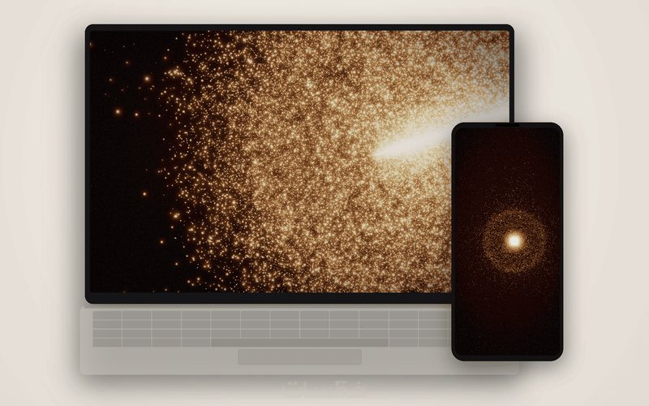</a> <b><a href="services/landing-page-design/">Responsive Landing Page Design &amp; Development</a></b> سأصمم لك صفحة هبوط Landing Page متجاوبة واحترافية 🟢 Listed on Khamsat · from $10</td><td align="center" valign="top" width="25%"><a href="services/backend-api-development/">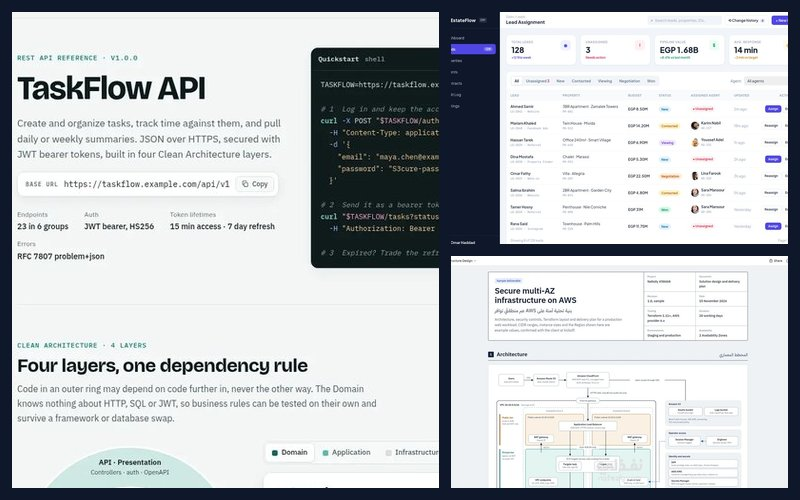</a> <b><a href="services/backend-api-development/">Backend &amp; REST API Development</a></b> تطوير الباك إند وواجهات REST API Freelancer.com · Nafezly · custom quote</td><td align="center" valign="top" width="25%"><a href="services/ai-apps-automation/">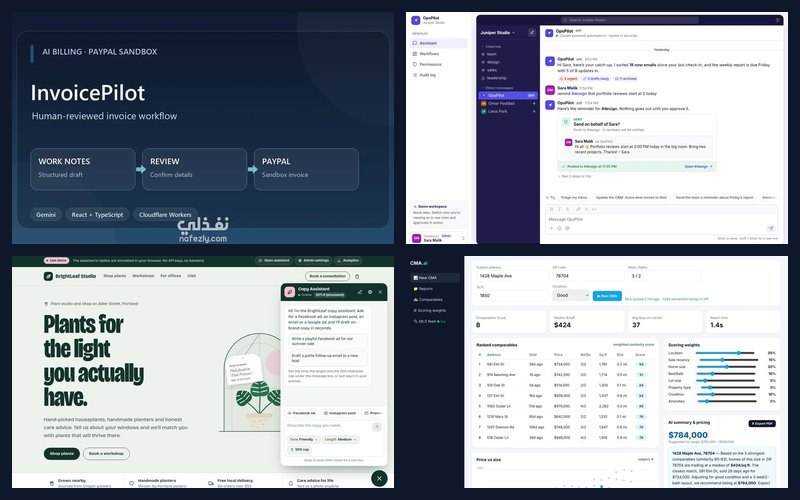</a> <b><a href="services/ai-apps-automation/">AI-Powered Apps &amp; Workflow Automation</a></b> تطبيقات وأتمتة بالذكاء الاصطناعي Freelancer.com · Nafezly · custom quote</td><td align="center" valign="top" width="25%"><a href="services/machine-learning-data-science/">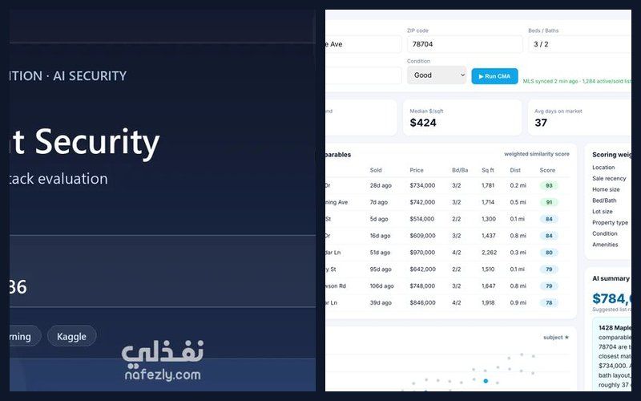</a> <b><a href="services/machine-learning-data-science/">Machine Learning &amp; Data Science Prototypes</a></b> نماذج تعلّم الآلة وعلوم البيانات Freelancer.com · Nafezly · custom quote</td></tr>
<tr><td align="center" valign="top" width="25%"><a href="services/data-cleaning-excel-dashboards/">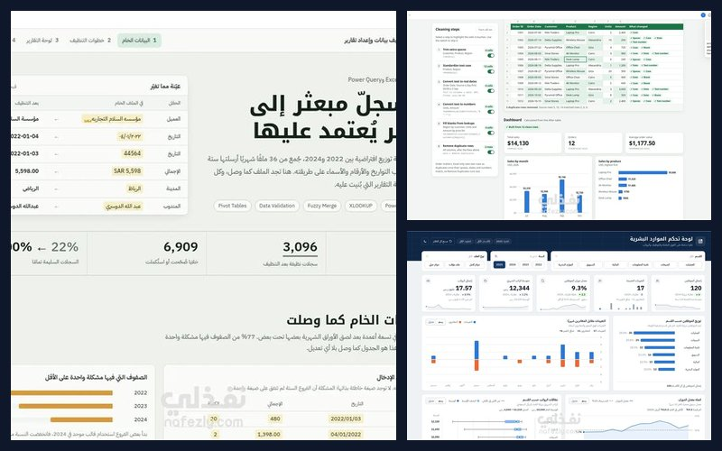</a> <b><a href="services/data-cleaning-excel-dashboards/">Data Cleaning &amp; Excel Dashboards</a></b> تنظيف البيانات ولوحات تحكم Excel Freelancer.com · Nafezly · custom quote</td><td align="center" valign="top" width="25%"><a href="services/websites-ecommerce/">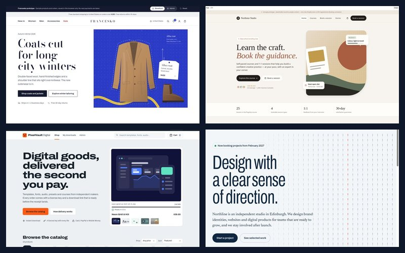</a> <b><a href="services/websites-ecommerce/">Websites, Stores &amp; Web Prototypes</a></b> تطوير المواقع والمتاجر والنماذج التفاعلية Freelancer.com · Nafezly · custom quote</td><td align="center" valign="top" width="25%"><a href="services/brand-identity-design/">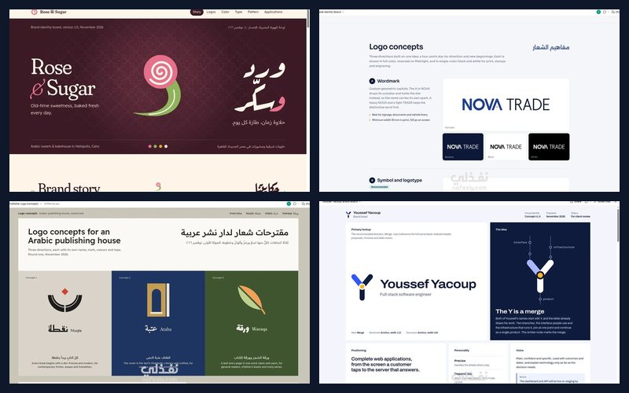</a> <b><a href="services/brand-identity-design/">Logo &amp; Visual Identity Design</a></b> تصميم الشعارات والهوية البصرية Freelancer.com · Nafezly · custom quote</td><td align="center" valign="top" width="25%"><a href="services/ad-copy-video-scripts/">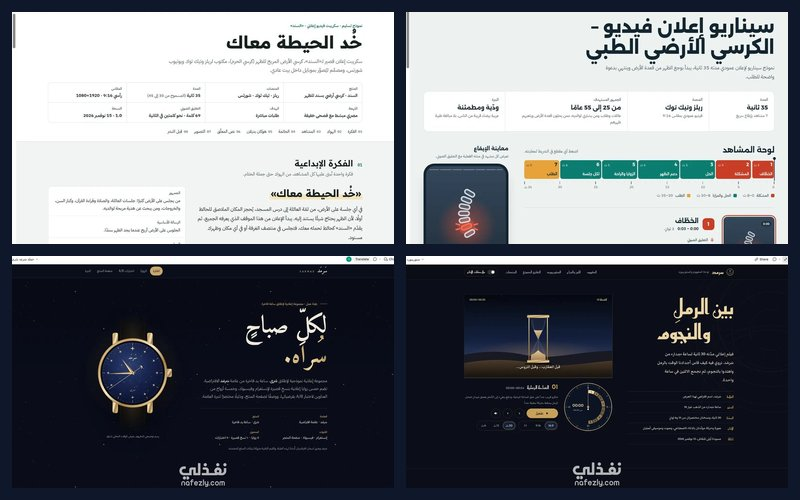</a> <b><a href="services/ad-copy-video-scripts/">Ad Copy, Video Scripts &amp; Storyboards</a></b> كتابة الإعلانات وسيناريوهات الفيديو والستوري بورد Freelancer.com · Nafezly · custom quote</td></tr>
</table>

<a href="services/README.md"><b>See all service details → · كل تفاصيل الخدمات</b></a>

---

## ⭐ Featured Work · أعمال مميزة

<table>
<tr><td align="center" valign="top" width="33%"><a href="portfolio/ai/invoicepilot/">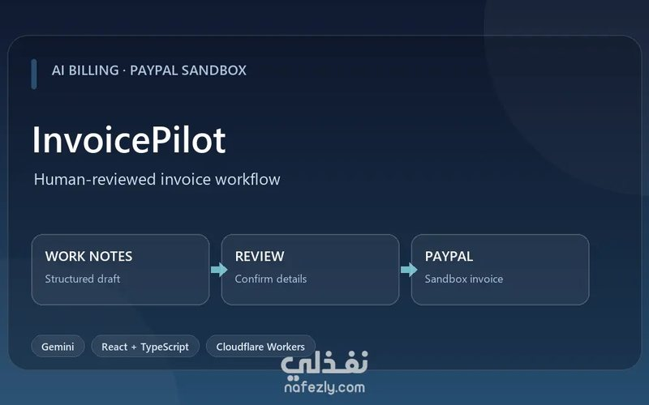</a> <b><a href="portfolio/ai/invoicepilot/">InvoicePilot – Smart Invoices for Freelancers</a></b> InvoicePilot – فواتير ذكية للمستقلين Nafezly</td><td align="center" valign="top" width="33%"><a href="portfolio/backend/secure-aws-infrastructure/">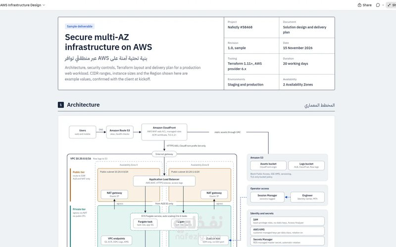</a> <b><a href="portfolio/backend/secure-aws-infrastructure/">Secure AWS Infrastructure Design</a></b> تصميم بنية تحتية آمنة على AWS Nafezly · ▶ Live demo</td><td align="center" valign="top" width="33%"><a href="portfolio/data/hr-analytics-dashboard/">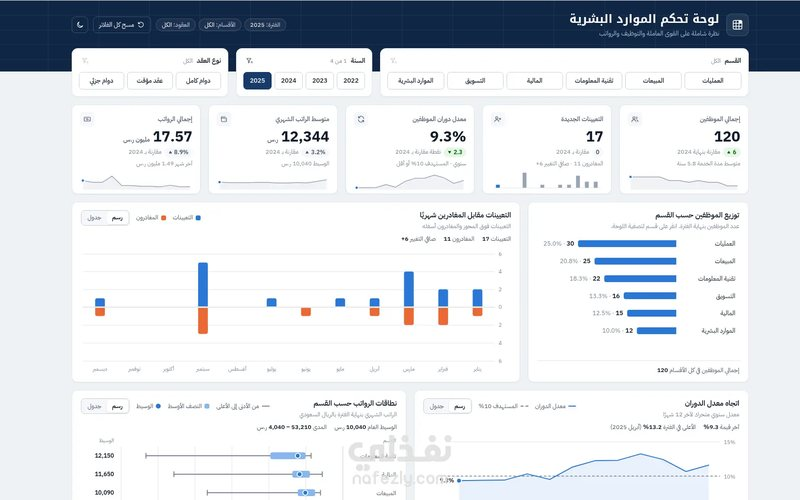</a> <b><a href="portfolio/data/hr-analytics-dashboard/">HR Analytics Interactive Dashboard</a></b> لوحة تحكم الموارد البشرية – داشبورد تفاعلي لتحليل بيانات الموظفين Nafezly · ▶ Live demo</td></tr>
<tr><td align="center" valign="top" width="33%"><a href="portfolio/design/rose-and-sugar-identity/">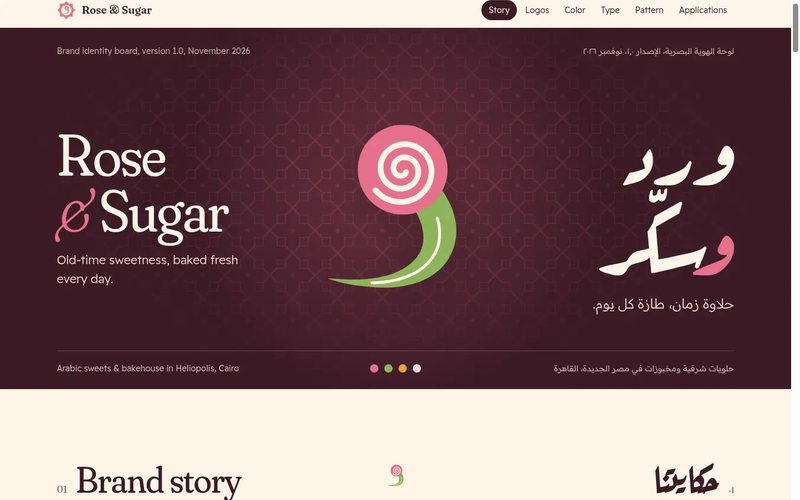</a> <b><a href="portfolio/design/rose-and-sugar-identity/">Rose &amp; Sugar – Arabic Bakery Brand Identity</a></b> Rose &amp; Sugar / ورد وسكّر — هوية بصرية متكاملة لمخبز عربي Nafezly</td><td align="center" valign="top" width="33%"><a href="portfolio/ecommerce/shopify-booking-storefront/">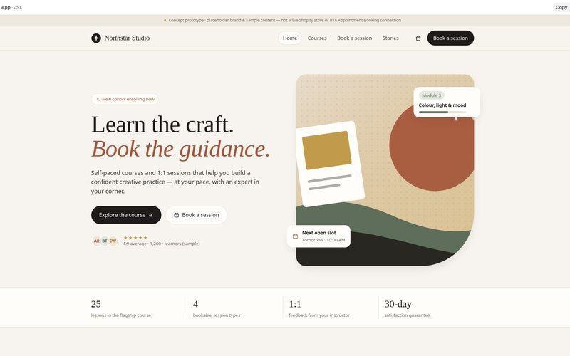</a> <b><a href="portfolio/ecommerce/shopify-booking-storefront/">Shopify Storefront Booking Prototype</a></b> متجر Shopify مع نظام حجز Freelancer.com · ▶ Live demo</td><td align="center" valign="top" width="33%"><a href="portfolio/web/madar-landing-page/">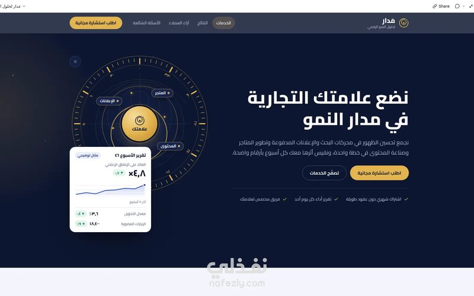</a> <b><a href="portfolio/web/madar-landing-page/">"Madar" Arabic RTL Landing Page</a></b> صفحة هبوط إعلانية احترافية «مَدار» – HTML وCSS متجاوبة بالعربية Nafezly · ▶ Live demo</td></tr>
</table>

---

## 🗂️ Portfolio by Category · المعرض حسب التصنيف

| | Category | التصنيف | Projects |
|:-:|---|---|:-:|
| 🤖 | [**AI & Machine Learning**](portfolio/README.md#cat-ai) | 
الذكاء الاصطناعي وتعلّم الآلة
 | 5 |
| ⚙️ | [**Backend, APIs & Cloud**](portfolio/README.md#cat-backend) | 
الباك إند والـ APIs والسحابة
 | 3 |
| 📊 | [**Data Analysis & Dashboards**](portfolio/README.md#cat-data) | 
تحليل البيانات ولوحات التحكم
 | 3 |
| 🛒 | [**E-Commerce**](portfolio/README.md#cat-ecommerce) | 
التجارة الإلكترونية
 | 3 |
| 🌐 | [**Websites & Landing Pages**](portfolio/README.md#cat-web) | 
المواقع وصفحات الهبوط
 | 12 |
| 🎨 | [**Branding & Visual Identity**](portfolio/README.md#cat-design) | 
الهوية البصرية والتصميم
 | 6 |
| 🎬 | [**Video, Scripts & Copywriting**](portfolio/README.md#cat-content) | 
الفيديو والسيناريو والإعلانات
 | 4 |

<a href="portfolio/README.md"><b>Open the full gallery (36 projects) → · افتح المعرض كامل</b></a>

---

## 💻 Open Source & Competitions · مشاريع مفتوحة المصدر ومسابقات

| Project | Highlights | Repo |
|---|---|---|
| **InvoicePilot** | AI invoice assistant · PayPal AI Hackathon |  |
| **MedMonitor 24/7** | Hospital monitoring · graduation project 100/100 |  |
| **Kaggle Competitions** | 2 bronze medals |  |
| **TechMind Challenge 2025** | 1st place · TechMind Challenge 3 |  |
| **Devpost Competitions** | Hackathon projects collection |  |
| **rollout-trace** | Deployment-failure research desk · ODSC × Nebius |  |
| **sleight-of-eye** | WebXR game for Meta Quest |  |
| **ghostlight-kiroween-2026** | HTML accessibility repair workshop |  |

---

## 🎓 Experience & Credentials · الخبرات والشهادات

<table>
<tr>
<td valign="top" width="50%">

**💼 Experience**
- ML Engineer (part-time) — **Shipd / Datacurve** · 2026–now
- Freelance Backend Developer — **ALX Ventures** · 2024–now
- AI & ML Intern — **GTC** · 2025
- React Trainee — **ITI** · 2024

</td>
<td valign="top" width="50%">

**📜 Education & Certificates**
- B.Sc. Computer Science — **Nahda University** (2022–2026)
- ALX Software Engineering — Backend
- IBM Full Stack Software Developer
- Google Cloud: AI in Action badge
- DEPI React · GTC Machine Learning

</td>
</tr>
</table>

---

## 📩 Contact · تواصل معايا

Share your dataset, API requirements or project brief — we'll agree on the first deliverable and how to evaluate it.

ابعتلي فكرتك أو بياناتك أو متطلبات الـ API، ونتفق على أول مرحلة وطريقة تقييمها.

Content synced from my platform profiles · Last updated: November 2026

