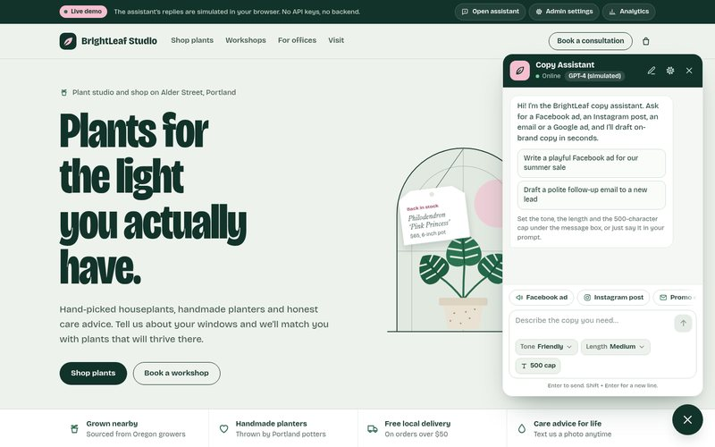
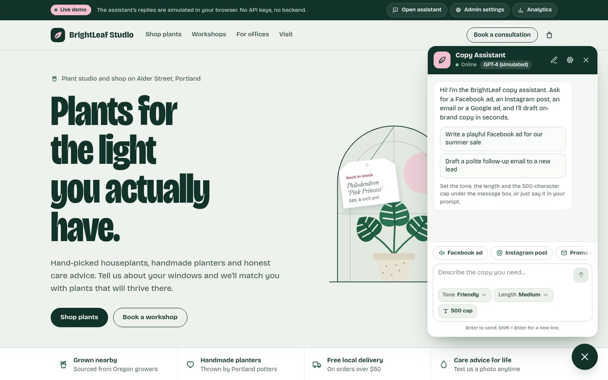
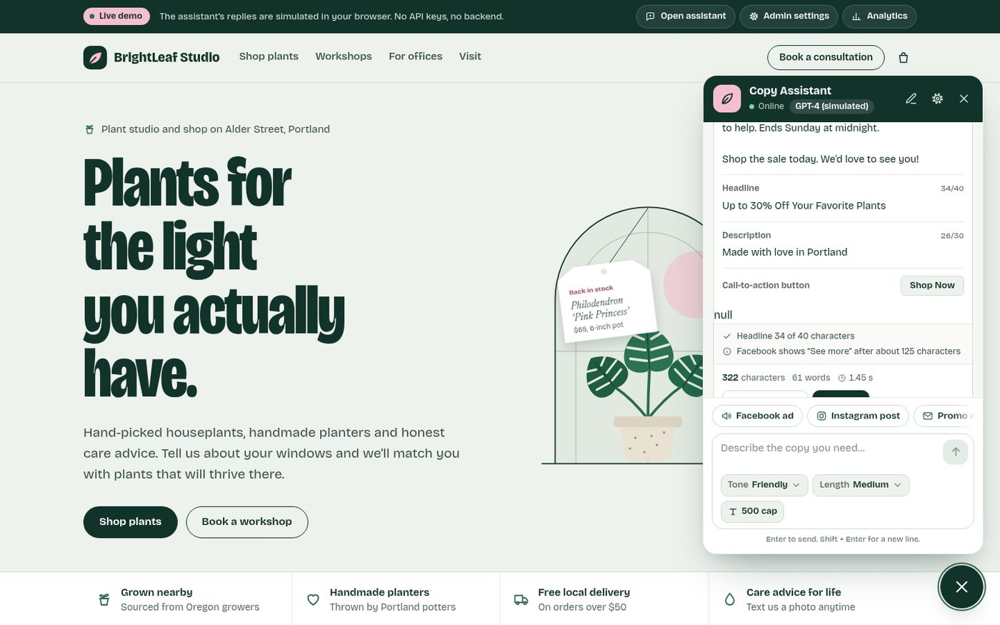
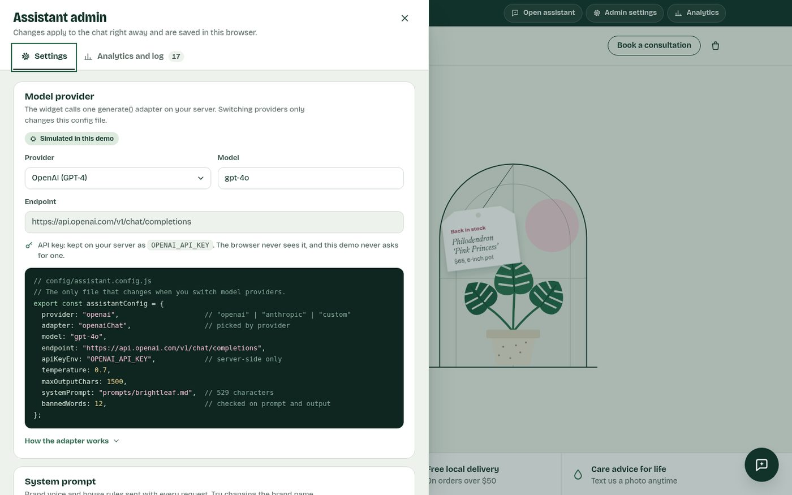
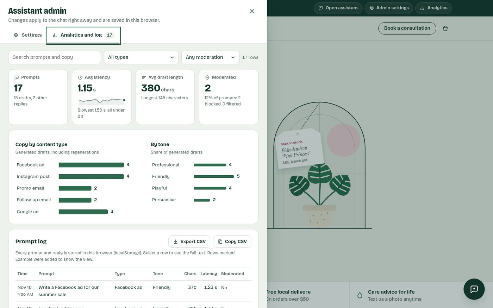
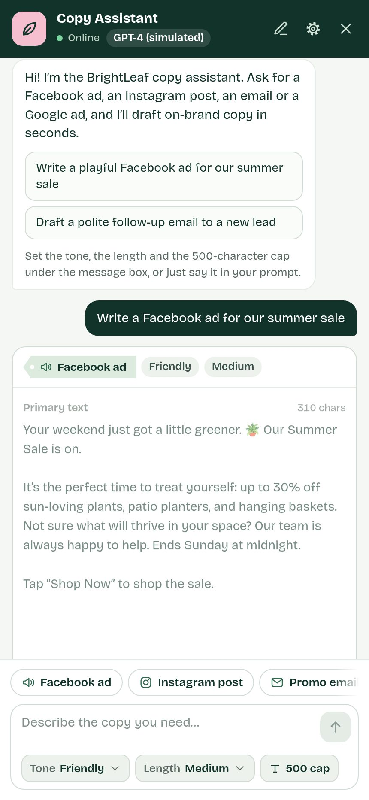

# AI Chat Marketing Copy Assistant

<h3 dir="rtl">مساعد ذكاء اصطناعي لكتابة النصوص التسويقية</h3>

  

---

## 🤖 Overview · نظرة عامة

BrightLeaf Copy Assistant is a working demo of an AI marketing-copy assistant embedded in a business website's chat widget.
- Floating chat bubble on a realistic small-business site that opens an embedded assistant (full-screen on mobile)
- Quick prompts for Facebook ads, Instagram posts, promo and follow-up emails and Google ads, with tone, length and 500-character cap controls
- On-brand copy with character counts, copy and regenerate buttons, and replies in under 2 seconds
- Moderation with an editable banned-words list
- Admin panel: switchable model provider (GPT-4, Claude or custom) through one adapter config, system prompt, temperature and limits
- Analytics and prompt log with stats, charts and CSV export
- Skills: JavaScript, HTML5, CSS3, chatbot UI/UX, AI integration architecture, responsive design.

> **بالعربي —** مساعد دردشة مدمج في موقع لكتابة إعلانات ومنشورات وإيميلات تسويقية، مع لوحة إدارة وتحليلات وتبديل مزوّد النموذج.

## 🧰 Skills & Tools · المهارات والأدوات

<code>JavaScript</code> <code>CSS</code> <code>HTML5</code> <code>Web Development</code> <code>Chatbot</code>

## 🖼️ Gallery · معرض الصور

<table>
<tr><td width="50%"></td><td width="50%"></td></tr>
<tr><td width="50%"></td><td width="50%"></td></tr>
<tr><td width="50%"></td><td width="50%"></td></tr>
</table>

## 🔗 Links · الروابط

| | |
|---|---|
| **View on Freelancer.com** | [Freelancer.com](https://www.freelancer.com/u/yyacoup) |
| **Category · التصنيف** | AI & Machine Learning · الذكاء الاصطناعي وتعلّم الآلة |

<a href="../../README.md">⬅ Back to Portfolio · الرجوع للمعرض</a> &nbsp;•&nbsp; <a href="../../../README.md">🏠 Home · الرئيسية</a>

