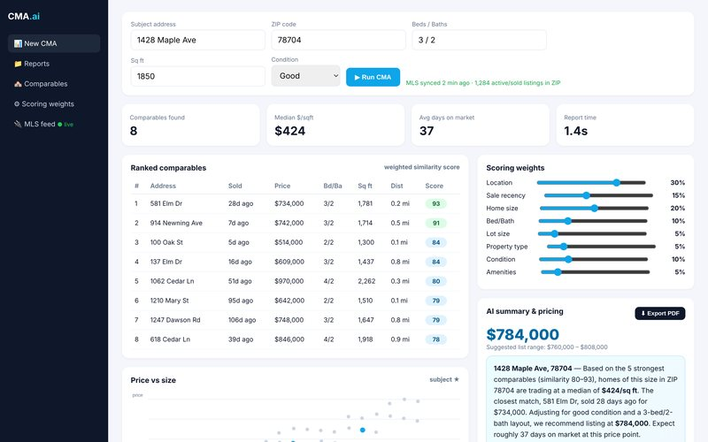
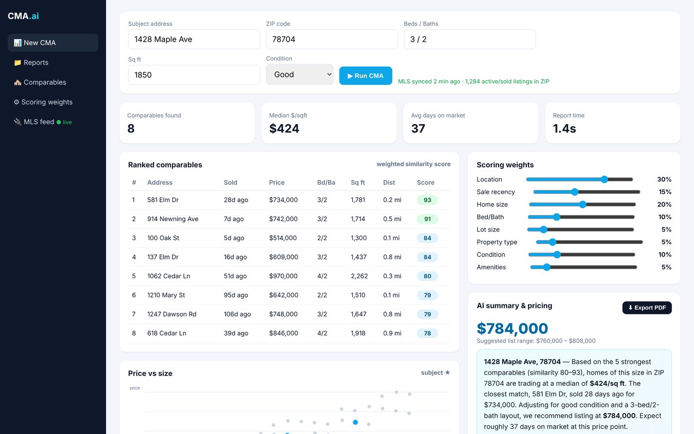
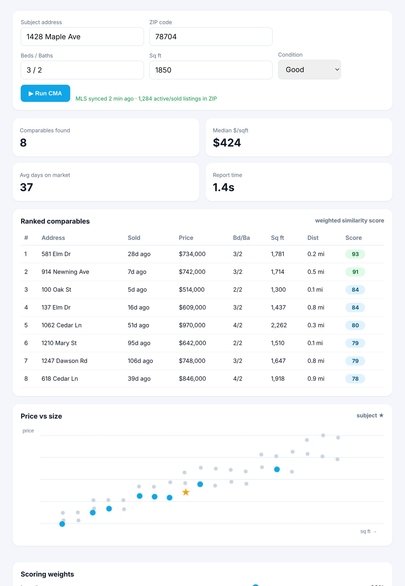

# AI Real Estate CMA Dashboard

<h3 dir="rtl">لوحة تحليل السوق العقاري بالذكاء الاصطناعي</h3>

  

---

## 🤖 Overview · نظرة عامة

Prototype of an AI-driven Comparative Market Analysis dashboard: subject property input, ZIP-based comparable search over MLS-style data, weighted similarity scoring (location, sale recency, size, bed/bath, lot, property type, condition, amenities) with adjustable weights, ranked comparables table, price-vs-size chart, AI-generated pricing summary and PDF export.

> **بالعربي —** لوحة تحليل مقارن لأسعار العقارات تبحث عن عقارات مشابهة وتقيّمها بأوزان قابلة للتعديل مع ملخص تسعير بالذكاء الاصطناعي.

## 🧰 Skills & Tools · المهارات والأدوات

<code>Web Development</code> <code>Python</code> <code>Software Architecture</code> <code>Machine Learning (ML)</code> <code>API</code>

## 🖼️ Gallery · معرض الصور

<table>
<tr><td width="50%"></td><td width="50%"></td></tr>
</table>

## 🔗 Links · الروابط

| | |
|---|---|
| **View on Freelancer.com** | [Freelancer.com](https://www.freelancer.com/u/yyacoup) |
| **Category · التصنيف** | AI & Machine Learning · الذكاء الاصطناعي وتعلّم الآلة |

<a href="../../README.md">⬅ Back to Portfolio · الرجوع للمعرض</a> &nbsp;•&nbsp; <a href="../../../README.md">🏠 Home · الرئيسية</a>

