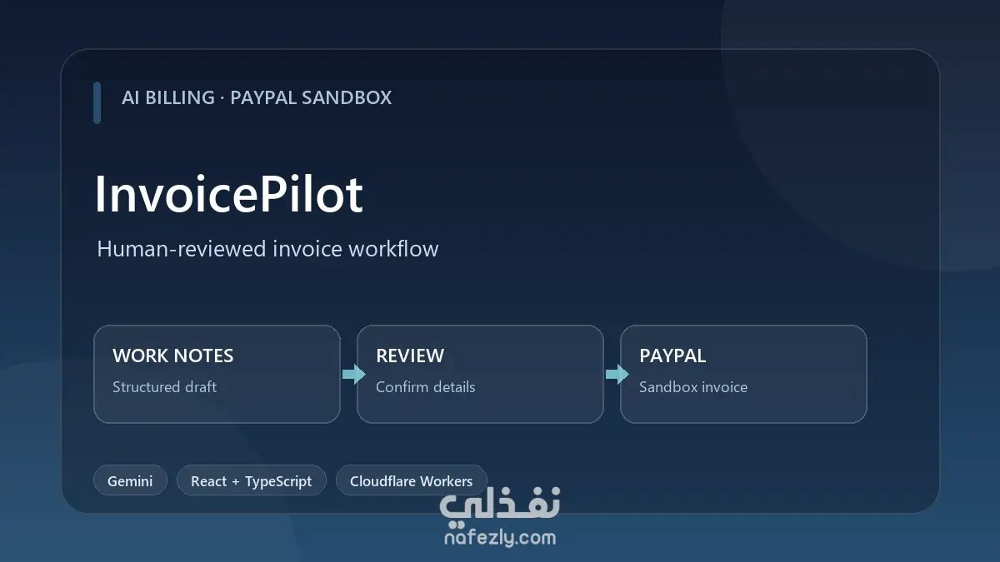

# InvoicePilot – Smart Invoices for Freelancers

<h3 dir="rtl">InvoicePilot – فواتير ذكية للمستقلين</h3>

  

   

---

## 🤖 Overview · نظرة عامة

> **EN —** Web app that turns freelancer work notes into reviewable invoice drafts with Gemini, then creates them in PayPal Sandbox (React, TS, Cloudflare Workers).

تطبيق ويب يحوّل ملاحظات المستقل عن العمل إلى مسودة فاتورة قابلة للمراجعة قبل إنشائها. يستخدم Gemini لاستخراج بنود الفاتورة وطرح أسئلة عند نقص الكميات أو الأسعار. بعد مراجعة المستخدم، ينشئ فاتورة في PayPal Sandbox، ويمكنه تفعيل رابط الدفع وقراءة الحالة الفعلية من PayPal. بنيته باستخدام React وTypeScript وCloudflare Workers وZod، مع التحقق من الطلبات في الخادم وحفظ اختياري للمسودة محليًا. المشروع مقدم إلى PayPal AI Hackathon. ملاحظة: التكامل مع PayPal يعمل في بيئة Sandbox، وعينة العرض غير مدفوعة.

## 🔗 Links · الروابط

| | |
|---|---|
| **View on Nafezly** | [Nafezly · نفذلي](https://nafezly.com/portfolio/266804-InvoicePilot-%E2%80%93-%D9%81%D9%88%D8%A7%D8%AA%D9%8A%D8%B1-%D8%B0%D9%83%D9%8A%D8%A9-%D9%84%D9%84%D9%85%D8%B3%D8%AA%D9%82%D9%84%D9%8A%D9%86) |
| **Devpost** | [https://devpost.com/software/invoicepilot-s9euh1](https://devpost.com/software/invoicepilot-s9euh1) |
| **GitHub Repository** | [https://github.com/Youssef123ya/invoicepilot-paypal-ai](https://github.com/Youssef123ya/invoicepilot-paypal-ai) |
| **YouTube Demo** | [https://youtube.com/shorts/KYOtxpa2Lqk](https://youtube.com/shorts/KYOtxpa2Lqk) |
| **Category · التصنيف** | AI & Machine Learning · الذكاء الاصطناعي وتعلّم الآلة |

<a href="../../README.md">⬅ Back to Portfolio · الرجوع للمعرض</a> &nbsp;•&nbsp; <a href="../../../README.md">🏠 Home · الرئيسية</a>

