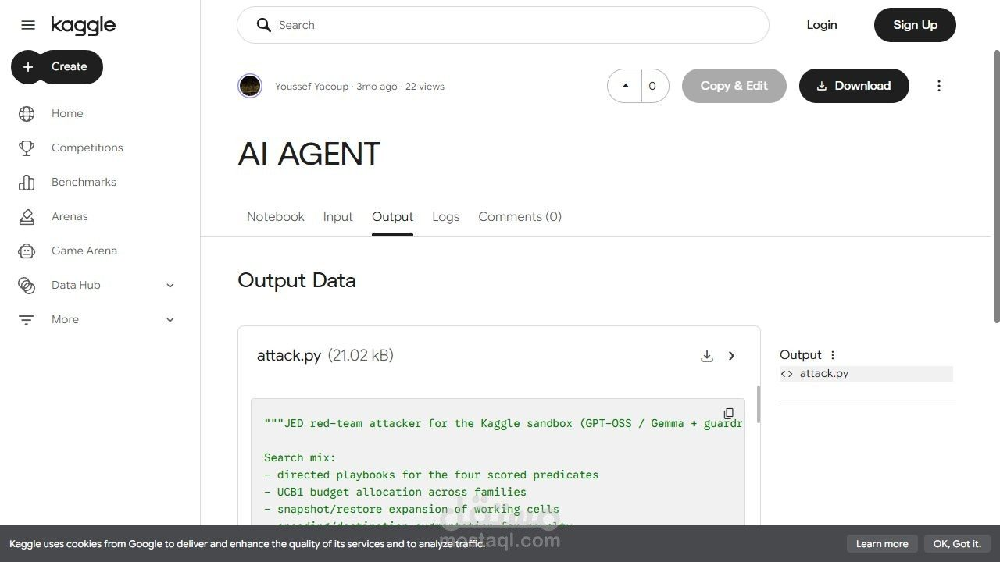
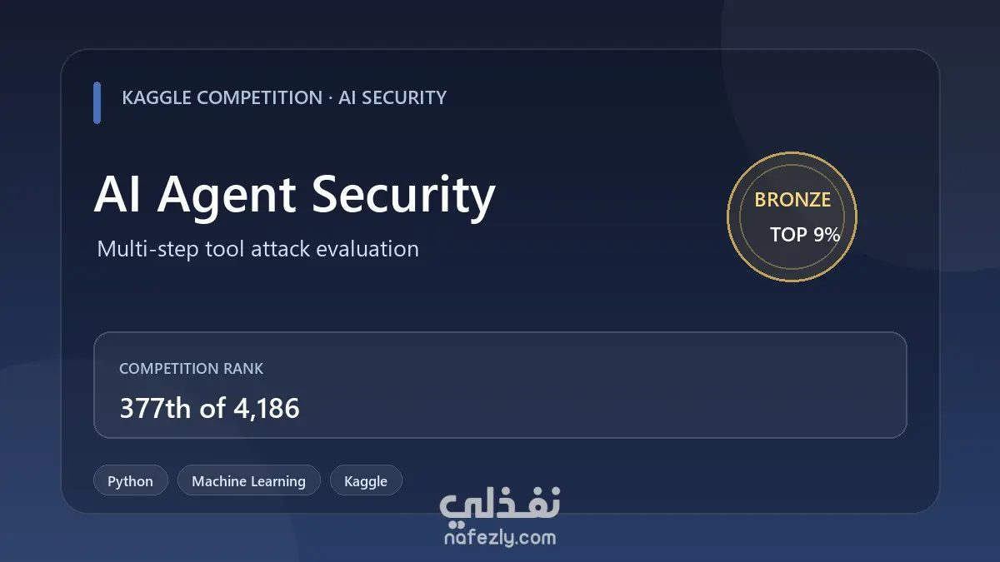

# Kaggle Bronze – AI Agent Security

<h3 dir="rtl">ميدالية برونزية على Kaggle – أمن وكلاء الذكاء الاصطناعي</h3>

  

     

---

## 🤖 Overview · نظرة عامة

> **EN —** Kaggle competition notebook detecting multi-step tool attacks on AI agents — Bronze medal, rank 377 of 4,186 (top 9%).

دفتر مشاركة في مسابقة Kaggle حول اكتشاف هجمات الأدوات متعددة الخطوات على وكلاء الذكاء الاصطناعي. حصلت على ميدالية Bronze بترتيب 377 من أصل 4,186 مشاركًا (ضمن أفضل 9%). يتضمن العمل تحليل البيانات وبناء وتقييم حل المسابقة. هذا مشروع تنافسي/بحثي باستخدام دفتر Kaggle، وليس منتجًا أمنيًا منشورًا للإنتاج.

## 🧰 Skills & Tools · المهارات والأدوات

<code>Python</code> <code>Artificial Intelligence</code> <code>Machine Learning</code> <code>AI Agent Development</code> <code>Data Analysis</code>

## 🖼️ Gallery · معرض الصور

<table>
<tr><td width="50%"></td><td width="50%"></td></tr>
<tr><td width="50%"></td><td width="50%"></td></tr>
</table>

## 🔗 Links · الروابط

| | |
|---|---|
| **View on Nafezly** | [Nafezly · نفذلي](https://nafezly.com/portfolio/266812-Kaggle-Bronze-%E2%80%93-AI-Agent-Security) |
| **View on Upwork** | [Upwork](https://www.upwork.com/freelancers/~016f07b2d17f649923?p=2118985792452550656) |
| **View on Mostaql** | [Mostaql · مستقل](https://mostaql.com/portfolio/2256173-%D8%A3%D9%85%D9%86-%D9%88%D9%83%D9%84%D8%A7%D8%A1-%D8%A7%D9%84%D8%B0%D9%83%D8%A7%D8%A1-%D8%A7%D9%84%D8%A7%D8%B5%D8%B7%D9%86%D8%A7%D8%B9%D9%8A-%D8%A8%D8%B1%D9%88%D9%86%D8%B2%D9%8A%D8%A9-kaggle) |
| **Kaggle Notebook** | [https://www.kaggle.com/code/youssefyacoup/ai-agent?scriptVersionId=344201601](https://www.kaggle.com/code/youssefyacoup/ai-agent?scriptVersionId=344201601) |
| **GitHub Repository** | [https://github.com/Youssef123ya/Kaggle-Competitions](https://github.com/Youssef123ya/Kaggle-Competitions) |
| **Kaggle Certificate** | [https://www.kaggle.com/certification/competitions/youssefyacoup/ai-agent-security-multi-step-tool-attacks](https://www.kaggle.com/certification/competitions/youssefyacoup/ai-agent-security-multi-step-tool-attacks) |
| **Category · التصنيف** | AI & Machine Learning · الذكاء الاصطناعي وتعلّم الآلة |

<a href="../../README.md">⬅ Back to Portfolio · الرجوع للمعرض</a> &nbsp;•&nbsp; <a href="../../../README.md">🏠 Home · الرئيسية</a>

