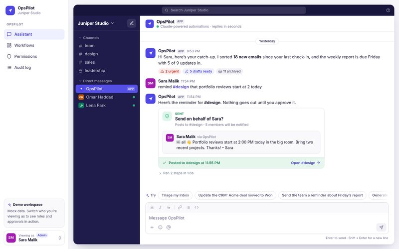
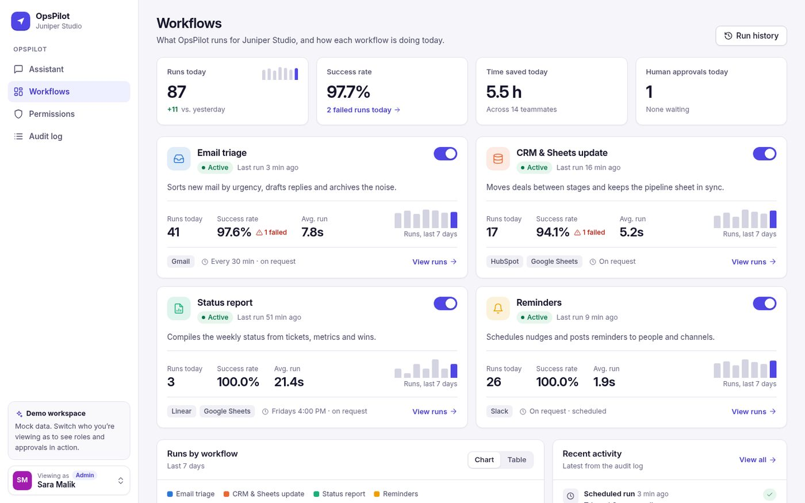
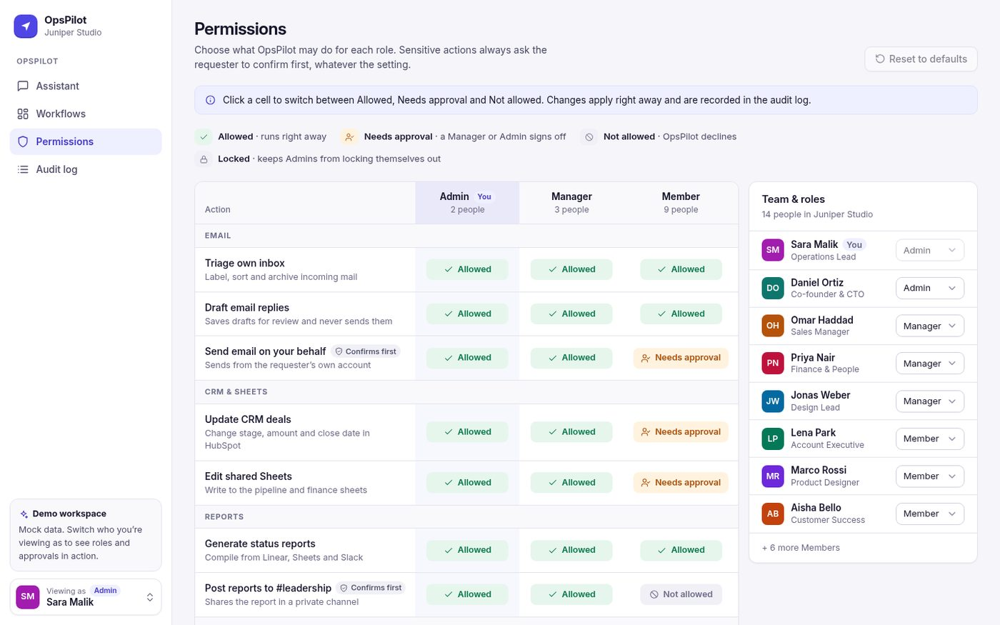
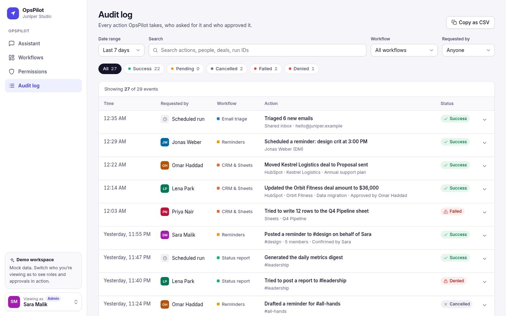

# OpsPilot – Slack Task Automation

<h3 dir="rtl">OpsPilot لأتمتة المهام على Slack</h3>

  

---

## 🤖 Overview · نظرة عامة

OpsPilot is a polished, interactive prototype of a Claude-powered task-automation assistant for Slack. It demonstrates a conversational assistant for email triage, CRM updates and team reminders; configurable workflows; role-based permissions with approval gates for sensitive actions; and an audit log that records who requested and approved each action. The responsive dashboard uses realistic mock data to show how a small team can automate routine operations while keeping work transparent and controlled.

> **بالعربي —** نموذج تفاعلي لمساعد ذكاء اصطناعي يؤتمت المهام على Slack مع صلاحيات وموافقات وسجل تدقيق.

## 🧰 Skills & Tools · المهارات والأدوات

<code>JavaScript</code> <code>CSS</code> <code>HTML</code> <code>Web Design</code> <code>AI Development</code>

## 🖼️ Gallery · معرض الصور

<table>
<tr><td width="50%"></td><td width="50%"></td></tr>
<tr><td width="50%"></td><td width="50%"></td></tr>
</table>

## 🔗 Links · الروابط

| | |
|---|---|
| **View on Freelancer.com** | [Freelancer.com](https://www.freelancer.com/u/yyacoup) |
| **Category · التصنيف** | AI & Machine Learning · الذكاء الاصطناعي وتعلّم الآلة |

<a href="../../README.md">⬅ Back to Portfolio · الرجوع للمعرض</a> &nbsp;•&nbsp; <a href="../../../README.md">🏠 Home · الرئيسية</a>

