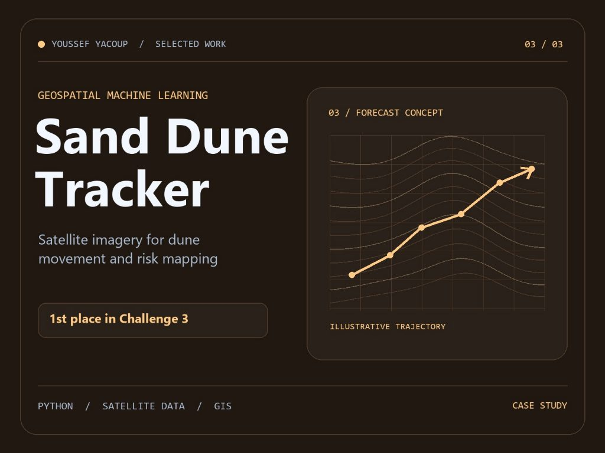

# Sand Dune Encroachment Tracker – Geospatial ML

<h3 dir="rtl">متتبّع زحف الكثبان الرملية – تعلّم آلي جيومكاني</h3>

  

 

---

## 🤖 Overview · نظرة عامة

For the TechMind Challenge, my team built a Python prototype that uses satellite imagery and spatial analysis to track sand dunes and forecast their movement. The dashboard visualizes predicted trajectories and areas where dunes could encroach on farmland or infrastructure. Our team placed first in Challenge 3.

> **بالعربي —** نموذج أولي بـ Python لمسابقة TechMind Challenge يستخدم صور الأقمار الصناعية والتحليل المكاني لتتبع الكثبان الرملية والتنبؤ بحركتها، مع لوحة عرض للمسارات المتوقعة والمناطق المعرضة للزحف على الأراضي الزراعية والبنية التحتية — حصل الفريق على المركز الأول في التحدي الثالث.

## 🧰 Skills & Tools · المهارات والأدوات

<code>Machine Learning</code> <code>Geospatial Data</code> <code>Data Visualization</code> <code>GIS</code> <code>Python</code>

## 🔗 Links · الروابط

| | |
|---|---|
| **View on Upwork** | [Upwork](https://www.upwork.com/freelancers/~016f07b2d17f649923?p=2118985485468385280) |
| **GitHub Repository** | [https://github.com/Youssef123ya/Challenge-3-Sand-Dune-Encroachment-Tracker](https://github.com/Youssef123ya/Challenge-3-Sand-Dune-Encroachment-Tracker) |
| **Category · التصنيف** | AI & Machine Learning · الذكاء الاصطناعي وتعلّم الآلة |

<a href="../../README.md">⬅ Back to Portfolio · الرجوع للمعرض</a> &nbsp;•&nbsp; <a href="../../../README.md">🏠 Home · الرئيسية</a>

