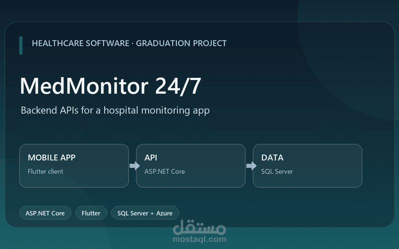
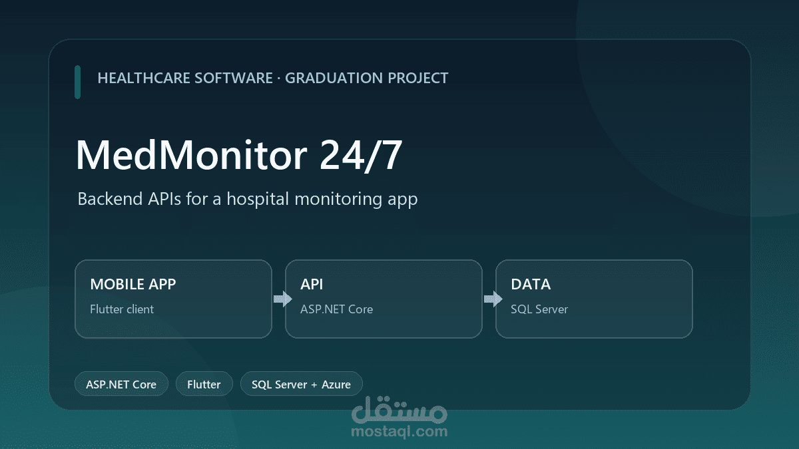
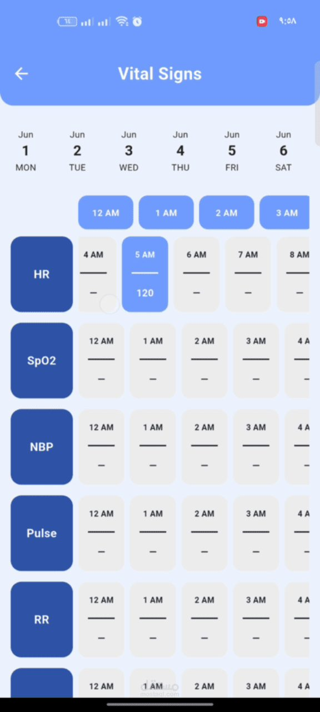
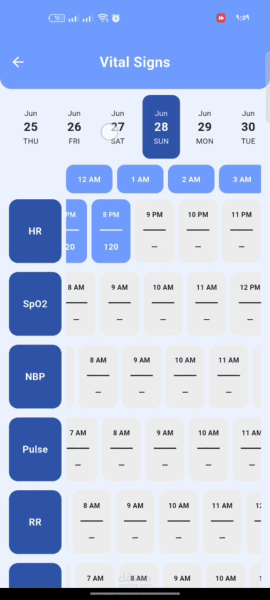

# MedMonitor 24/7 – Hospital Bed & Vitals Monitoring

<h3 dir="rtl">MedMonitor 24/7 — نظام لمراقبة أسرّة المستشفى</h3>

  

 

---

## ⚙️ Overview · نظرة عامة

> **EN —** Team hospital bed & vital-signs monitoring prototype scoring 100/100 as a graduation project (Top 15 at Nahda University CS faculty). Built .NET backend services and Azure cloud integration streaming real-time vitals to the monitoring UI.

عملت ضمن فريق مشروع التخرج MedMonitor 24/7 لتطوير نموذج أولي لمراقبة أسرّة المستشفى والعلامات الحيوية. توليت تطوير أجزاء من الواجهة الخلفية باستخدام .NET وإعداد خدمات Azure التي تدعم نقل البيانات إلى واجهة المتابعة. توضح الصور المرفقة شاشة العلامات الحيوية داخل التطبيق، وأرفقت الملفات المصدرية للمراجعة. حصل المشروع الجماعي على 100/100، وكان ضمن أفضل 15 مشروعًا في كلية علوم الحاسب بجامعة النهضة.

## 🧰 Skills & Tools · المهارات والأدوات

<code>ASP.NET</code> <code>.NET</code> <code>Microsoft Azure</code> <code>C#</code> <code>REST API</code>

## 🖼️ Gallery · معرض الصور

<table>
<tr><td width="50%"></td><td width="50%"></td></tr>
<tr><td width="50%"></td><td width="50%"></td></tr>
</table>

## 🔗 Links · الروابط

| | |
|---|---|
| **View on Mostaql** | [Mostaql · مستقل](https://mostaql.com/portfolio/2256167-medmonitor-247-%D9%86%D8%B8%D8%A7%D9%85-%D9%84%D9%85%D8%B1%D8%A7%D9%82%D8%A8%D8%A9-%D8%A3%D8%B3%D8%B1%D8%A9-%D8%A7%D9%84%D9%85%D8%B3%D8%AA%D8%B4%D9%81%D9%89) |
| **GitHub Repository** | [https://github.com/Youssef123ya/MedMonitor-24-7](https://github.com/Youssef123ya/MedMonitor-24-7) |
| **Category · التصنيف** | Backend, APIs & Cloud · الباك إند والـ APIs والسحابة |

<a href="../../README.md">⬅ Back to Portfolio · الرجوع للمعرض</a> &nbsp;•&nbsp; <a href="../../../README.md">🏠 Home · الرئيسية</a>

