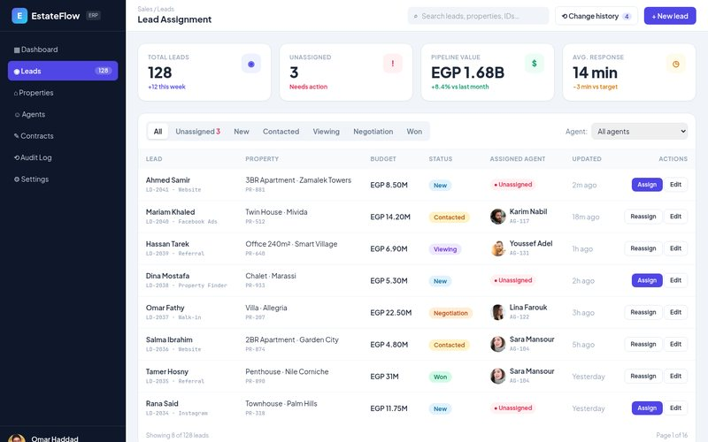
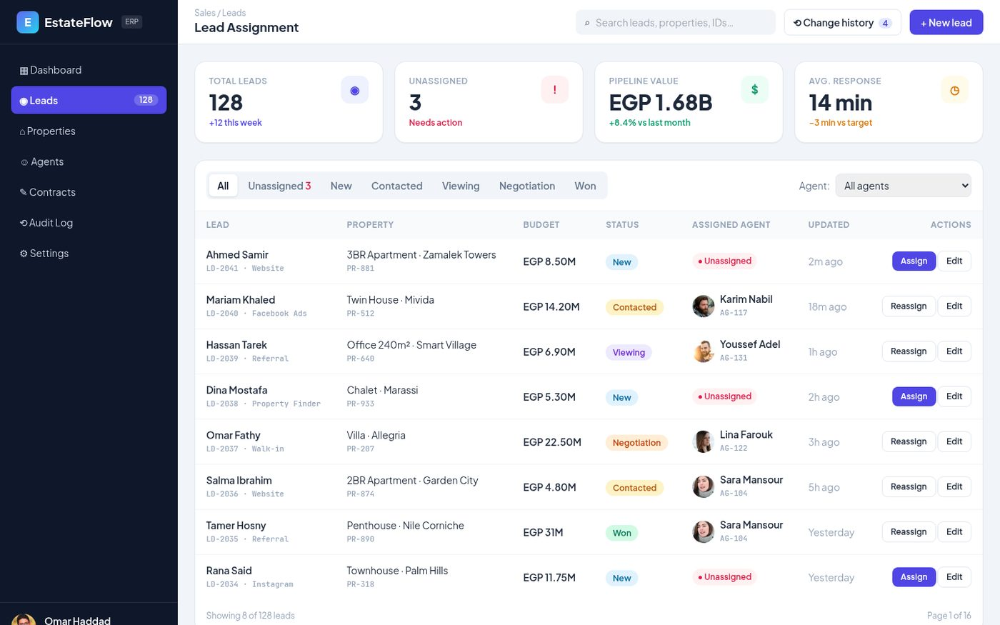
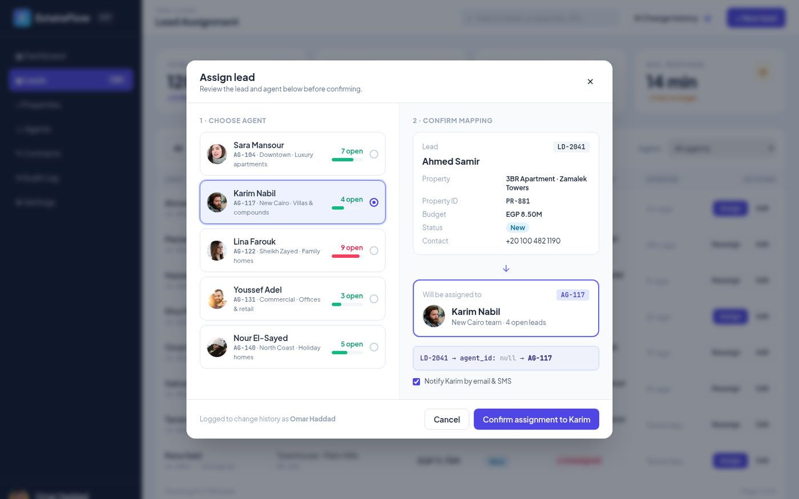
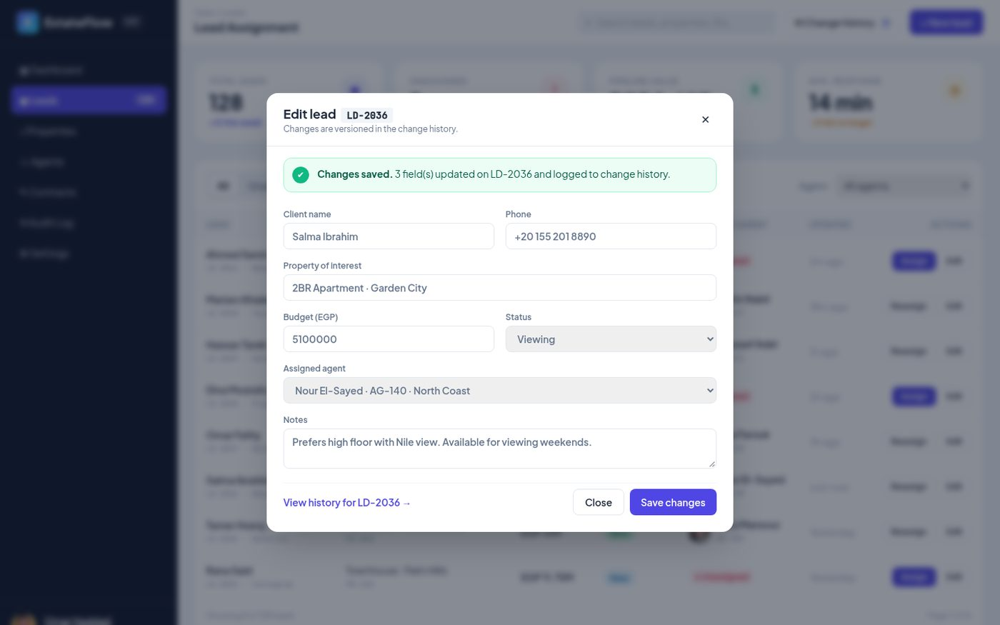
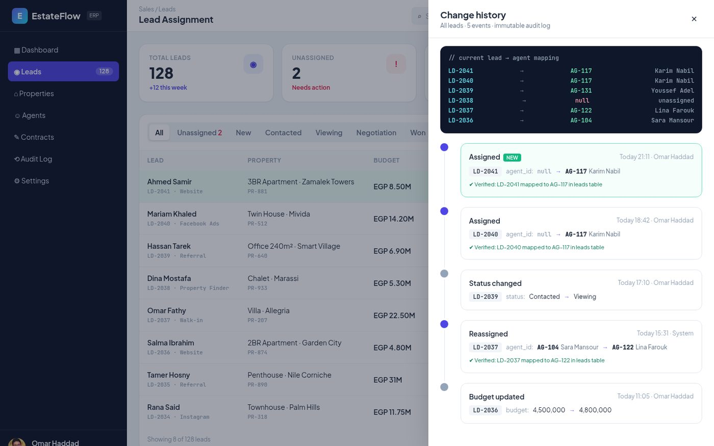

# Real Estate ERP Lead Assignment UI

<h3 dir="rtl">واجهة توزيع العملاء لنظام ERP عقاري</h3>

  

---

## ⚙️ Overview · نظرة عامة

Admin UI prototype for a real estate ERP lead workflow: KPI dashboard and leads table, an assign-lead modal that previews the exact lead and agent mapping before confirming, an edit-lead form with save confirmation, and a change-history panel tracing every lead-to-agent change. Built to demonstrate a clean, verifiable fix for lead assignment and update issues in an ASP.NET / C# system.

> **بالعربي —** واجهة إدارة لتوزيع العملاء المحتملين على الوكلاء في نظام ERP عقاري مبني بـ ASP.NET / C# مع سجل للتغييرات.

## 🧰 Skills & Tools · المهارات والأدوات

<code>Web Development</code> <code>.NET</code> <code>C# Programming</code> <code>ASP.NET</code> <code>UI / User Interface</code>

## 🖼️ Gallery · معرض الصور

<table>
<tr><td width="50%"></td><td width="50%"></td></tr>
<tr><td width="50%"></td><td width="50%"></td></tr>
</table>

## 🔗 Links · الروابط

| | |
|---|---|
| **View on Freelancer.com** | [Freelancer.com](https://www.freelancer.com/u/yyacoup) |
| **Category · التصنيف** | Backend, APIs & Cloud · الباك إند والـ APIs والسحابة |

<a href="../../README.md">⬅ Back to Portfolio · الرجوع للمعرض</a> &nbsp;•&nbsp; <a href="../../../README.md">🏠 Home · الرئيسية</a>

