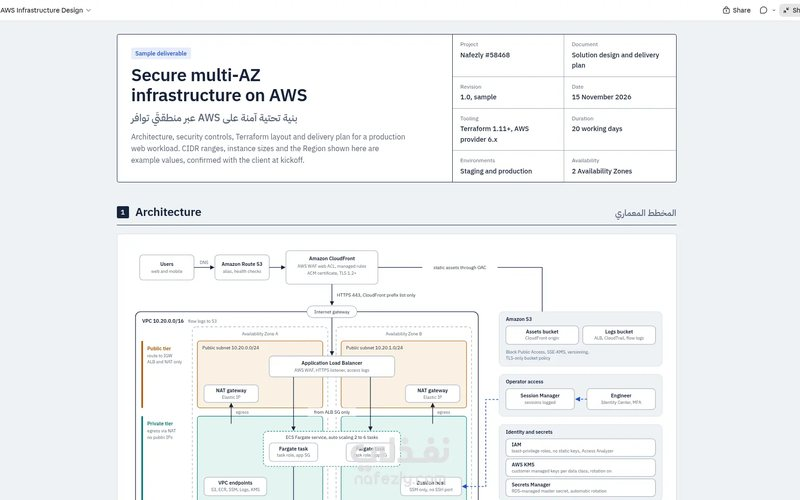
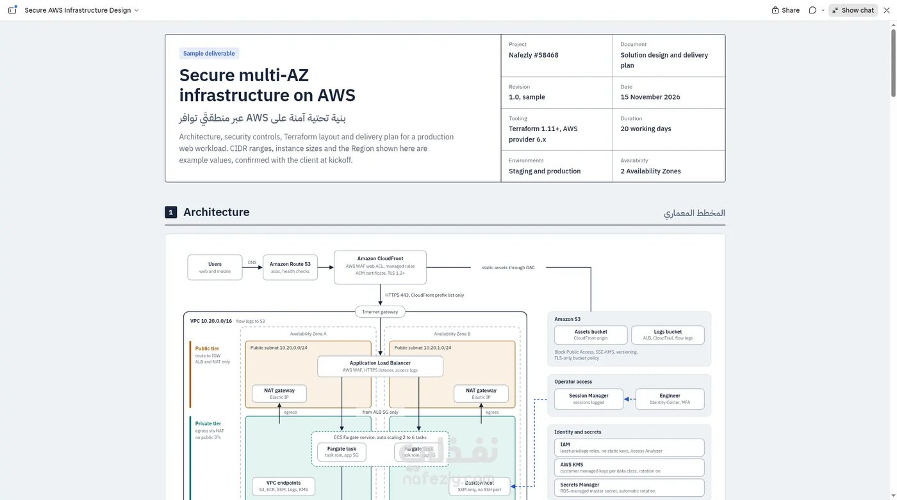
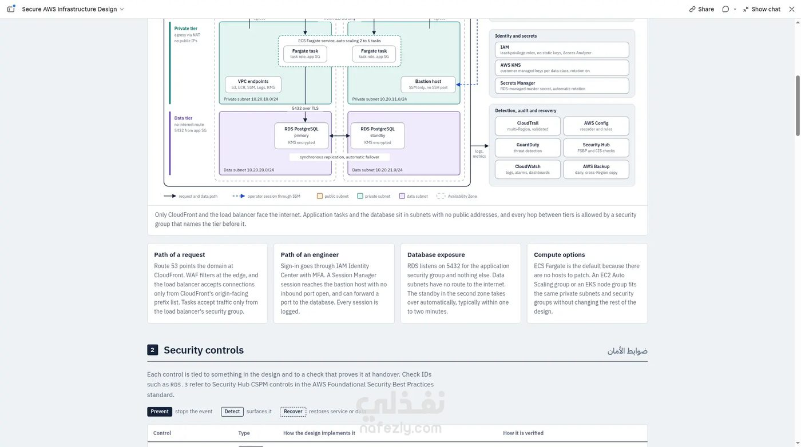
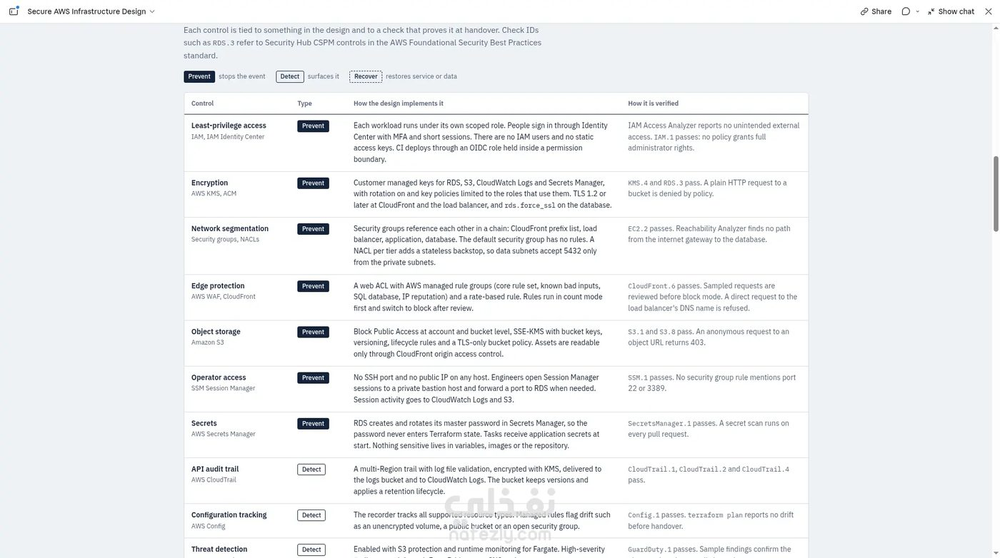
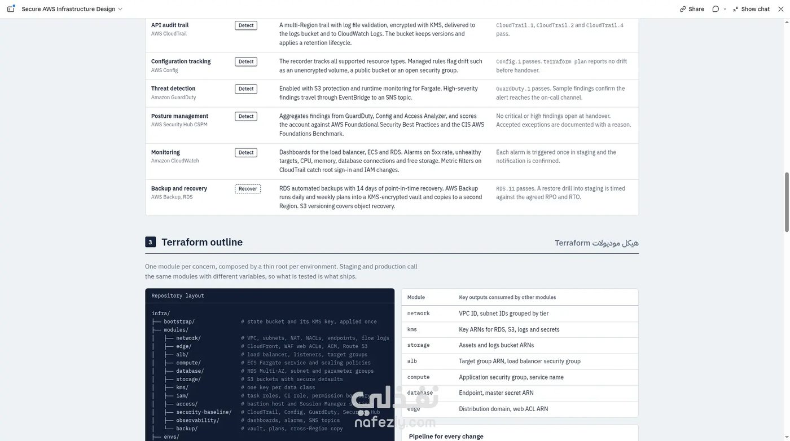
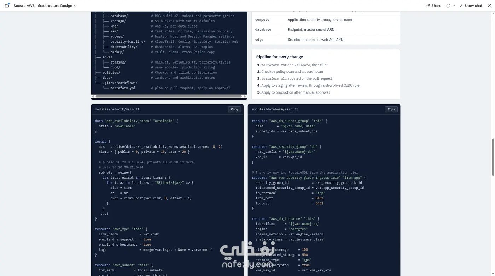
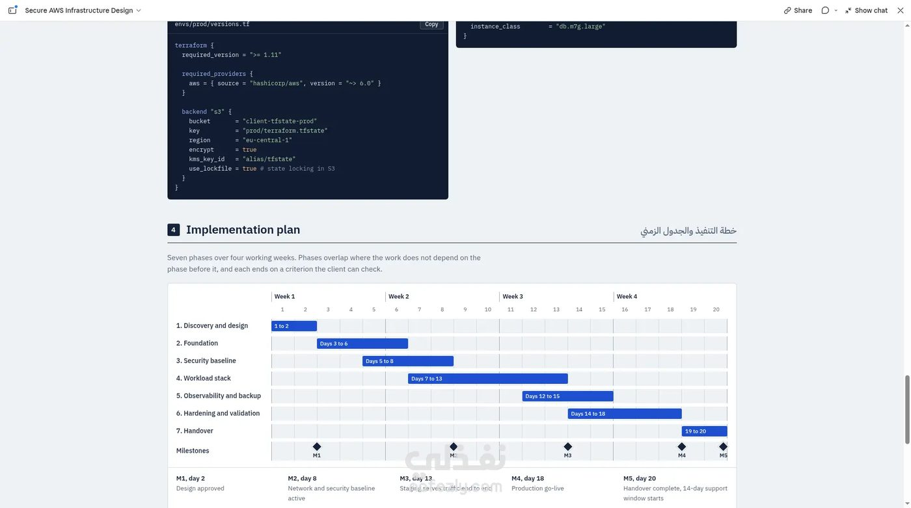
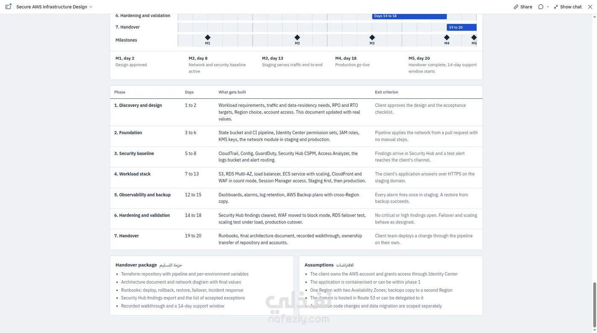

# Secure AWS Infrastructure Design

<h3 dir="rtl">تصميم بنية تحتية آمنة على AWS</h3>

  

 

---

## ⚙️ Overview · نظرة عامة

Sample deliverable for Nafezly project #58468: a secure multi-AZ AWS reference architecture with CloudFront/WAF, ALB, ECS Fargate, isolated encrypted RDS Multi-AZ, private S3, IAM least privilege, KMS, Secrets Manager, CloudTrail, Config, GuardDuty, Security Hub, CloudWatch and AWS Backup. Includes an SVG architecture diagram, security-control matrix, Terraform module outline with VPC/RDS snippets, and a phased four-week implementation plan. Sample only: values are illustrative, and Terraform was not applied or validated against an AWS account.

> **بالعربي —** None

## 🧰 Skills & Tools · المهارات والأدوات

<code>Terraform</code> <code>Amazon Web Services</code> <code>الحوسبة السحابية</code> <code>DevOps</code>

## 🖼️ Gallery · معرض الصور

<table>
<tr><td width="50%"></td><td width="50%"></td></tr>
<tr><td width="50%"></td><td width="50%"></td></tr>
<tr><td width="50%"></td><td width="50%"></td></tr>
<tr><td width="50%"></td><td width="50%"></td></tr>
</table>

## 🔗 Links · الروابط

| | |
|---|---|
| **View on Nafezly** | [Nafezly · نفذلي](https://nafezly.com/portfolio/268987-Secure-AWS-Infrastructure-Design-%E2%80%94-Nafezly-58468) |
| **Live Demo · نسخة تجريبية** | [Open demo](https://claude.ai/artifact/8FeLgRjc5j6LqgiapsBPDs) |
| **Category · التصنيف** | Backend, APIs & Cloud · الباك إند والـ APIs والسحابة |

<a href="../../README.md">⬅ Back to Portfolio · الرجوع للمعرض</a> &nbsp;•&nbsp; <a href="../../../README.md">🏠 Home · الرئيسية</a>

