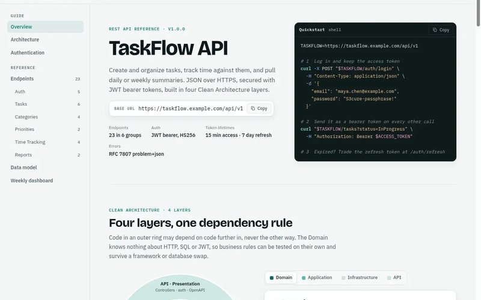
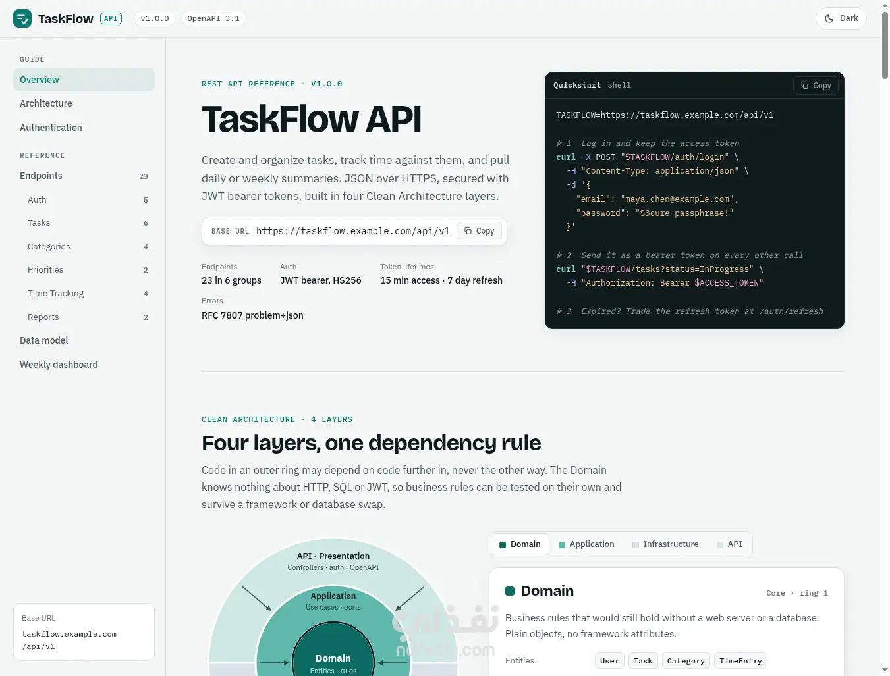
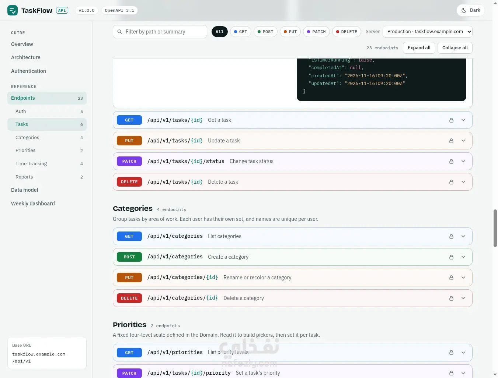
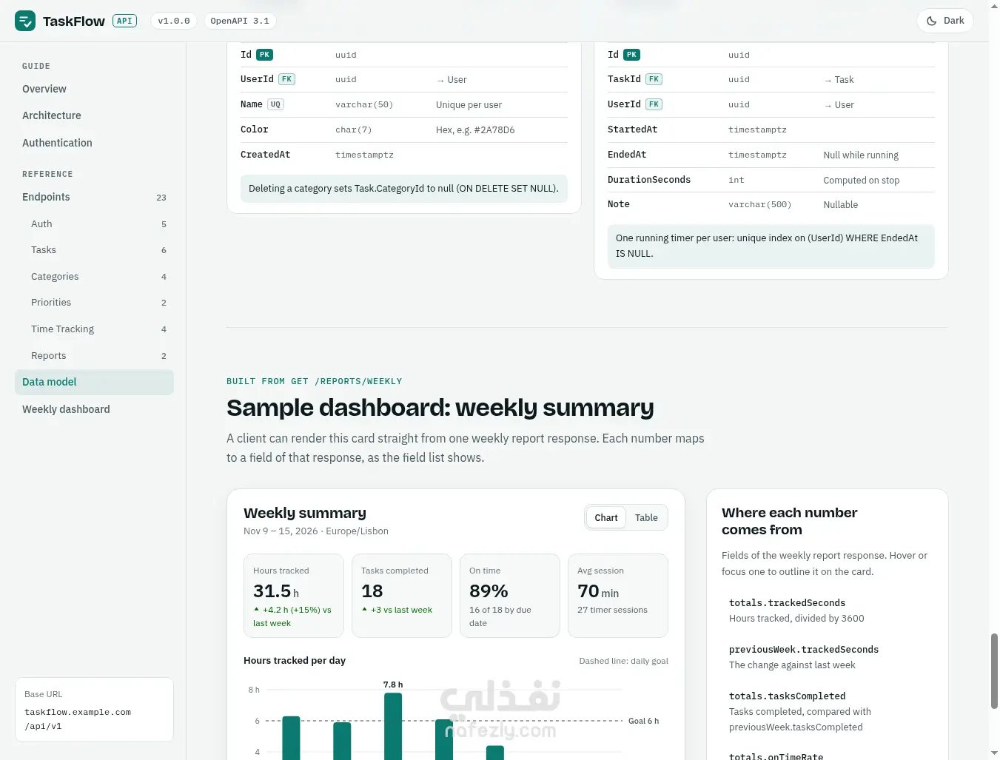

# TaskFlow API

<h3 dir="rtl">TaskFlow API – واجهة برمجية لإدارة المهام</h3>

  

---

## ⚙️ Overview · نظرة عامة

> **EN —** Interactive documentation for a task-management API: clean 4-layer architecture, JWT auth flow, endpoints, data model and reports.

واجهة توثيق تفاعلية لواجهة TaskFlow API لإدارة المهام. تعرض التصميم المعماري النظيف بأربع طبقات، تدفق مصادقة JWT، ومراجع نقاط النهاية لمجموعات المصادقة والمهام والفئات والأولويات وتتبع الوقت والتقارير، مع أمثلة الطلبات والاستجابات ونموذج البيانات ولوحة ملخص أسبوعي. تتضمن الصفحة بيانات توضيحية لشرح الواجهة.

## 🧰 Skills & Tools · المهارات والأدوات

<code>HTML</code> <code>CSS</code> <code>جافاسكربت</code>

## 🖼️ Gallery · معرض الصور

<table>
<tr><td width="50%"></td><td width="50%"></td></tr>
<tr><td width="50%"></td><td width="50%"></td></tr>
</table>

## 🔗 Links · الروابط

| | |
|---|---|
| **View on Nafezly** | [Nafezly · نفذلي](https://nafezly.com/portfolio/269216-TaskFlow-API) |
| **Category · التصنيف** | Backend, APIs & Cloud · الباك إند والـ APIs والسحابة |

<a href="../../README.md">⬅ Back to Portfolio · الرجوع للمعرض</a> &nbsp;•&nbsp; <a href="../../../README.md">🏠 Home · الرئيسية</a>

