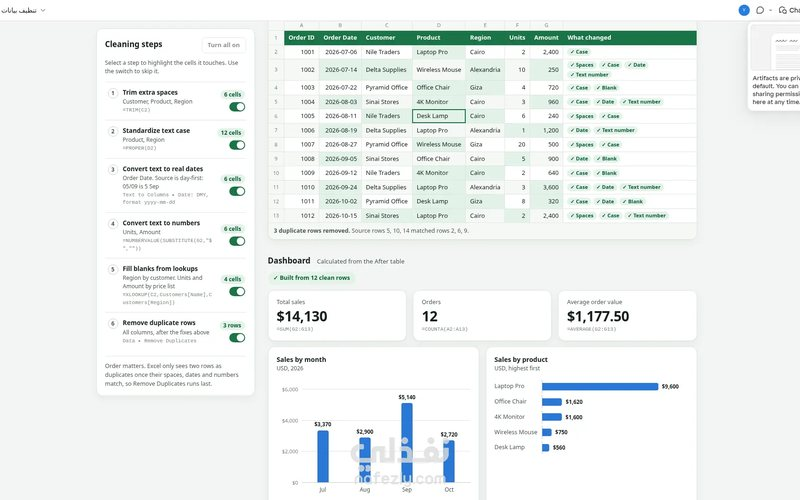
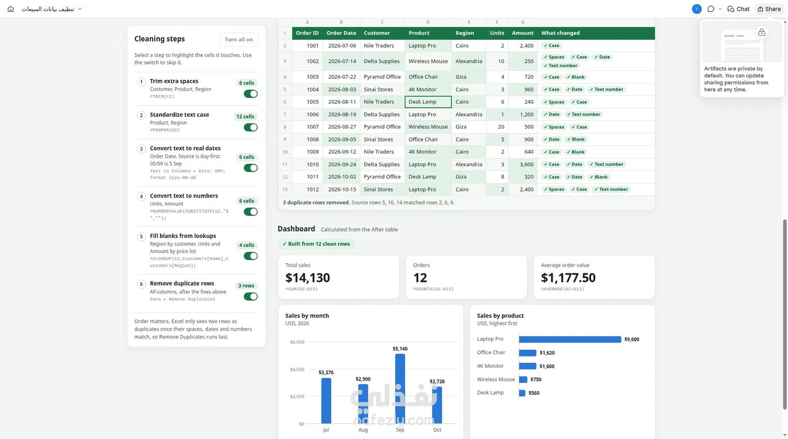
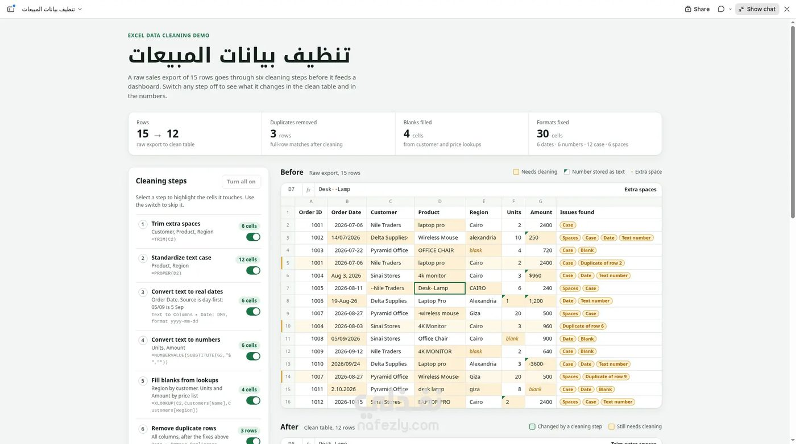

# Excel Sales Data Cleanup with Summary Dashboard

<h3 dir="rtl">تنظيف وتنسيق بيانات مبيعات Excel مع لوحة ملخص</h3>

  

 

---

## 📊 Overview · نظرة عامة

> **EN —** Removing duplicates, standardizing formats and filling missing values in sales data, with a KPI summary dashboard by month and product.

تنظيف وتنسيق بيانات مبيعات Excel من خلال إزالة الصفوف المكررة، وتوحيد تنسيقات النصوص والتواريخ والأرقام، ومعالجة القيم المفقودة بالاعتماد على بيانات مرجعية، ثم تنظيم البيانات في جدول واضح. يتضمن العمل لوحة ملخص تعرض إجمالي المبيعات وعدد الطلبات ومتوسط قيمة الطلب، مع رسوم توضح المبيعات حسب الشهر والمنتج.

## 🧰 Skills & Tools · المهارات والأدوات

<code>Microsoft Excel</code> <code>إدخال البيانات</code> <code>تحليل البيانات</code>

## 🖼️ Gallery · معرض الصور

<table>
<tr><td width="50%"></td><td width="50%"></td></tr>
</table>

## 🔗 Links · الروابط

| | |
|---|---|
| **View on Nafezly** | [Nafezly · نفذلي](https://nafezly.com/portfolio/269023-%D8%AA%D9%86%D8%B8%D9%8A%D9%81-%D9%88%D8%AA%D9%86%D8%B3%D9%8A%D9%82-%D8%A8%D9%8A%D8%A7%D9%86%D8%A7%D8%AA-%D9%85%D8%A8%D9%8A%D8%B9%D8%A7%D8%AA-Excel-%D9%85%D8%B9-%D9%84%D9%88%D8%AD%D8%A9-%D9%85%D9%84%D8%AE%D8%B5) |
| **Live Demo · نسخة تجريبية** | [Open demo](https://claude.ai/artifact/TS2z7oyrDWLf9sQ4PK2oFB) |
| **Category · التصنيف** | Data Analysis & Dashboards · تحليل البيانات ولوحات التحكم |

<a href="../../README.md">⬅ Back to Portfolio · الرجوع للمعرض</a> &nbsp;•&nbsp; <a href="../../../README.md">🏠 Home · الرئيسية</a>

