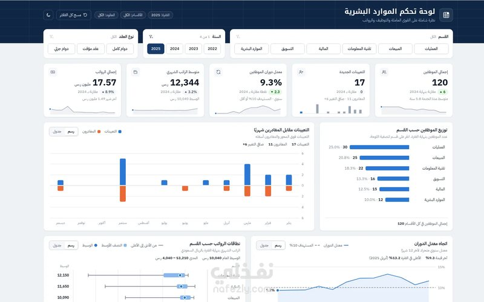
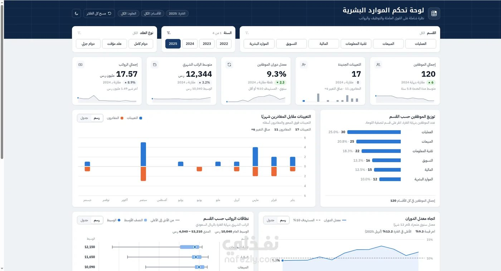
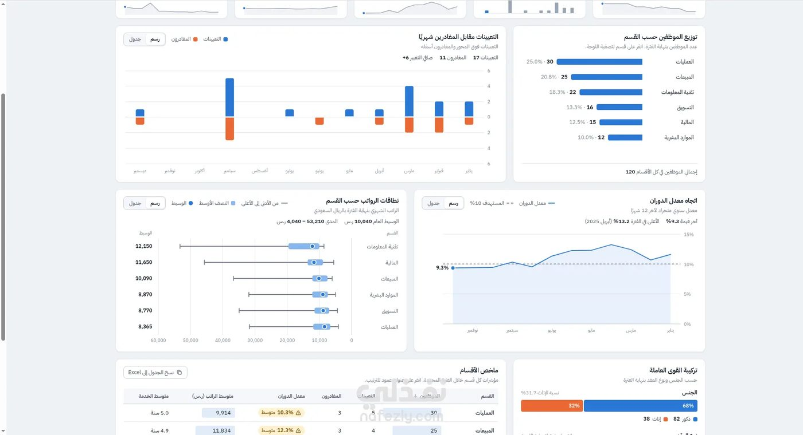
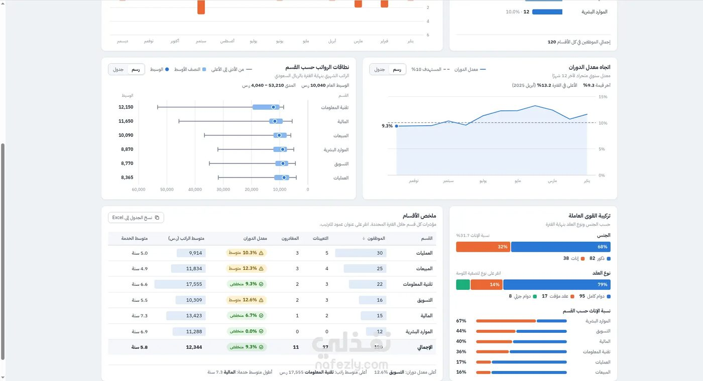

# HR Analytics Interactive Dashboard

<h3 dir="rtl">لوحة تحكم الموارد البشرية – داشبورد تفاعلي لتحليل بيانات الموظفين</h3>

  

 

---

## 📊 Overview · نظرة عامة

> **EN —** Arabic HR dashboard with KPIs (headcount, hires, turnover, salaries), interactive filters, charts and an Excel-ready summary table.

لوحة تحكم تفاعلية باللغة العربية لتحليل بيانات الموارد البشرية، تعرض مؤشرات الأداء الرئيسية مثل إجمالي الموظفين، التعيينات الجديدة، معدل دوران الموظفين، متوسط الرواتب وإجمالي الرواتب. تتضمن فلاتر تفاعلية حسب القسم والسنة ونوع العقد، ورسوماً بيانية للتعيينات مقابل المغادرين شهرياً، وتوزيع الموظفين حسب القسم، واتجاه معدل الدوران مقارنة بالمستهدف، ونطاقات الرواتب لكل قسم، وتركيبة القوى العاملة حسب الجنس ونوع العقد، مع جدول ملخص للأقسام قابل للنسخ إلى Excel ووضع ليلي. تصميم متجاوب واحترافي يناسب العرض على الإدارة.

## 🧰 Skills & Tools · المهارات والأدوات

<code>Microsoft Excel</code> <code>تحليل البيانات</code> <code>HTML</code>

## 🖼️ Gallery · معرض الصور

<table>
<tr><td width="50%"></td><td width="50%"></td></tr>
<tr><td width="50%"></td><td width="50%"></td></tr>
</table>

## 🔗 Links · الروابط

| | |
|---|---|
| **View on Nafezly** | [Nafezly · نفذلي](https://nafezly.com/portfolio/269162-%D9%84%D9%88%D8%AD%D8%A9-%D8%AA%D8%AD%D9%83%D9%85-%D8%A7%D9%84%D9%85%D9%88%D8%A7%D8%B1%D8%AF-%D8%A7%D9%84%D8%A8%D8%B4%D8%B1%D9%8A%D8%A9-%E2%80%93-%D8%AF%D8%A7%D8%B4%D8%A8%D9%88%D8%B1%D8%AF-%D8%AA%D9%81%D8%A7%D8%B9%D9%84%D9%8A-%D9%84%D8%AA%D8%AD%D9%84%D9%8A%D9%84-%D8%A8%D9%8A%D8%A7%D9%86%D8%A7%D8%AA-%D8%A7%D9%84%D9%85%D9%88%D8%B8%D9%81%D9%8A%D9%86) |
| **Live Demo · نسخة تجريبية** | [Open demo](https://claude.ai/artifact/Qx3zUcXHGb3NSYoTPYCS7j) |
| **Category · التصنيف** | Data Analysis & Dashboards · تحليل البيانات ولوحات التحكم |

<a href="../../README.md">⬅ Back to Portfolio · الرجوع للمعرض</a> &nbsp;•&nbsp; <a href="../../../README.md">🏠 Home · الرئيسية</a>

