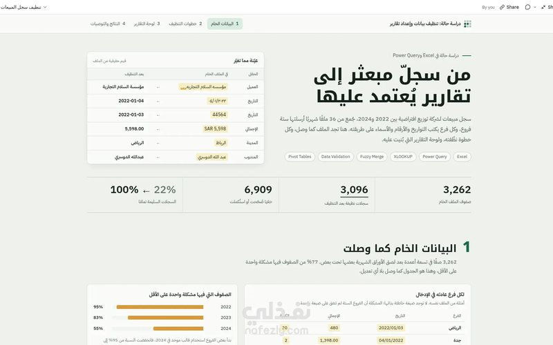
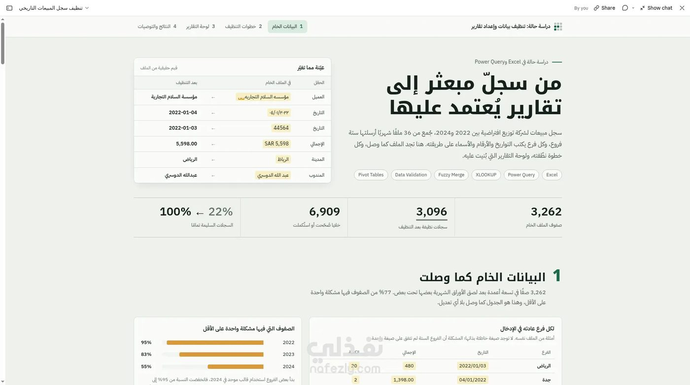
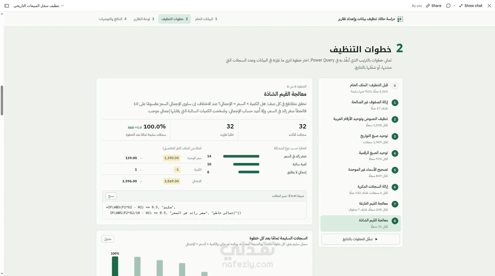
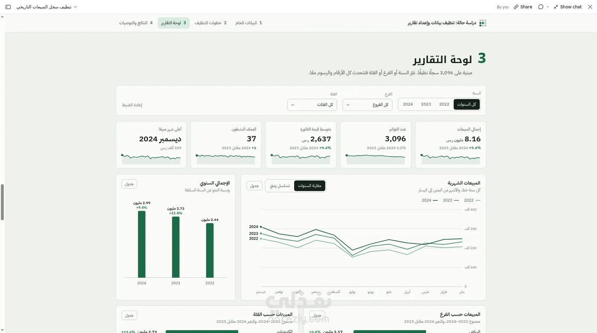
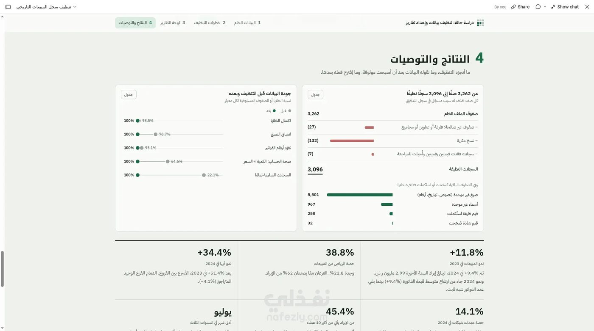

# Historical Sales Cleanup & Excel Reporting

<h3 dir="rtl">تنظيف سجل المبيعات التاريخي وإعداد لوحة تقارير Excel</h3>

  

 

---

## 📊 Overview · نظرة عامة

> **EN —** Excel/Power Query case study: 3,262 messy records cleaned in 8 traceable steps to 100% valid rows, plus a filterable reporting dashboard.

دراسة حالة تفاعلية لتنظيف سجل مبيعات تاريخي لثلاث سنوات باستخدام Excel وPower Query. بدأت البيانات التجريبية من 3,262 سجلًا، وتضمنت التكرارات والقيم الناقصة واختلاف صيغ التواريخ والأرقام وأسماء العملاء والفروع، بما في ذلك اختلافات الكتابة العربية. نُفذت ثماني خطوات تنظيف قابلة للتتبع مع أمثلة قبل/بعد وسجل تدقيق، فنتج 3,096 سجلًا نظيفًا وإصلاح 6,909 خلايا، وارتفعت نسبة السجلات السليمة تمامًا من 22% إلى 100%. تتضمن لوحة التقارير فلاتر للسنة والفرع والفئة، ومؤشرات أداء، واتجاهات المبيعات الشهرية والسنوية والنمو والموسمية وأكبر العملاء. جميع البيانات اصطناعية لأغراض العرض ولا تمثل بيانات عميل حقيقية.

## 🧰 Skills & Tools · المهارات والأدوات

<code>Microsoft Excel</code> <code>تحليل البيانات</code>

## 🖼️ Gallery · معرض الصور

<table>
<tr><td width="50%"></td><td width="50%"></td></tr>
<tr><td width="50%"></td><td width="50%"></td></tr>
</table>

## 🔗 Links · الروابط

| | |
|---|---|
| **View on Nafezly** | [Nafezly · نفذلي](https://nafezly.com/portfolio/269151-%D8%AA%D9%86%D8%B8%D9%8A%D9%81-%D8%B3%D8%AC%D9%84-%D8%A7%D9%84%D9%85%D8%A8%D9%8A%D8%B9%D8%A7%D8%AA-%D8%A7%D9%84%D8%AA%D8%A7%D8%B1%D9%8A%D8%AE%D9%8A-%D9%88%D8%A5%D8%B9%D8%AF%D8%A7%D8%AF-%D9%84%D9%88%D8%AD%D8%A9-%D8%AA%D9%82%D8%A7%D8%B1%D9%8A%D8%B1-Excel) |
| **Live Demo · نسخة تجريبية** | [Open demo](https://claude.ai/artifact/5KcAEEeu29UBhZZKb83H1q) |
| **Category · التصنيف** | Data Analysis & Dashboards · تحليل البيانات ولوحات التحكم |

<a href="../../README.md">⬅ Back to Portfolio · الرجوع للمعرض</a> &nbsp;•&nbsp; <a href="../../../README.md">🏠 Home · الرئيسية</a>

