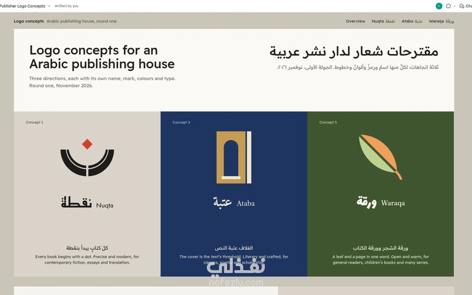
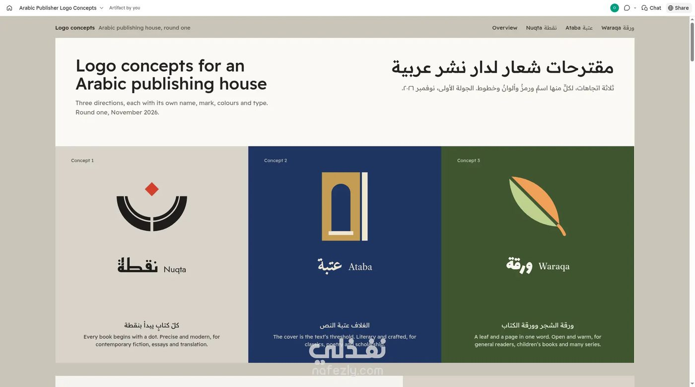
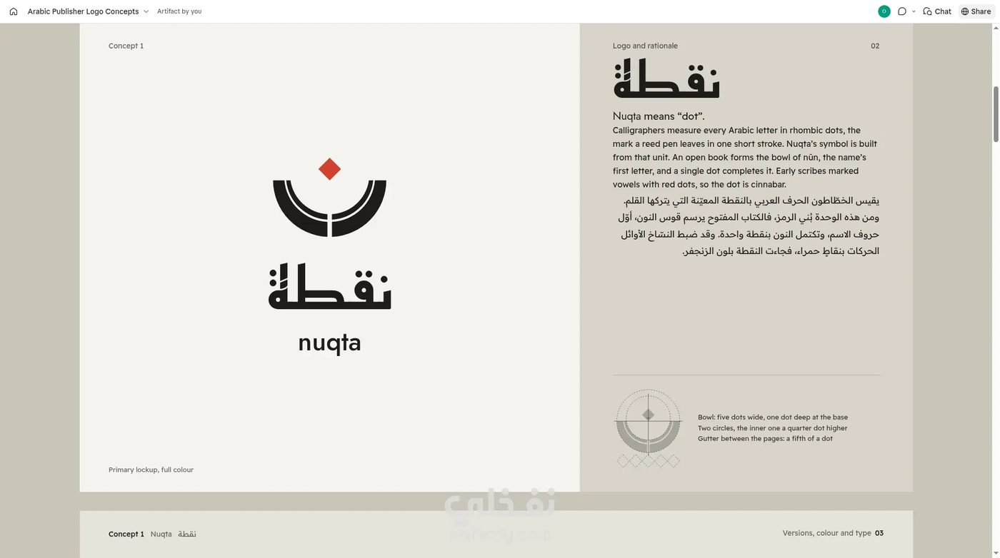
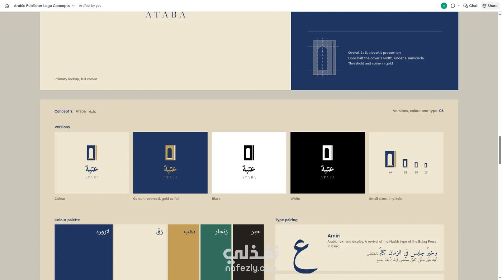
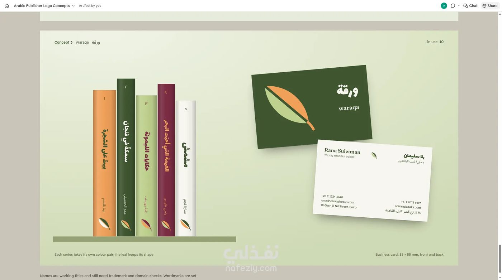

# Arabic Publishing House Identity – Nuqta, Ataba, Waraqa

<h3 dir="rtl">مفاهيم هوية وشعار لدار نشر عربية – نقطة، عتبة، ورقة</h3>

  

 

---

## 🎨 Overview · نظرة عامة

> **EN —** Concept board with three identity directions for an Arabic publisher, including palettes, typography and book/business-card mockups.

لوحة مفاهيم لشعار دار نشر عربية تضم ثلاثة اتجاهات تصميمية: نقطة (Nuqta)، عتبة (Ataba)، وورقة (Waraqa). لكل اتجاه معالجة للشعار بنسخ ملونة وأحادية اللون، ولوحة ألوان بأكواد HEX، واقتراحات للخطوط العربية واللاتينية، مع تطبيقات موكاب على أغلفة وكعوب الكتب وبطاقات العمل. توضح اللوحة الفكرة التصميمية لكل اتجاه وتناسبه مع أنماط النشر المختلفة. تنويه: الأسماء المعروضة أسماء عمل مقترحة وليست اسماً نهائياً للدار، وبيانات الأشخاص والاتصال في الموكابات تجريبية. اللوحة تركز على موكابات الكتب وبطاقات العمل ولا تتضمن نموذجاً لواجهة الموقع.

## 🧰 Skills & Tools · المهارات والأدوات

<code>تصميم الشعارات</code> <code>تصميم الجرافيك</code> <code>هوية المؤسسات</code>

## 🖼️ Gallery · معرض الصور

<table>
<tr><td width="50%"></td><td width="50%"></td></tr>
<tr><td width="50%"></td><td width="50%"></td></tr>
</table>

## 🔗 Links · الروابط

| | |
|---|---|
| **View on Nafezly** | [Nafezly · نفذلي](https://nafezly.com/portfolio/269220-%D9%85%D9%81%D8%A7%D9%87%D9%8A%D9%85-%D9%87%D9%88%D9%8A%D8%A9-%D9%88%D8%B4%D8%B9%D8%A7%D8%B1-%D9%84%D8%AF%D8%A7%D8%B1-%D9%86%D8%B4%D8%B1-%D8%B9%D8%B1%D8%A8%D9%8A%D8%A9-%E2%80%93-%D9%86%D9%82%D8%B7%D8%A9%D8%8C-%D8%B9%D8%AA%D8%A8%D8%A9%D8%8C-%D9%88%D8%B1%D9%82%D8%A9) |
| **Live Demo · نسخة تجريبية** | [Open demo](https://claude.ai/artifact/Xc4Y8amKS5d69RsrDP4ewX) |
| **Category · التصنيف** | Branding & Visual Identity · الهوية البصرية والتصميم |

<a href="../../README.md">⬅ Back to Portfolio · الرجوع للمعرض</a> &nbsp;•&nbsp; <a href="../../../README.md">🏠 Home · الرئيسية</a>

