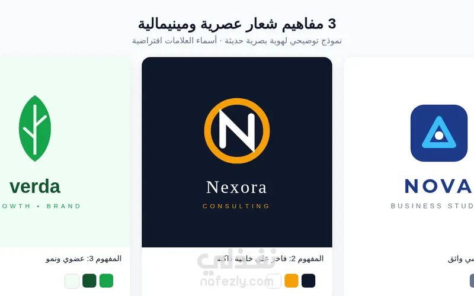
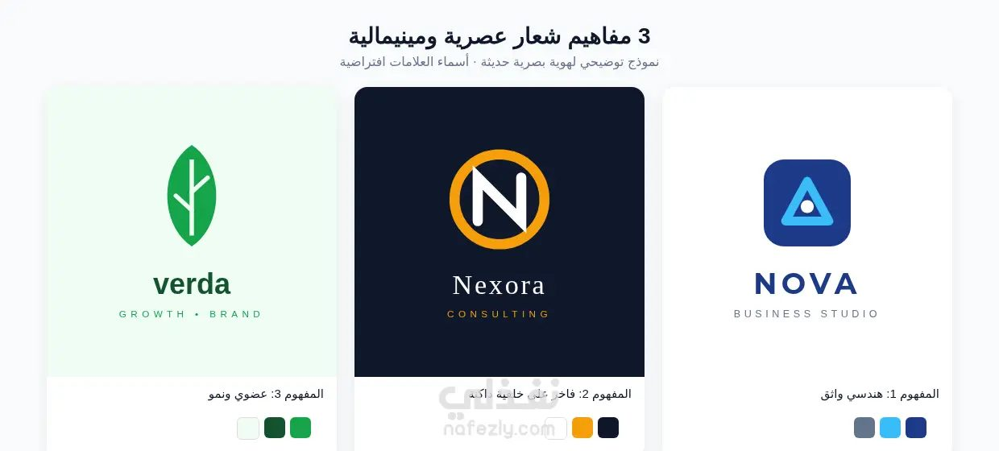
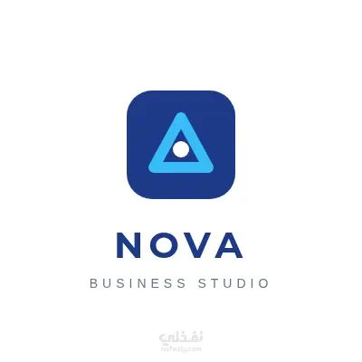
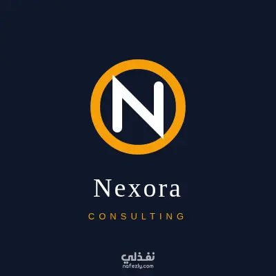
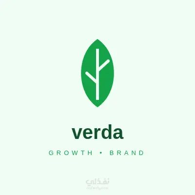

# 3 Modern Minimalist Logo Concepts

<h3 dir="rtl">تصميم 3 مفاهيم شعار عصرية وهوية بصرية مينيمالية</h3>

  

---

## 🎨 Overview · نظرة عامة

> **EN —** Three minimalist logo concepts (geometric, luxury, organic) with a color palette each, delivered as SVG and PNG.

نموذج لثلاثة مفاهيم شعار عصرية ومينيمالية لعلامات تجارية افتراضية: مفهوم هندسي واثق، ومفهوم فاخر على خلفية داكنة، ومفهوم عضوي يعبر عن النمو، مع لوحة ألوان لكل مفهوم. التسليم يشمل ملفات SVG فيكتور وPNG عالي الدقة.

## 🧰 Skills & Tools · المهارات والأدوات

<code>تصميم الشعارات</code> <code>تصميم الجرافيك</code> <code>Illustrator</code> <code>هوية المؤسسات</code>

## 🖼️ Gallery · معرض الصور

<table>
<tr><td width="50%"></td><td width="50%"></td></tr>
<tr><td width="50%"></td><td width="50%"></td></tr>
</table>

## 🔗 Links · الروابط

| | |
|---|---|
| **View on Nafezly** | [Nafezly · نفذلي](https://nafezly.com/portfolio/269860-%D8%AA%D8%B5%D9%85%D9%8A%D9%85-3-%D9%85%D9%81%D8%A7%D9%87%D9%8A%D9%85-%D8%B4%D8%B9%D8%A7%D8%B1-%D8%B9%D8%B5%D8%B1%D9%8A%D8%A9-%D9%88%D9%87%D9%88%D9%8A%D8%A9-%D8%A8%D8%B5%D8%B1%D9%8A%D8%A9-%D9%85%D9%8A%D9%86%D9%8A%D9%85%D8%A7%D9%84%D9%8A%D8%A9) |
| **Category · التصنيف** | Branding & Visual Identity · الهوية البصرية والتصميم |

<a href="../../README.md">⬅ Back to Portfolio · الرجوع للمعرض</a> &nbsp;•&nbsp; <a href="../../../README.md">🏠 Home · الرئيسية</a>

