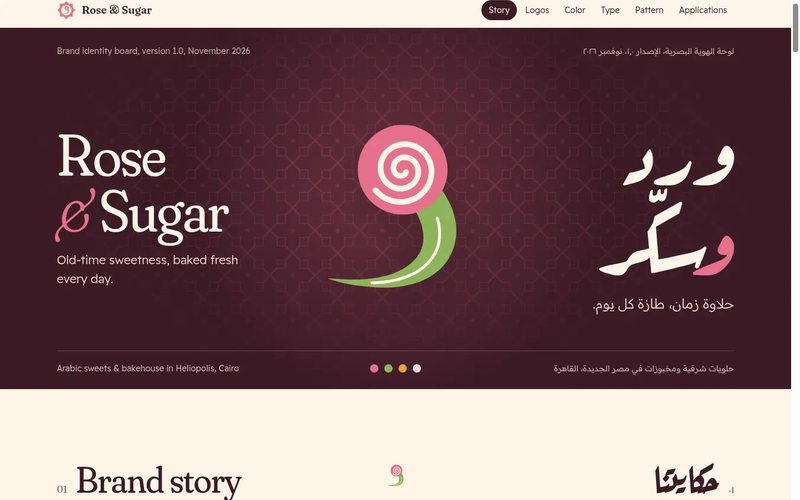
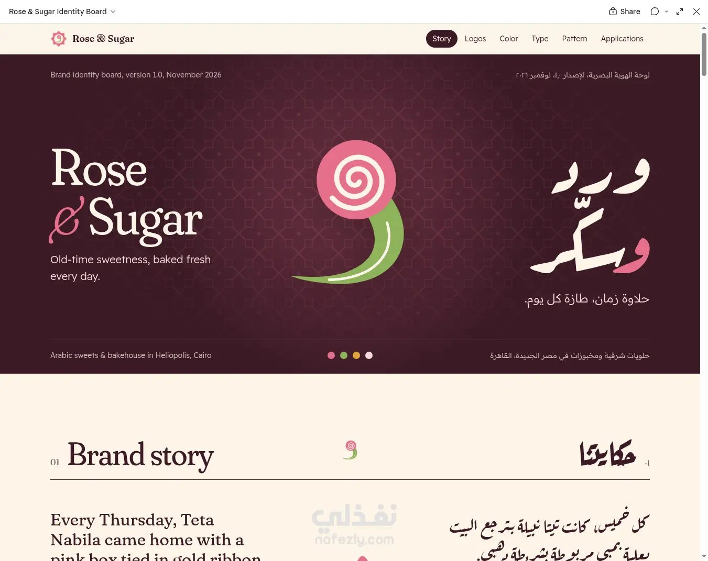
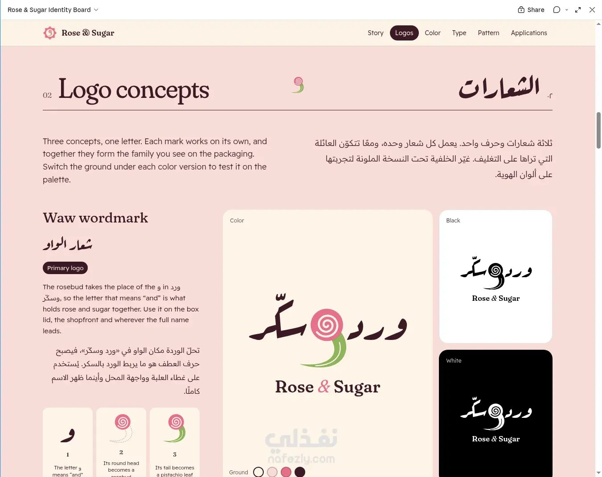
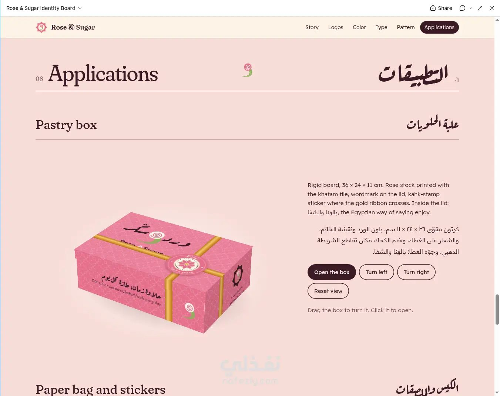

# Rose & Sugar – Arabic Bakery Brand Identity

<h3 dir="rtl">Rose & Sugar / ورد وسكّر — هوية بصرية متكاملة لمخبز عربي</h3>

  

---

## 🎨 Overview · نظرة عامة

> **EN —** Complete bilingual bakery identity: brand story, logo directions, colors, typography, baklava-inspired pattern and packaging/social applications.

صمّمت لوحة هوية بصرية متكاملة لعلامة مخبوزات وحلويات عربية باسم Rose & Sugar (ورد وسكّر)، بهوية دافئة مستوحاة من حلويات القاهرة وعلبة الورد المربوطة بالشريط الذهبي. تشمل اللوحة قصة العلامة وتموضعها وشعارًا عربيًا/لاتينيًا وثلاثة اتجاهات للشعار بنسخ ملونة وأحادية اللون، ونظام ألوان موثقًا بالقيم اللونية، وتوليفة خطوط عربية ولاتينية، ونمطًا زخرفيًا مستلهمًا من تقطيع البقلاوة. كما تتضمن تطبيقات الهوية على علبة المعجنات، والأكياس والملصقات، ومنشورات إنستغرام، مع مراعاة اتجاه الكتابة العربية من اليمين إلى اليسار.

## 🧰 Skills & Tools · المهارات والأدوات

<code>هوية المؤسسات</code> <code>تصميم الشعارات</code>

## 🖼️ Gallery · معرض الصور

<table>
<tr><td width="50%"></td><td width="50%"></td></tr>
<tr><td width="50%"></td><td width="50%"></td></tr>
</table>

## 🔗 Links · الروابط

| | |
|---|---|
| **View on Nafezly** | [Nafezly · نفذلي](https://nafezly.com/portfolio/269214-Rose---Sugar-%D9%88%D8%B1%D8%AF-%D9%88%D8%B3%D9%83%D9%91%D8%B1-%E2%80%94-%D9%87%D9%88%D9%8A%D8%A9-%D8%A8%D8%B5%D8%B1%D9%8A%D8%A9-%D9%85%D8%AA%D9%83%D8%A7%D9%85%D9%84%D8%A9-%D9%84%D9%85%D8%AE%D8%A8%D8%B2-%D8%B9%D8%B1%D8%A8%D9%8A) |
| **Category · التصنيف** | Branding & Visual Identity · الهوية البصرية والتصميم |

<a href="../../README.md">⬅ Back to Portfolio · الرجوع للمعرض</a> &nbsp;•&nbsp; <a href="../../../README.md">🏠 Home · الرئيسية</a>

