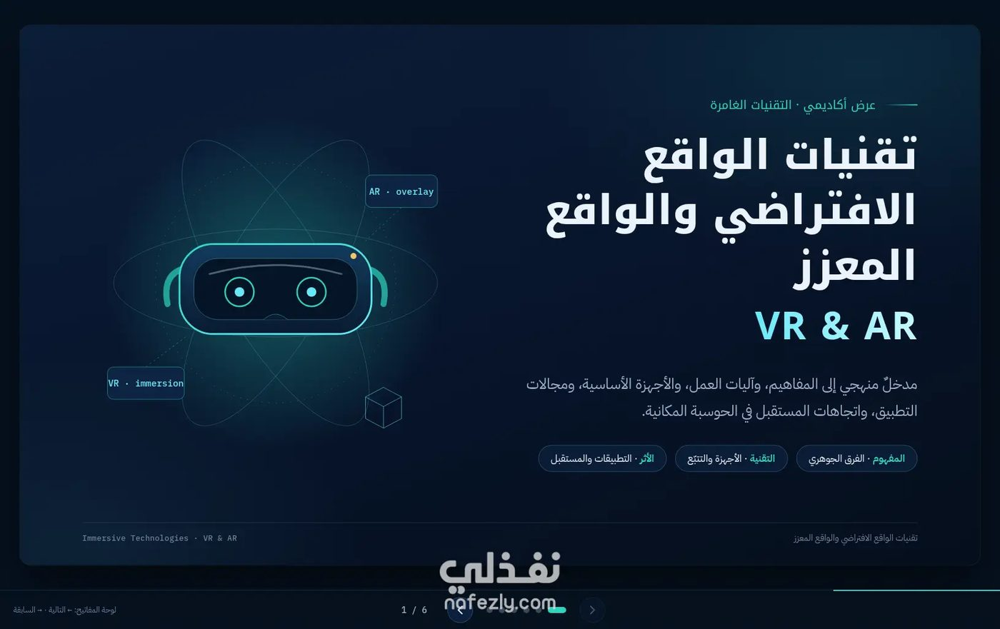
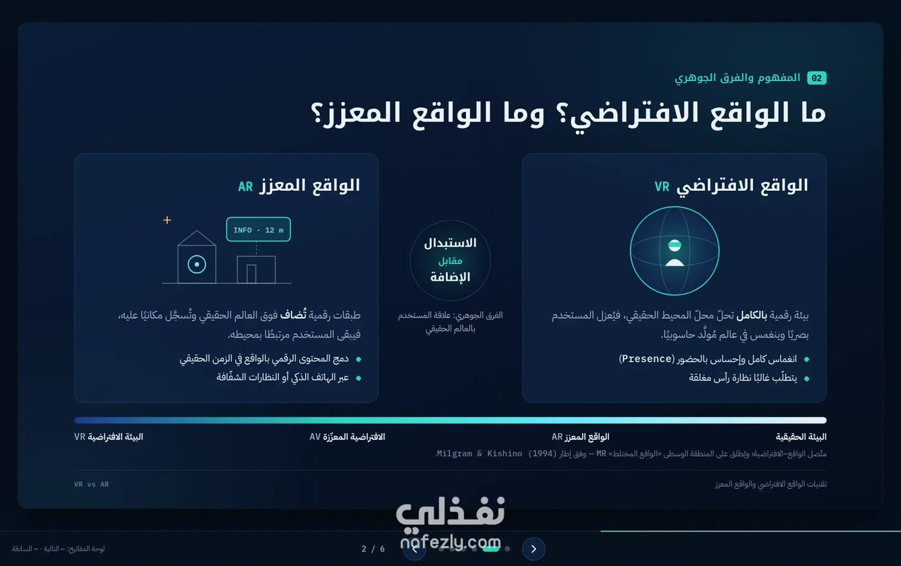
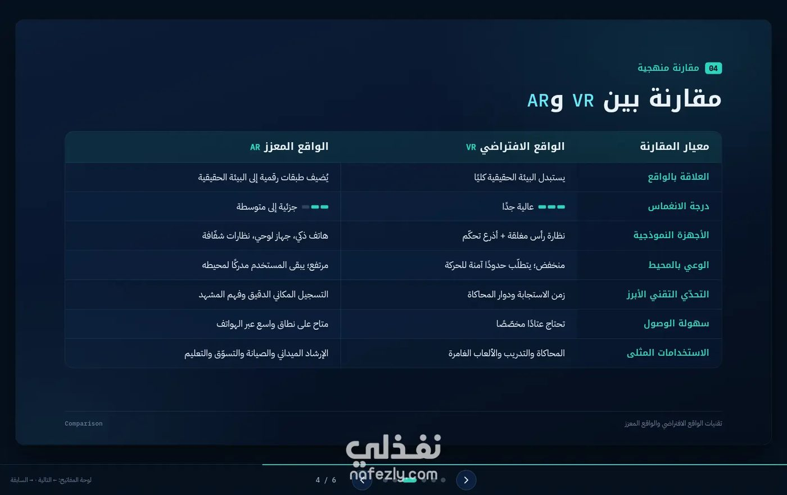
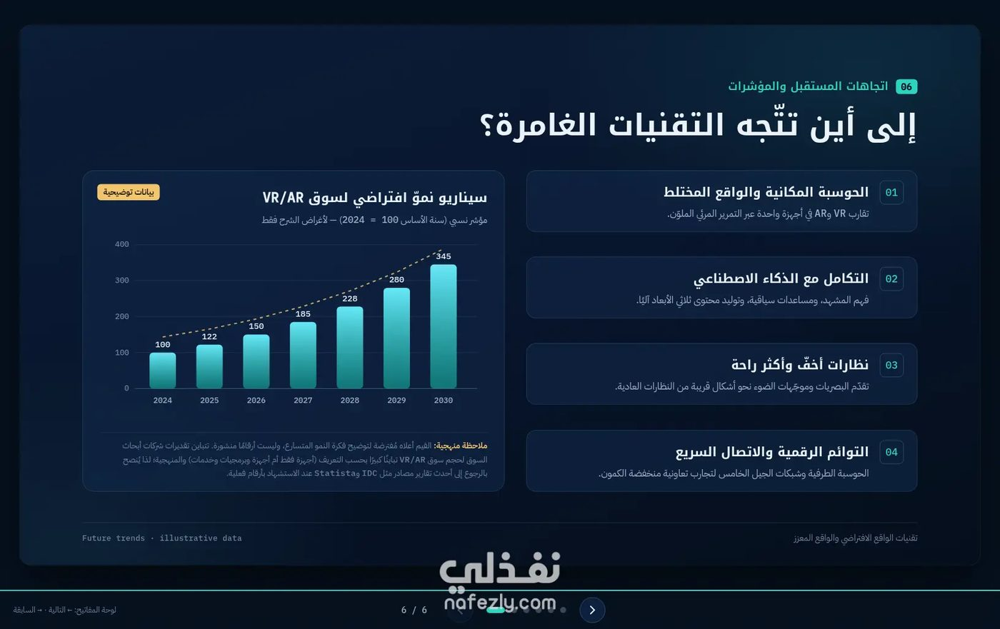

# VR & AR Professional Presentation

<h3 dir="rtl">عرض تقديمي احترافي عن تقنيات الواقع الافتراضي والواقع المعزز VR & AR</h3>

  

---

## 🎨 Overview · نظرة عامة

> **EN —** Academic Arabic (RTL) presentation on VR/AR: definitions, hardware, comparison table, applications, stats and infographics.

نموذج أولي لعرض تقديمي أكاديمي احترافي عن تقنيات الواقع الافتراضي والواقع المعزز، بتصميم عصري موحّد يدعم اللغة العربية (RTL). يتضمن شريحة العنوان، تعريف الواقع الافتراضي والمعزز والفرق بينهما، آلية العمل والأجهزة المستخدمة، جدول مقارنة منهجي بين VR وAR، مجالات التطبيق في التعليم والطب والألعاب والصناعة والهندسة، وإحصائيات واتجاهات مستقبلية مدعومة برسوم بيانية وإنفوجرافيك. التصميم قابل للتسليم بصيغة PowerPoint قابلة للتعديل وPDF.

## 🧰 Skills & Tools · المهارات والأدوات

<code>Powerpoint</code> <code>Microsoft Office</code> <code>الرسوم البيانية</code> <code>التصميم الإبداعي</code>

## 🖼️ Gallery · معرض الصور

<table>
<tr><td width="50%"></td><td width="50%"></td></tr>
<tr><td width="50%"></td><td width="50%"></td></tr>
</table>

## 🔗 Links · الروابط

| | |
|---|---|
| **View on Nafezly** | [Nafezly · نفذلي](https://nafezly.com/portfolio/268669-%D8%B9%D8%B1%D8%B6-%D8%AA%D9%82%D8%AF%D9%8A%D9%85%D9%8A-%D8%A7%D8%AD%D8%AA%D8%B1%D8%A7%D9%81%D9%8A-%D8%B9%D9%86-%D8%AA%D9%82%D9%86%D9%8A%D8%A7%D8%AA-%D8%A7%D9%84%D9%88%D8%A7%D9%82%D8%B9-%D8%A7%D9%84%D8%A7%D9%81%D8%AA%D8%B1%D8%A7%D8%B6%D9%8A-%D9%88%D8%A7%D9%84%D9%88%D8%A7%D9%82%D8%B9-%D8%A7%D9%84%D9%85%D8%B9%D8%B2%D8%B2-VR---AR) |
| **Category · التصنيف** | Branding & Visual Identity · الهوية البصرية والتصميم |

<a href="../../README.md">⬅ Back to Portfolio · الرجوع للمعرض</a> &nbsp;•&nbsp; <a href="../../../README.md">🏠 Home · الرئيسية</a>

