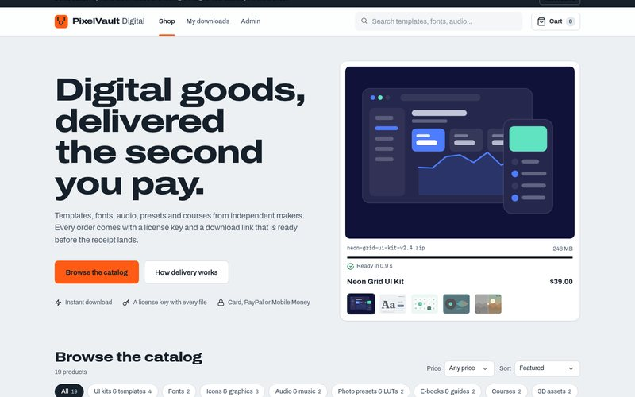
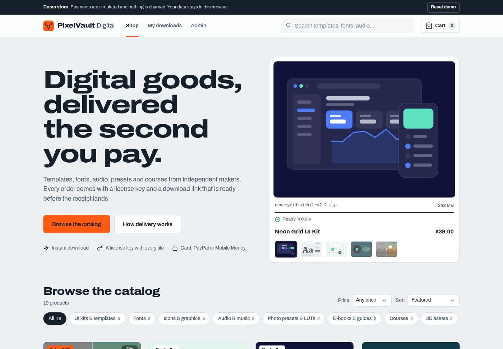
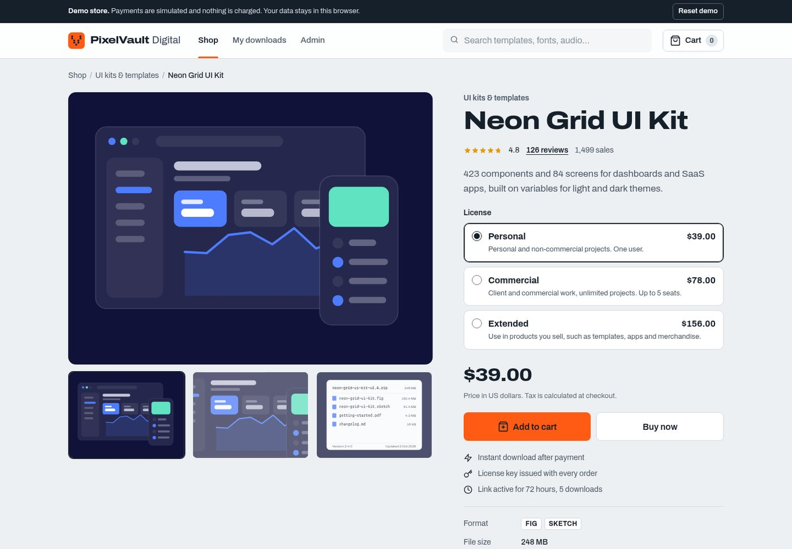
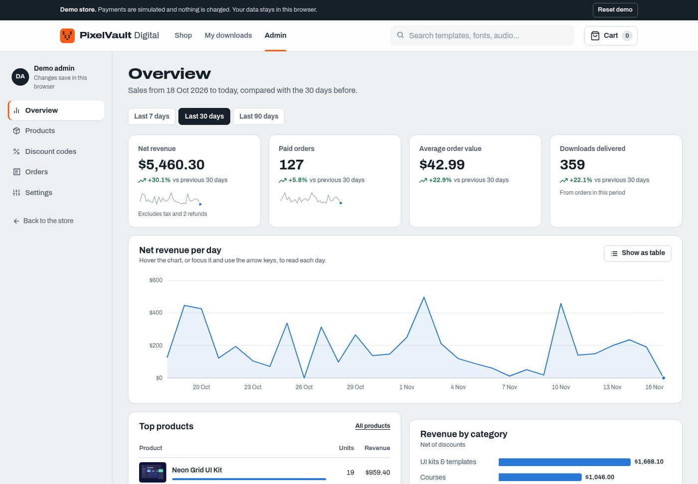
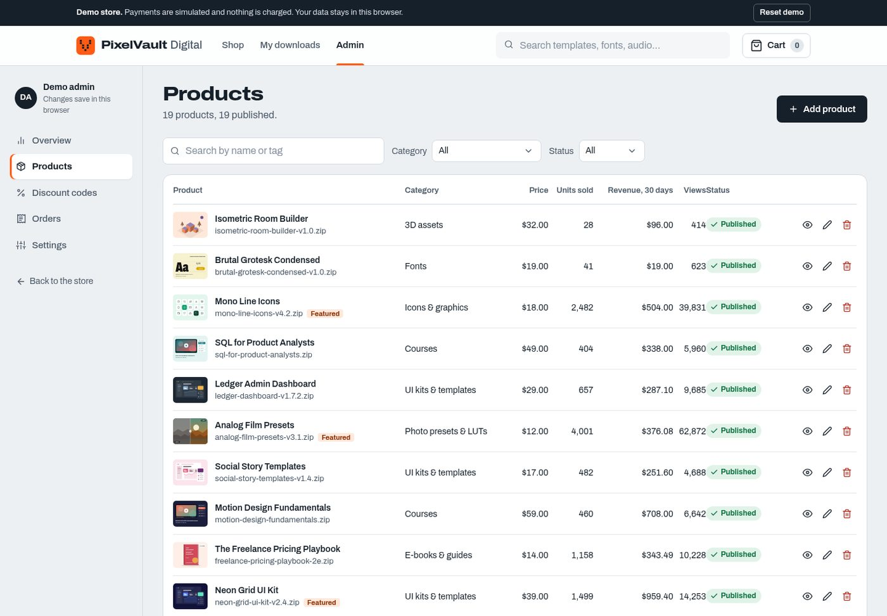
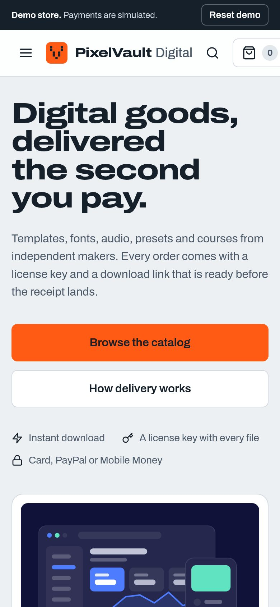

# Digital Download Store Demo

<h3 dir="rtl">متجر منتجات رقمية مع تحميل فوري</h3>

  

---

## 🛒 Overview · نظرة عامة

PixelVault Digital is a fully working, responsive e-commerce demo for selling digital products with instant download.
- Storefront with category filters, search, sorting and detailed product pages (preview, format, file size, licenses, reviews)
- Cart and checkout with simulated Stripe, PayPal and Mobile Money payments and working discount codes
- Automatic delivery: order confirmation, a "My downloads" area with expiring download links, download limits and a license key per purchase
- Admin dashboard: add, edit and delete products, manage discount codes and orders, sales analytics with a revenue chart
- GDPR cookie consent, privacy policy and SEO-ready semantic markup
- Mobile-first responsive layout
- Skills: HTML5, CSS3, JavaScript, responsive UI/UX design, e-commerce front-end, admin dashboards.

> **بالعربي —** متجر لبيع المنتجات الرقمية مع دفع تجريبي وروابط تحميل منتهية الصلاحية ومفاتيح ترخيص ولوحة إدارة.

## 🧰 Skills & Tools · المهارات والأدوات

<code>JavaScript</code> <code>CSS</code> <code>HTML</code>

## 🖼️ Gallery · معرض الصور

<table>
<tr><td width="50%"></td><td width="50%"></td></tr>
<tr><td width="50%"></td><td width="50%"></td></tr>
<tr><td width="50%"></td><td width="50%"></td></tr>
</table>

## 🔗 Links · الروابط

| | |
|---|---|
| **View on Freelancer.com** | [Freelancer.com](https://www.freelancer.com/u/yyacoup) |
| **Category · التصنيف** | E-Commerce · التجارة الإلكترونية |

<a href="../../README.md">⬅ Back to Portfolio · الرجوع للمعرض</a> &nbsp;•&nbsp; <a href="../../../README.md">🏠 Home · الرئيسية</a>

