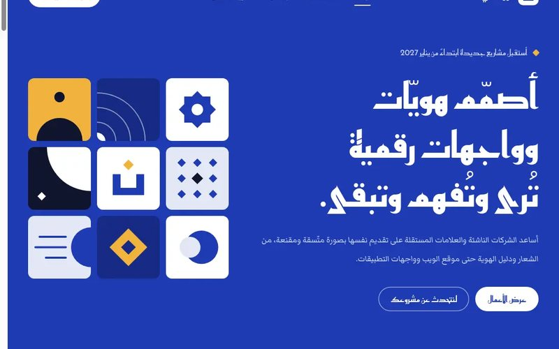
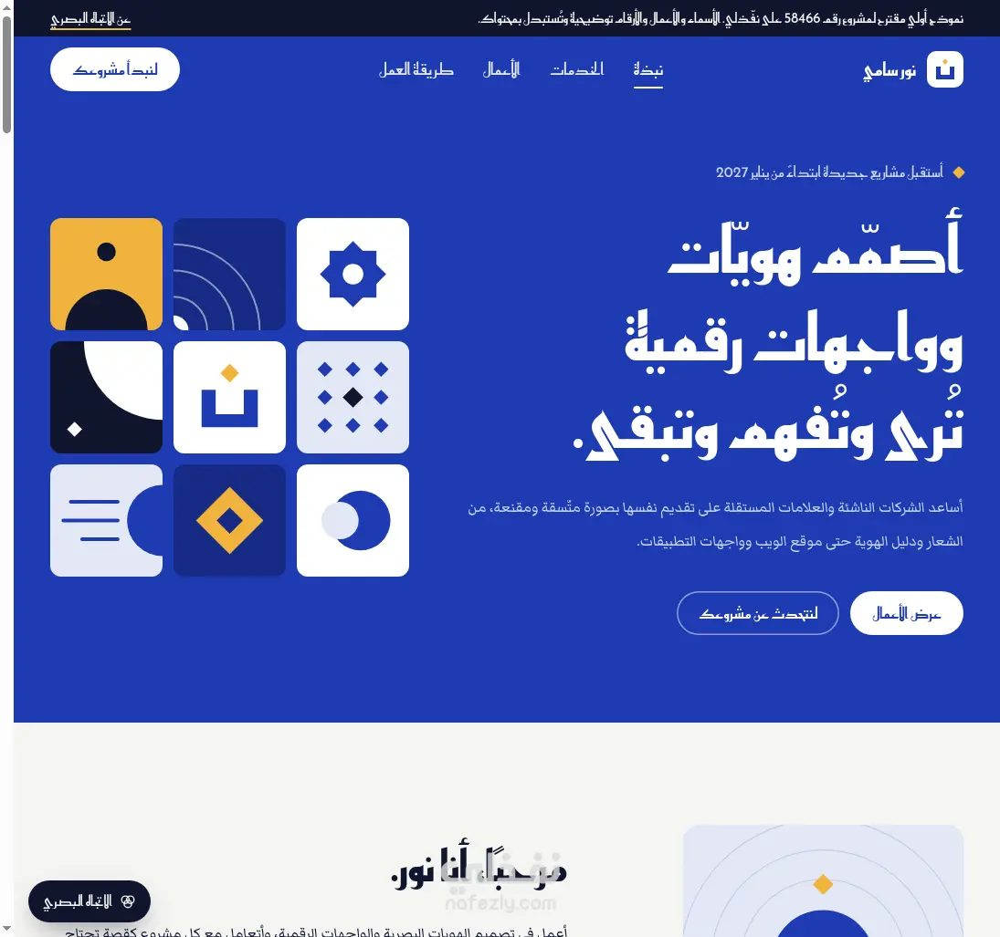
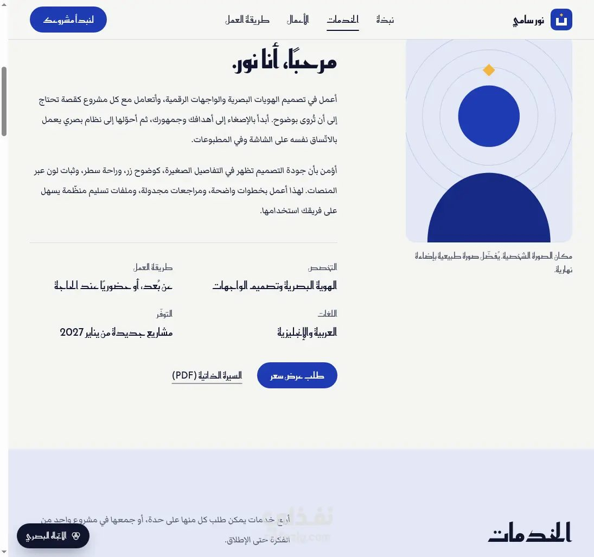
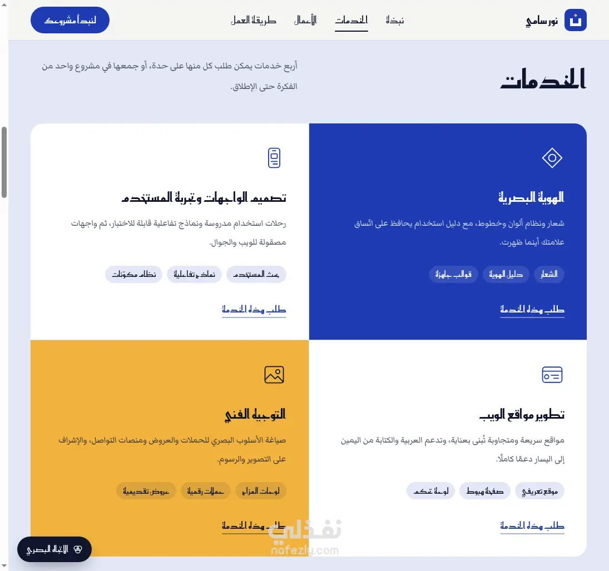

# Arabic Personal Portfolio Website

<h3 dir="rtl">موقع بورتفوليو شخصي احترافي باللغة العربية – نموذج تفاعلي</h3>

  

 

---

## 🌐 Overview · نظرة عامة

> **EN —** Interactive Arabic personal portfolio built with Tailwind CSS: about, skills, services, projects and contact sections.

نموذج تفاعلي لموقع بورتفوليو شخصي عربي يعرض الهوية المهنية والأعمال بأسلوب عصري. تصميم متجاوب يعمل على الهواتف والأجهزة اللوحية والحواسيب. يتضمن أقسام نبذة عني والمهارات والخدمات والمشاريع ووسائل التواصل. واجهة أنيقة بتدرج بصري واضح وتجربة استخدام سهلة. منفذ كصفحة HTML واحدة باستخدام Tailwind CSS وJavaScript.

## 🧰 Skills & Tools · المهارات والأدوات

<code>HTML</code> <code>CSS</code> <code>جافاسكربت</code> <code>Tailwind CSS</code>

## 🖼️ Gallery · معرض الصور

<table>
<tr><td width="50%"></td><td width="50%"></td></tr>
<tr><td width="50%"></td><td width="50%"></td></tr>
</table>

## 🔗 Links · الروابط

| | |
|---|---|
| **View on Nafezly** | [Nafezly · نفذلي](https://nafezly.com/portfolio/268751-%D9%85%D9%88%D9%82%D8%B9-%D8%A8%D9%88%D8%B1%D8%AA%D9%81%D9%88%D9%84%D9%8A%D9%88-%D8%B4%D8%AE%D8%B5%D9%8A-%D8%A7%D8%AD%D8%AA%D8%B1%D8%A7%D9%81%D9%8A-%D8%A8%D8%A7%D9%84%D9%84%D8%BA%D8%A9-%D8%A7%D9%84%D8%B9%D8%B1%D8%A8%D9%8A%D8%A9-%E2%80%93-%D9%86%D9%85%D9%88%D8%B0%D8%AC-%D8%AA%D9%81%D8%A7%D8%B9%D9%84%D9%8A) |
| **Live Demo · نسخة تجريبية** | [Open demo](https://claude.ai/artifact/KRu1iUxbWH6SoNoV6PGoiQ) |
| **Category · التصنيف** | Websites & Landing Pages · المواقع وصفحات الهبوط |

<a href="../../README.md">⬅ Back to Portfolio · الرجوع للمعرض</a> &nbsp;•&nbsp; <a href="../../../README.md">🏠 Home · الرئيسية</a>

