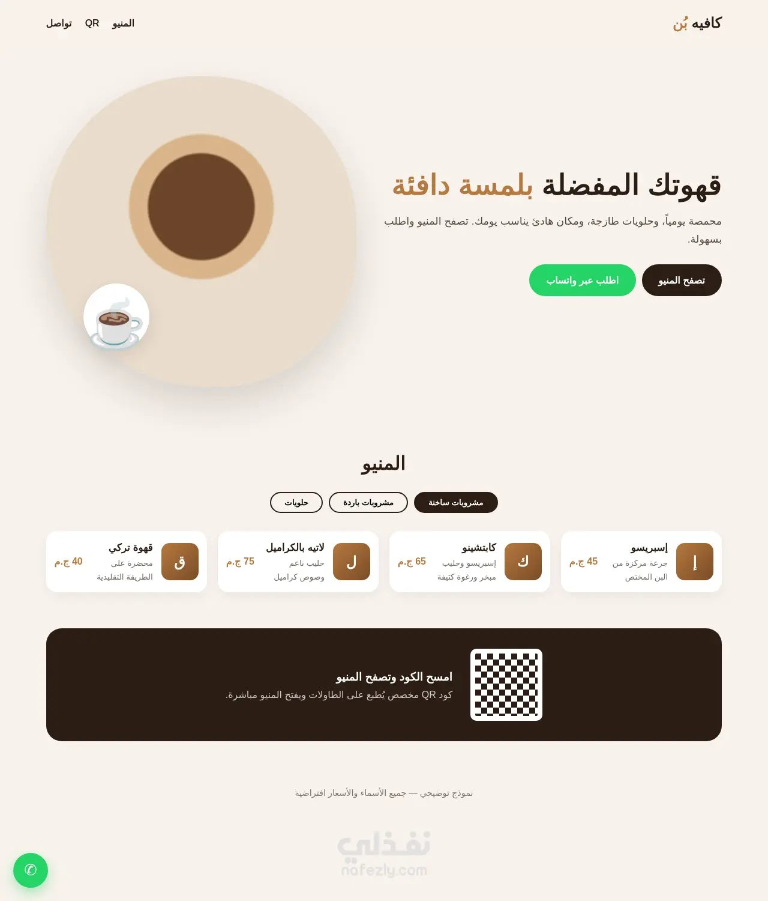

# Café Landing Page with Digital Menu

<h3 dir="rtl">تصميم صفحة هبوط لكافيه مع عرض المنيو</h3>

  

---

## 🌐 Overview · نظرة عامة

> **EN —** Responsive Arabic landing page for a café: categorized menu with prices, WhatsApp ordering and a QR-code menu section.

نموذج صفحة هبوط عربية متجاوبة لكافيه بتصميم Minimalist دافئ: واجهة رئيسية جذابة، منيو مقسم حسب الأقسام (مشروبات ساخنة، باردة، حلويات) مع الأسعار، زر طلب عبر واتساب، وقسم QR Code للوصول السريع للمنيو. تم التنفيذ بـ HTML وCSS وJavaScript. جميع الأسماء والأسعار افتراضية.

## 🧰 Skills & Tools · المهارات والأدوات

<code>HTML</code> <code>CSS</code>

## 🔗 Links · الروابط

| | |
|---|---|
| **View on Nafezly** | [Nafezly · نفذلي](https://nafezly.com/portfolio/270020-%D8%AA%D8%B5%D9%85%D9%8A%D9%85-%D8%B5%D9%81%D8%AD%D8%A9-%D9%87%D8%A8%D9%88%D8%B7-%D9%84%D9%83%D8%A7%D9%81%D9%8A%D9%87-%D9%85%D8%B9-%D8%B9%D8%B1%D8%B6-%D8%A7%D9%84%D9%85%D9%86%D9%8A%D9%88) |
| **Category · التصنيف** | Websites & Landing Pages · المواقع وصفحات الهبوط |

<a href="../../README.md">⬅ Back to Portfolio · الرجوع للمعرض</a> &nbsp;•&nbsp; <a href="../../../README.md">🏠 Home · الرئيسية</a>

