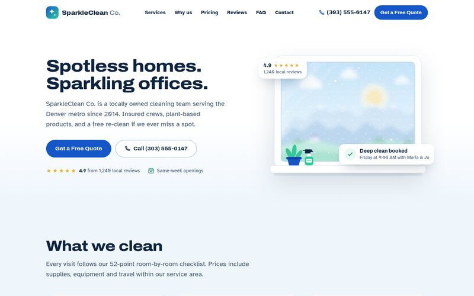
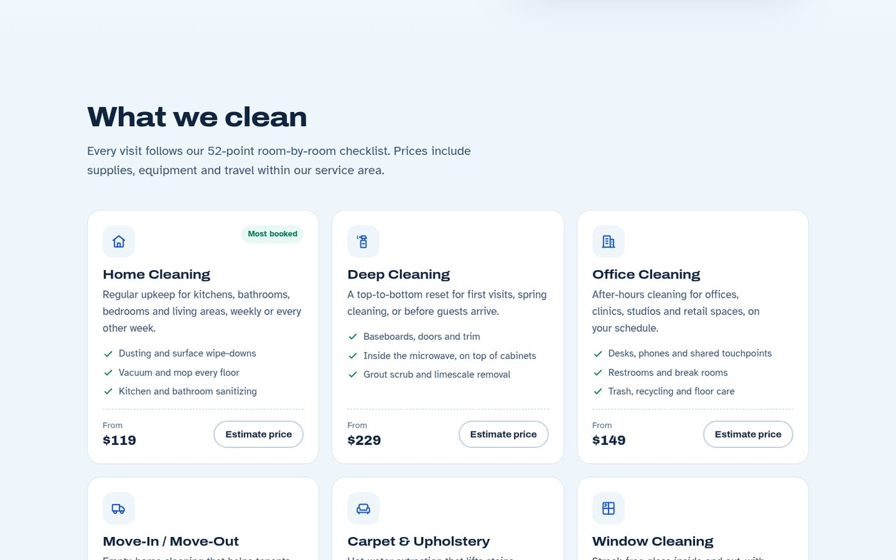
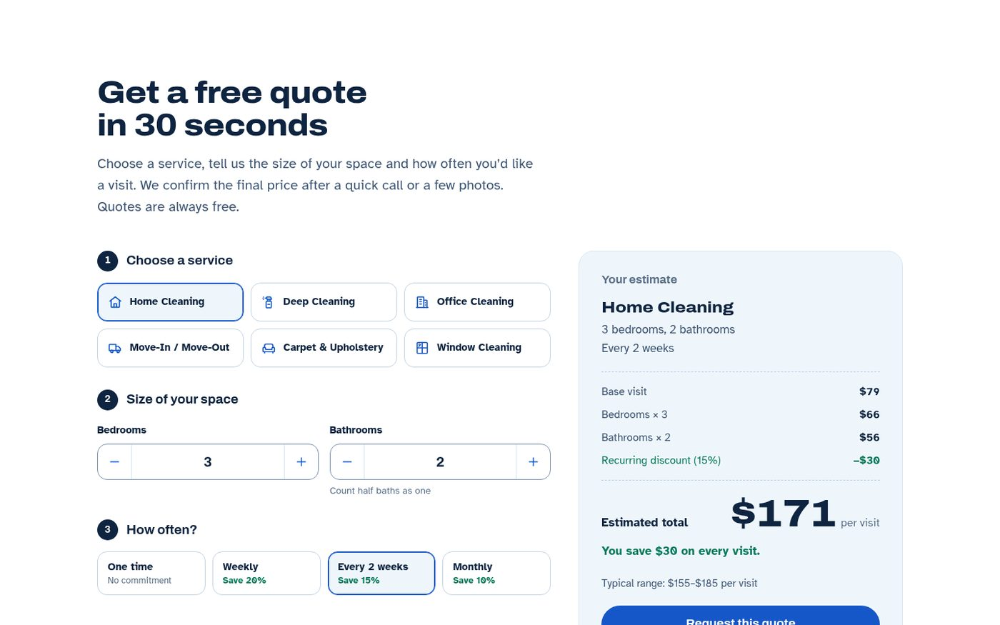
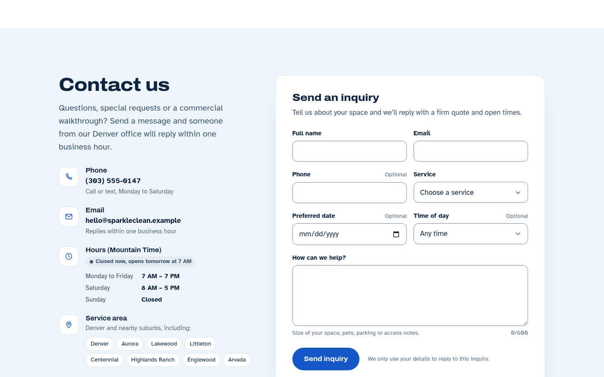
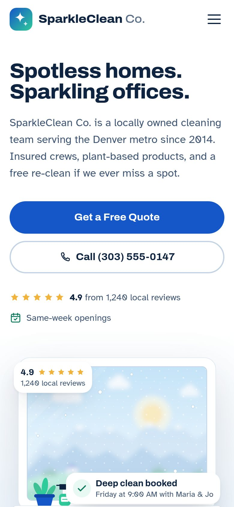

# Cleaning Company One-Page Website

<h3 dir="rtl">موقع صفحة واحدة لشركة تنظيف</h3>

  

---

## 🌐 Overview · نظرة عامة

Responsive one-page website for a local cleaning company (SparkleClean Co. demo), designed for a WordPress/Elementor build. Includes a sticky header with smooth-scroll navigation, a hero with quote and click-to-call CTAs, service cards (home, deep, office, move-in/out, carpet, windows), a "Why choose us" trust section, an interactive price estimator (service, rooms, frequency discounts), a testimonials slider, an FAQ accordion, and a validated inquiry form with a success state. It also has a sticky mobile call/quote bar. Mobile-first layout, accessible markup and fast loading. Built with HTML5, CSS3 and JavaScript.

> **بالعربي —** موقع متجاوب لشركة تنظيف مع حاسبة أسعار تفاعلية وآراء العملاء وأسئلة شائعة ونموذج طلب عرض سعر.

## 🧰 Skills & Tools · المهارات والأدوات

<code>JavaScript</code> <code>Website Design</code> <code>CSS</code> <code>WordPress</code> <code>Elementor</code> <code>HTML</code>

## 🖼️ Gallery · معرض الصور

<table>
<tr><td width="50%"></td><td width="50%"></td></tr>
<tr><td width="50%"></td><td width="50%"></td></tr>
<tr><td width="50%"></td><td width="50%"></td></tr>
</table>

## 🔗 Links · الروابط

| | |
|---|---|
| **View on Freelancer.com** | [Freelancer.com](https://www.freelancer.com/u/yyacoup) |
| **Category · التصنيف** | Websites & Landing Pages · المواقع وصفحات الهبوط |

<a href="../../README.md">⬅ Back to Portfolio · الرجوع للمعرض</a> &nbsp;•&nbsp; <a href="../../../README.md">🏠 Home · الرئيسية</a>

