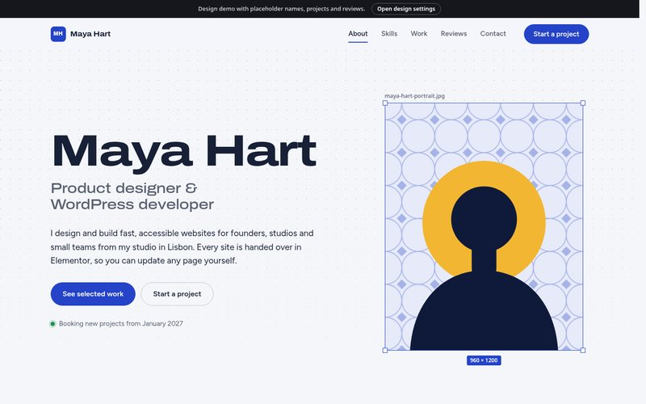
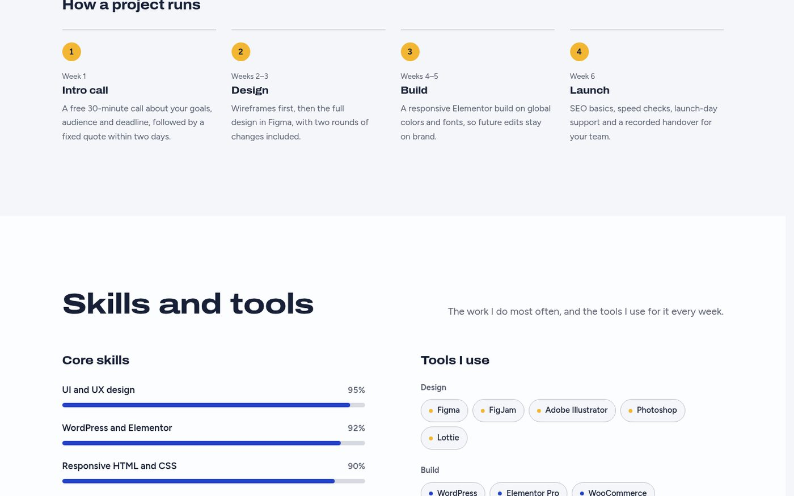
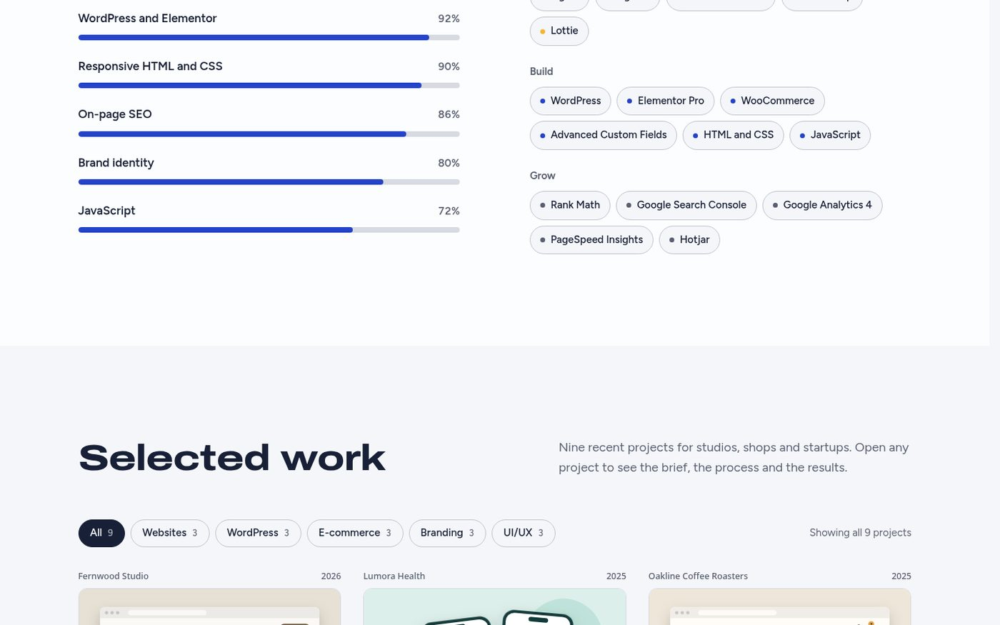
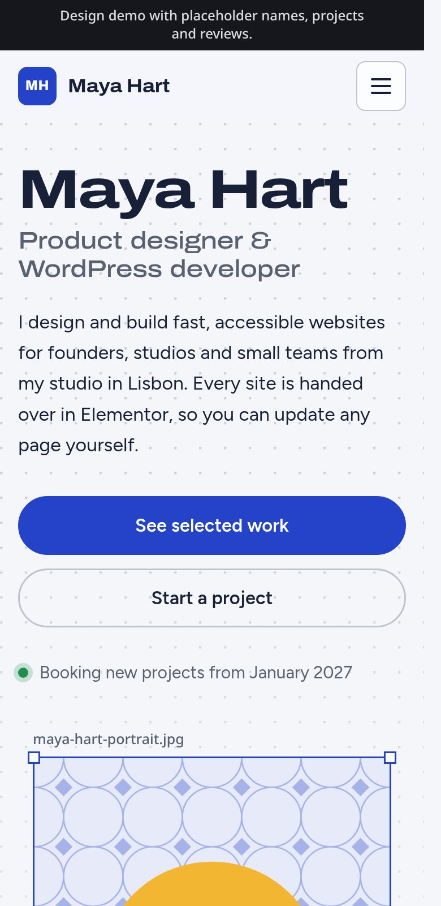

# Elementor One-Page Portfolio Demo

<h3 dir="rtl">بورتفوليو صفحة واحدة بـ Elementor</h3>

  

---

## 🌐 Overview · نظرة عامة

A fully responsive one-page personal portfolio landing page, designed to be rebuilt 1:1 in Elementor on WordPress with editable global colors and fonts.
- Sticky header with smooth-scroll navigation, active-section highlighting and a mobile hamburger menu
- Hero with name, title, intro, call-to-action buttons and photo
- About section and a "How a project runs" process timeline
- Skills section with animated skill bars and tool badges
- Selected Work grid with category filters and project detail modals
- Client reviews and a validated contact form with success state
- On-page SEO structure: single H1, semantic sections, meta tags, alt text, Open Graph
- Skills: WordPress, Elementor, HTML5, CSS3, JavaScript, responsive UI/UX design, on-page SEO.

> **بالعربي —** بورتفوليو شخصي من صفحة واحدة جاهز للتنفيذ على ووردبريس/Elementor، مع معرض أعمال ونموذج تواصل وتهيئة SEO.

## 🧰 Skills & Tools · المهارات والأدوات

<code>JavaScript</code> <code>Website Design</code> <code>CSS</code> <code>HTML5</code> <code>WordPress</code> <code>Elementor</code>

## 🖼️ Gallery · معرض الصور

<table>
<tr><td width="50%"></td><td width="50%"></td></tr>
<tr><td width="50%"></td><td width="50%"></td></tr>
</table>

## 🔗 Links · الروابط

| | |
|---|---|
| **View on Freelancer.com** | [Freelancer.com](https://www.freelancer.com/u/yyacoup) |
| **Category · التصنيف** | Websites & Landing Pages · المواقع وصفحات الهبوط |

<a href="../../README.md">⬅ Back to Portfolio · الرجوع للمعرض</a> &nbsp;•&nbsp; <a href="../../../README.md">🏠 Home · الرئيسية</a>

