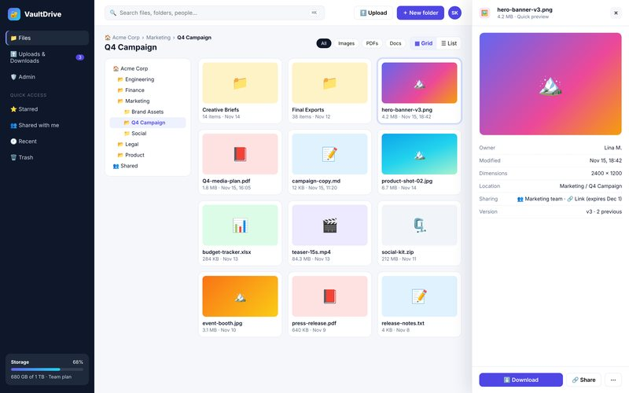
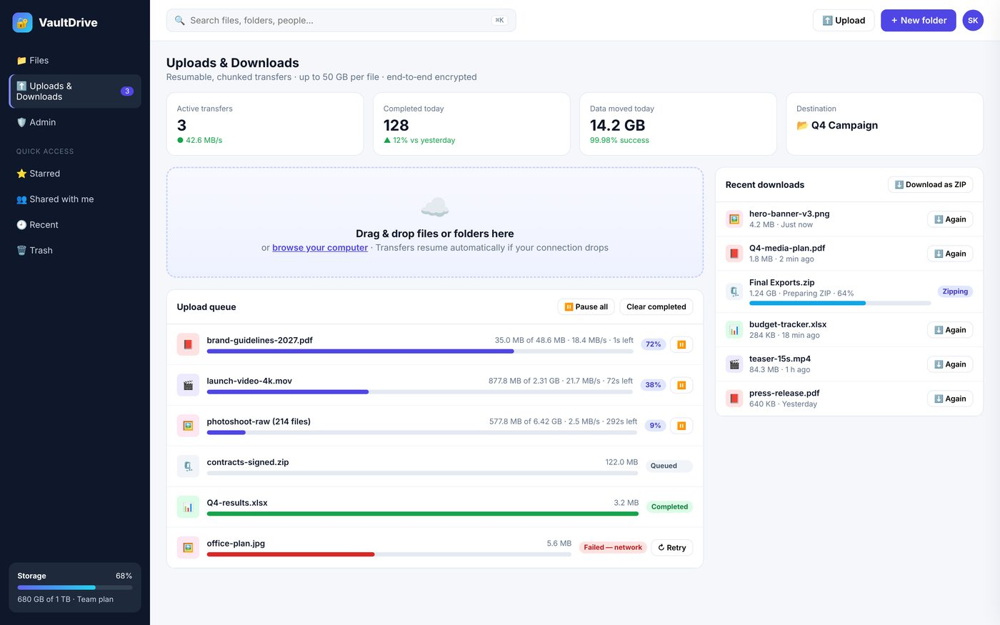
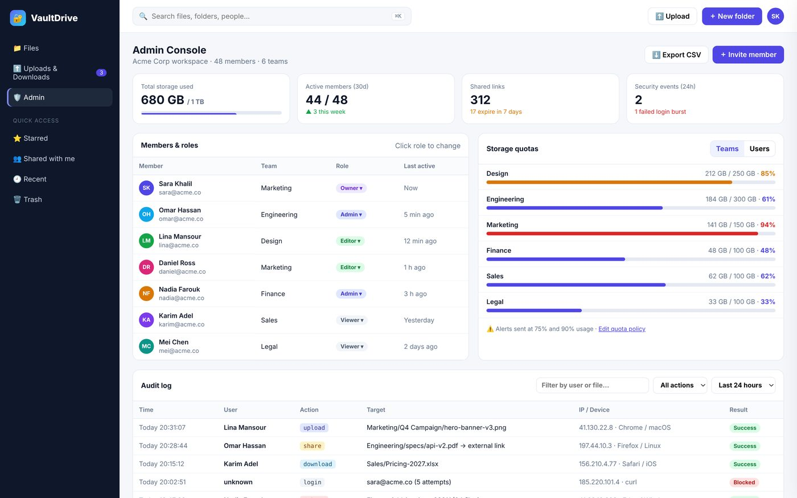
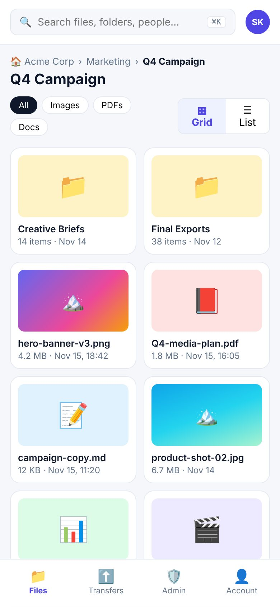

# File Service Dashboard UI Prototype

<h3 dir="rtl">لوحة تحكم لخدمة مشاركة الملفات</h3>

  

---

## 🌐 Overview · نظرة عامة

Interactive frontend prototype for a file-sharing service: drag-and-drop uploads with live progress, pause and retry; folder browser with instant search, grid/list views and a quick-preview drawer for images, PDFs and text; admin console with role management, storage quota bars and a filterable audit log. Fully responsive desktop and mobile layout.

> **بالعربي —** واجهة لخدمة مشاركة ملفات: رفع بالسحب والإفلات، مستعرض مجلدات، معاينة سريعة، وإدارة صلاحيات ومساحة.

## 🧰 Skills & Tools · المهارات والأدوات

<code>JavaScript</code> <code>CSS</code> <code>HTML</code> <code>UI / User Interface</code> <code>React.js</code> <code>Frontend Development</code> <code>Figma</code> <code>Tailwind CSS</code>

## 🖼️ Gallery · معرض الصور

<table>
<tr><td width="50%"></td><td width="50%"></td></tr>
<tr><td width="50%"></td><td width="50%"></td></tr>
</table>

## 🔗 Links · الروابط

| | |
|---|---|
| **View on Freelancer.com** | [Freelancer.com](https://www.freelancer.com/u/yyacoup) |
| **Category · التصنيف** | Websites & Landing Pages · المواقع وصفحات الهبوط |

<a href="../../README.md">⬅ Back to Portfolio · الرجوع للمعرض</a> &nbsp;•&nbsp; <a href="../../../README.md">🏠 Home · الرئيسية</a>

