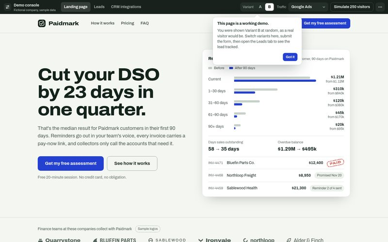
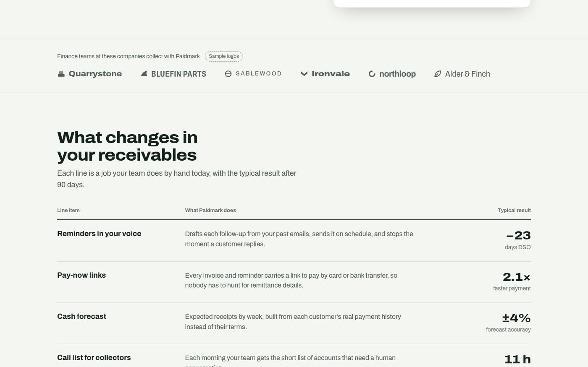
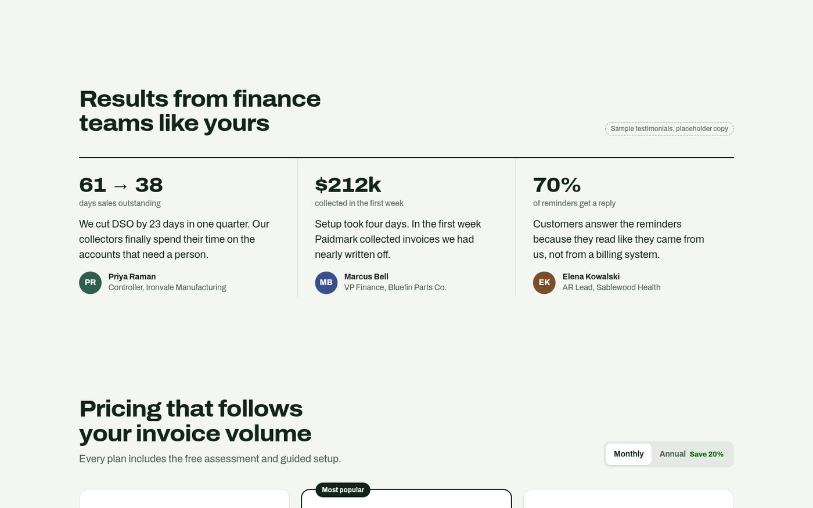
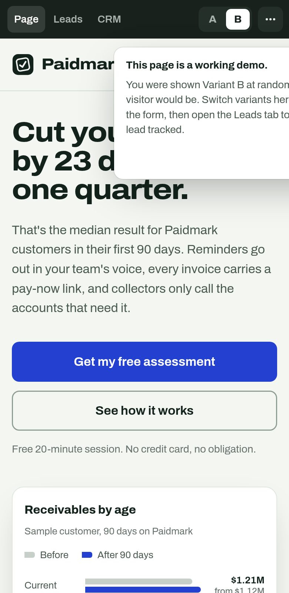
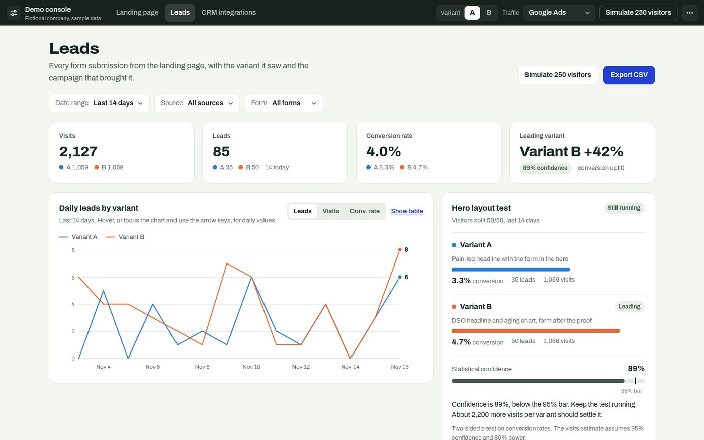

# Unbounce-Style Lead Gen Landing Page

<h3 dir="rtl">صفحة هبوط لجمع العملاء المحتملين</h3>

  

---

## 🌐 Overview · نظرة عامة

Working interactive demo of a high-converting, Unbounce-style lead generation landing page for a B2B SaaS offer.
- Hero with strong headline and CTA, benefits, social proof, testimonials, pricing, FAQ accordion, sticky CTA
- Lead capture form with inline validation, thank-you state and popup/sticky bar variant
- A/B variant toggle (Variant A / B) for testing headlines and layouts
- Leads dashboard: timestamps, variant, UTM source/campaign, CSV export, conversion stats per variant and chart
- Mock CRM integration panel (HubSpot / Mailchimp webhooks) with per-lead sync status
- Fully responsive for mobile and desktop
- Skills: landing page design, conversion optimization, HTML5, CSS3, JavaScript, responsive UI/UX.

> **بالعربي —** صفحة هبوط عالية التحويل لخدمة SaaS مع نموذج تسجيل، واختبار A/B، ولوحة لمتابعة العملاء المحتملين وربط CRM.

## 🧰 Skills & Tools · المهارات والأدوات

<code>JavaScript</code> <code>Website Design</code> <code>CSS</code> <code>HTML5</code> <code>Landing Pages</code> <code>Unbounce</code>

## 🖼️ Gallery · معرض الصور

<table>
<tr><td width="50%"></td><td width="50%"></td></tr>
<tr><td width="50%"></td><td width="50%"></td></tr>
<tr><td width="50%"></td><td width="50%"></td></tr>
</table>

## 🔗 Links · الروابط

| | |
|---|---|
| **View on Freelancer.com** | [Freelancer.com](https://www.freelancer.com/u/yyacoup) |
| **Category · التصنيف** | Websites & Landing Pages · المواقع وصفحات الهبوط |

<a href="../../README.md">⬅ Back to Portfolio · الرجوع للمعرض</a> &nbsp;•&nbsp; <a href="../../../README.md">🏠 Home · الرئيسية</a>

