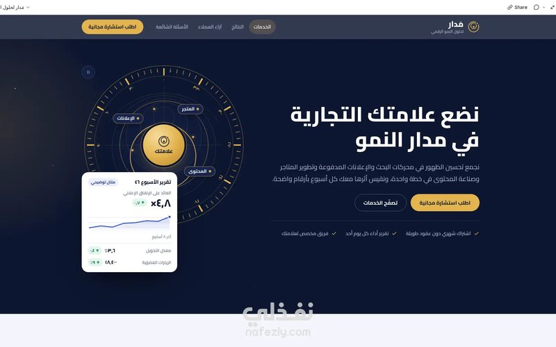
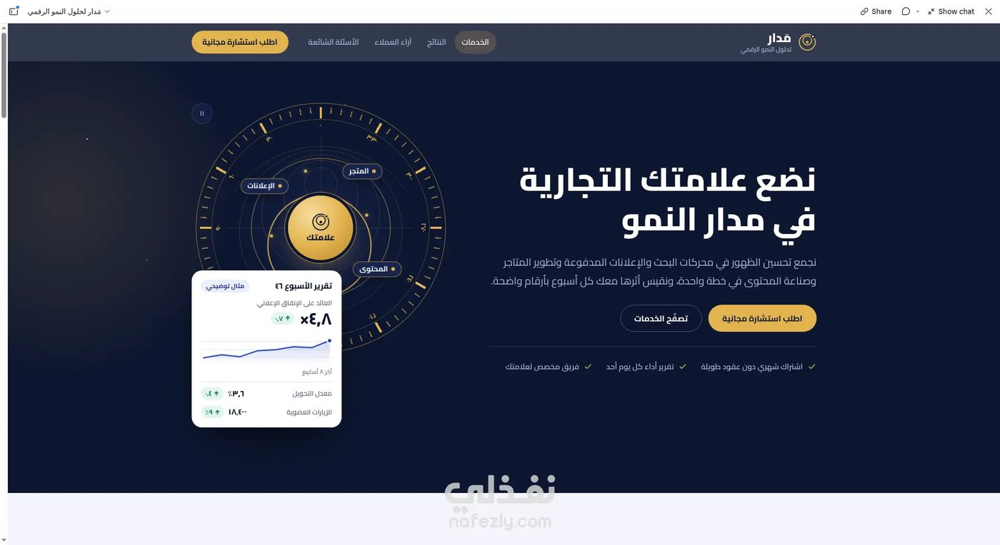
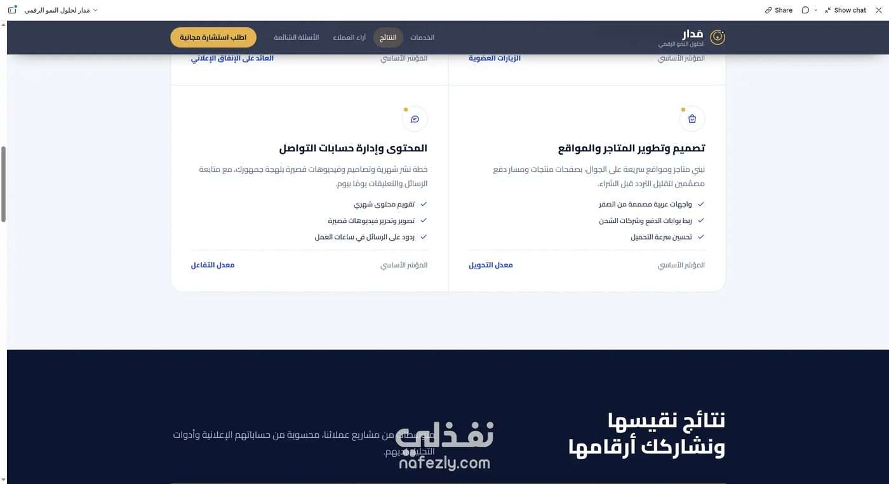
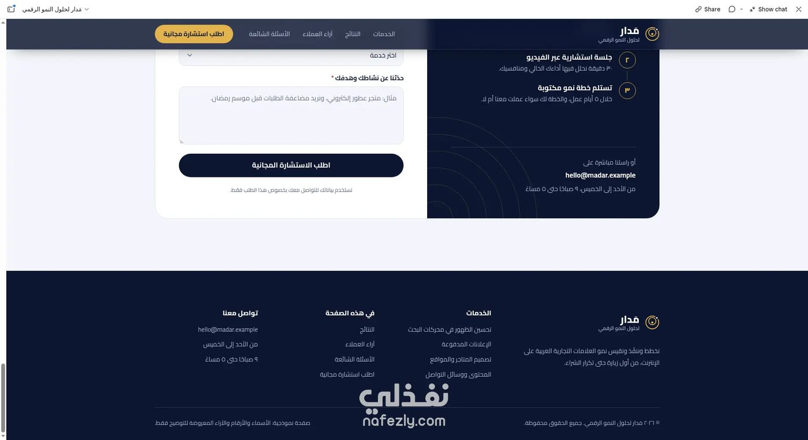

# "Madar" Arabic RTL Landing Page

<h3 dir="rtl">صفحة هبوط إعلانية احترافية «مَدار» – HTML وCSS متجاوبة بالعربية</h3>

  

 

---

## 🌐 Overview · نظرة عامة

> **EN —** Single-file Arabic RTL landing page in pure HTML/CSS/JS: responsive nav, hero, services, stats, testimonials, FAQ and contact form.

صفحة ويب إعلانية (Landing Page) احترافية باللغة العربية واتجاه RTL، مبنية بملف HTML واحد مستقل باستخدام HTML5 وCSS3 وقليل من JavaScript دون أي مكتبات خارجية. تتضمن: شريط تنقل متجاوب مع قائمة للجوال، قسم رئيسي (Hero) بعنوان جذاب وزرَّي دعوة لاتخاذ إجراء، بطاقات خدمات، قسم أرقام وإنجازات، آراء العملاء، أسئلة شائعة قابلة للطي، نموذج تواصل، وتذييل. تصميم عصري متناسق الألوان، سريع التحميل ومتوافق مع جميع الشاشات ومراعٍ لإمكانية الوصول.

## 🧰 Skills & Tools · المهارات والأدوات

<code>HTML</code> <code>CSS</code> <code>جافاسكربت</code> <code>تصميم صفحات الهبوط</code>

## 🖼️ Gallery · معرض الصور

<table>
<tr><td width="50%"></td><td width="50%"></td></tr>
<tr><td width="50%"></td><td width="50%"></td></tr>
</table>

## 🔗 Links · الروابط

| | |
|---|---|
| **View on Nafezly** | [Nafezly · نفذلي](https://nafezly.com/portfolio/268779-%D8%B5%D9%81%D8%AD%D8%A9-%D9%87%D8%A8%D9%88%D8%B7-%D8%A5%D8%B9%D9%84%D8%A7%D9%86%D9%8A%D8%A9-%D8%A7%D8%AD%D8%AA%D8%B1%D8%A7%D9%81%D9%8A%D8%A9-%C2%AB%D9%85%D9%8E%D8%AF%D8%A7%D8%B1%C2%BB-%E2%80%93-HTML-%D9%88CSS-%D9%85%D8%AA%D8%AC%D8%A7%D9%88%D8%A8%D8%A9-%D8%A8%D8%A7%D9%84%D8%B9%D8%B1%D8%A8%D9%8A%D8%A9) |
| **Live Demo · نسخة تجريبية** | [Open demo](https://claude.ai/artifact/VypasF3C4YrKCxJqzDq9fR) |
| **Category · التصنيف** | Websites & Landing Pages · المواقع وصفحات الهبوط |

<a href="../../README.md">⬅ Back to Portfolio · الرجوع للمعرض</a> &nbsp;•&nbsp; <a href="../../../README.md">🏠 Home · الرئيسية</a>

