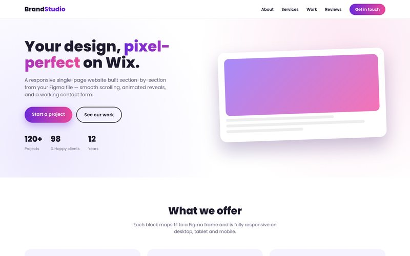
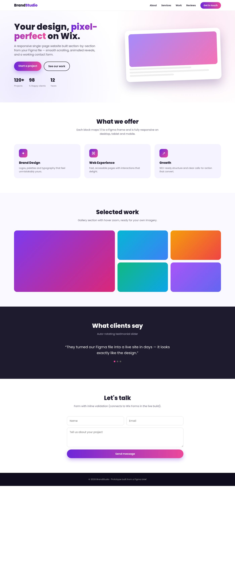
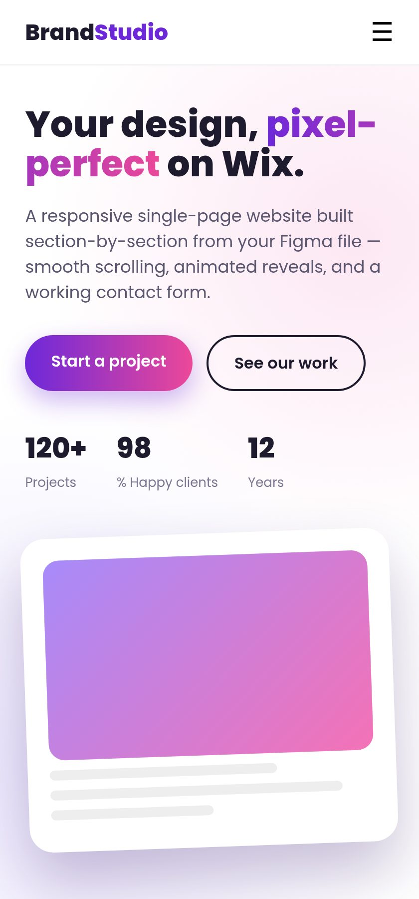

# Responsive Single-Page Website Design

<h3 dir="rtl">تصميم موقع صفحة واحدة متجاوب</h3>

  

---

## 🌐 Overview · نظرة عامة

Responsive single-page website prototype built section by section from a Figma-style design: sticky navigation with mobile menu, hero with animated stats, services cards, gallery, auto-rotating testimonial slider, scroll-reveal animations and a validated contact form. Optimised for desktop, tablet and mobile.

> **بالعربي —** موقع صفحة واحدة متجاوب مبني من تصميم Figma مع إحصائيات متحركة ومعرض وآراء عملاء ونموذج تواصل.

## 🧰 Skills & Tools · المهارات والأدوات

<code>Website Design</code> <code>HTML</code> <code>Web Design</code> <code>UI / User Interface</code> <code>Figma</code>

## 🖼️ Gallery · معرض الصور

<table>
<tr><td width="50%"></td><td width="50%"></td></tr>
<tr><td width="50%"></td><td width="50%"></td></tr>
</table>

## 🔗 Links · الروابط

| | |
|---|---|
| **View on Freelancer.com** | [Freelancer.com](https://www.freelancer.com/u/yyacoup) |
| **Category · التصنيف** | Websites & Landing Pages · المواقع وصفحات الهبوط |

<a href="../../README.md">⬅ Back to Portfolio · الرجوع للمعرض</a> &nbsp;•&nbsp; <a href="../../../README.md">🏠 Home · الرئيسية</a>

