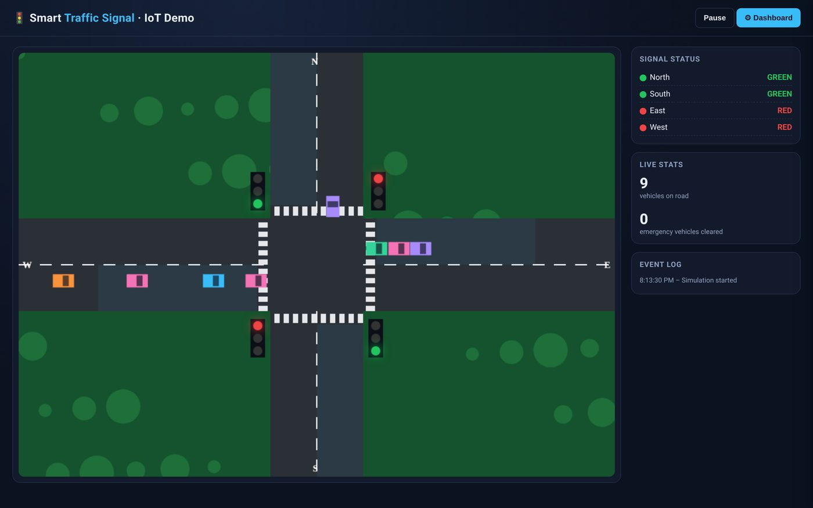
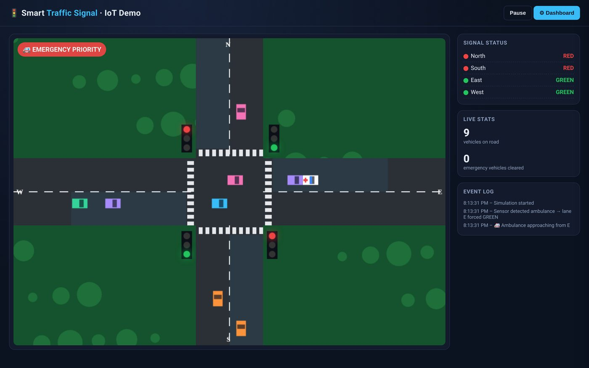
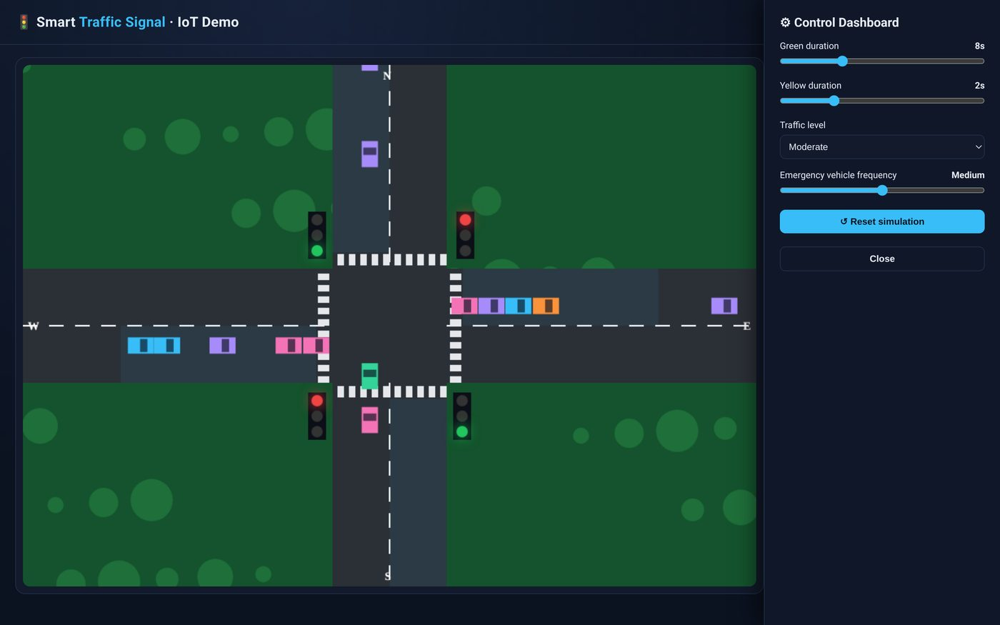
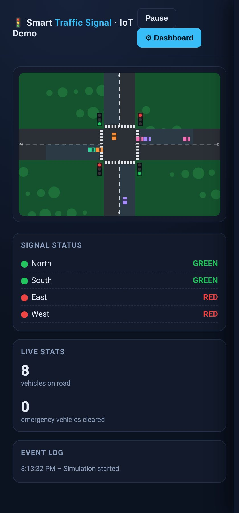

# Smart Traffic Signal Simulation Demo

<h3 dir="rtl">محاكاة إشارة مرور ذكية</h3>

  

---

## 🌐 Overview · نظرة عامة

Interactive smart traffic signal simulation built with plain HTML, CSS and vanilla JavaScript: a four-way intersection with automatic red/yellow/green cycling, animated traffic from light to heavy flow, sensor-based emergency vehicle detection that automatically gives the ambulance's lane right of way, and a slide-in dashboard to tune cycle durations and reset. Fully responsive on desktop and mobile.

> **بالعربي —** محاكاة تفاعلية لتقاطع مروري بإشارات ذكية تكتشف سيارات الإسعاف وتعطيها الأولوية، مبنية بـ JavaScript فقط.

## 🧰 Skills & Tools · المهارات والأدوات

<code>JavaScript</code> <code>CSS</code> <code>Web Development</code> <code>HTML</code> <code>Frontend Development</code> <code>Animation</code>

## 🖼️ Gallery · معرض الصور

<table>
<tr><td width="50%"></td><td width="50%"></td></tr>
<tr><td width="50%"></td><td width="50%"></td></tr>
</table>

## 🔗 Links · الروابط

| | |
|---|---|
| **View on Freelancer.com** | [Freelancer.com](https://www.freelancer.com/u/yyacoup) |
| **Category · التصنيف** | Websites & Landing Pages · المواقع وصفحات الهبوط |

<a href="../../README.md">⬅ Back to Portfolio · الرجوع للمعرض</a> &nbsp;•&nbsp; <a href="../../../README.md">🏠 Home · الرئيسية</a>

