

# Freelancer.com — Profile & Portfolio

- **Profile URL**: <https://www.freelancer.com/u/yyacoup>
- **Name / Handle**: Youssef (`@YYacoup`)
- **Headline**: AI & Backend Developer | Python, .NET, Azure
- **Hourly Rate**: `$10 USD / Hour`
- **Location**: Egypt
- **Member Since**: July 10, 2024
- **Verifications**: Payment, Phone, Email verified (Identity not verified as of 2026-11-18)
- **Stats (as of 2026-11-18)**: `0.0` rating (`0 reviews`), `$0.0` earned, `0%` completion
- **Note on Services**: Freelancer.com profile does not have a dedicated "Services" section; service offerings are presented through the hourly profile rate and bio below, alongside 16 portfolio items.

---

## About Me

> I build Python machine learning prototypes and .NET backends for clients who need to turn data or a workflow into a usable application. I can help you establish a baseline, connect it to a dashboard or API, and document how to run it.
>
> • Python and pandas for data cleaning, exploratory analysis, and model evaluation  
> • REST APIs and backend integrations with C#, ASP.NET, SQL, and Azure  
> • AI-assisted workflows with structured outputs and a human review step
>
> **Selected projects**  
> • **MedMonitor 24/7.** I contributed the .NET backend and Azure setup for a team hospital monitoring prototype that scored 100/100 as a graduation project. ([GitHub](https://github.com/Youssef123ya/MedMonitor-24-7))  
> • **InvoicePilot.** I built a React and TypeScript app that turns work notes into editable invoices and uses human review before creating invoices in PayPal Sandbox. ([GitHub](https://github.com/Youssef123ya/invoicepilot-paypal-ai) · [Devpost](https://devpost.com/software/invoicepilot-s9euh1))  
> • **Kaggle.** I earned bronze medals in AI Agent Security and Wellbore Geology Prediction. ([Kaggle](https://www.kaggle.com/youssefyacoup) · [GitHub](https://github.com/Youssef123ya/Kaggle-Competitions))
>
> I hold a bachelor's degree in Computer Science and completed the ALX Software Engineering backend track and the IBM Full Stack Software Developer Professional Certificate. Share your dataset, API requirements, or prototype brief so we can agree on the first deliverable and how to evaluate it.

---

## 🗂️ Portfolio on Freelancer.com · أعمالي على فريلانسر

<table>
<tr><td align="center" valign="top" width="33%"><a href="../portfolio/ecommerce/francesko-fashion-store/">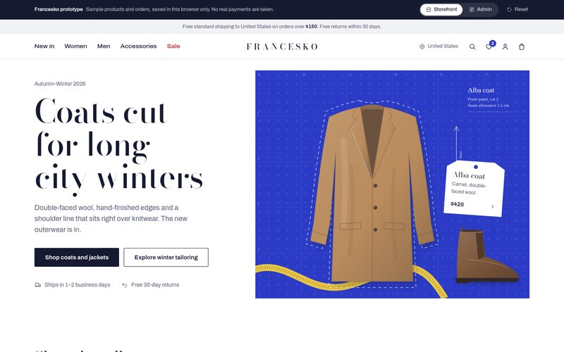</a> <b><a href="../portfolio/ecommerce/francesko-fashion-store/">Francesko Fashion Store + Admin Demo</a></b> متجر أزياء Francesko مع لوحة تحكم Freelancer.com</td><td align="center" valign="top" width="33%"><a href="../portfolio/web/lead-gen-landing-page/">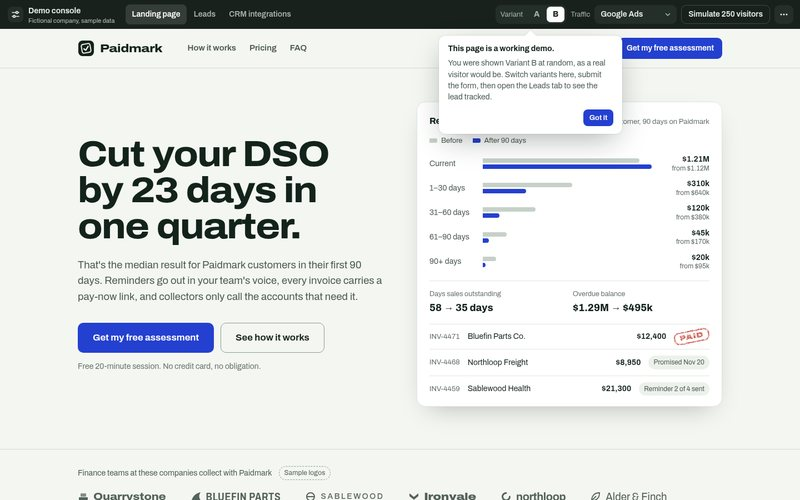</a> <b><a href="../portfolio/web/lead-gen-landing-page/">Unbounce-Style Lead Gen Landing Page</a></b> صفحة هبوط لجمع العملاء المحتملين Freelancer.com</td><td align="center" valign="top" width="33%"><a href="../portfolio/web/elementor-portfolio/">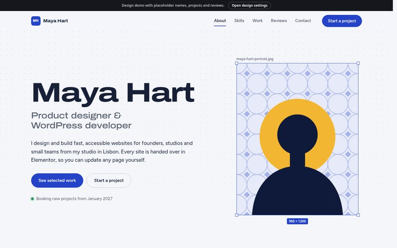</a> <b><a href="../portfolio/web/elementor-portfolio/">Elementor One-Page Portfolio Demo</a></b> بورتفوليو صفحة واحدة بـ Elementor Freelancer.com</td></tr>
<tr><td align="center" valign="top" width="33%"><a href="../portfolio/ai/ai-marketing-copy-assistant/">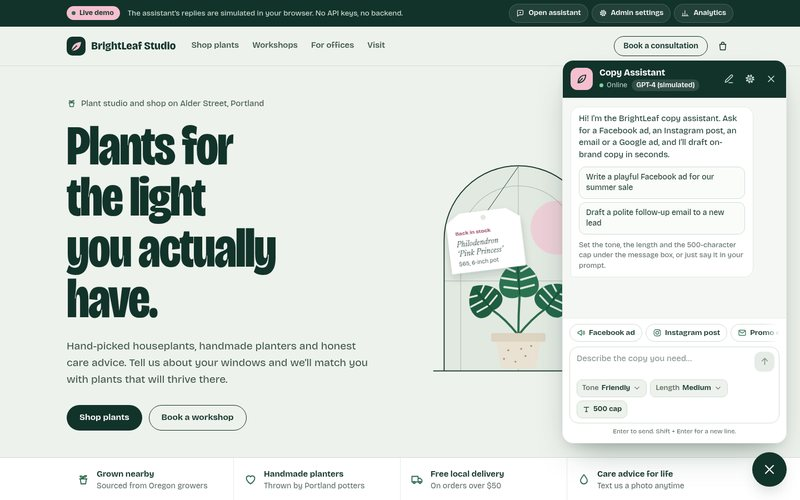</a> <b><a href="../portfolio/ai/ai-marketing-copy-assistant/">AI Chat Marketing Copy Assistant</a></b> مساعد ذكاء اصطناعي لكتابة النصوص التسويقية Freelancer.com</td><td align="center" valign="top" width="33%"><a href="../portfolio/ecommerce/digital-download-store/">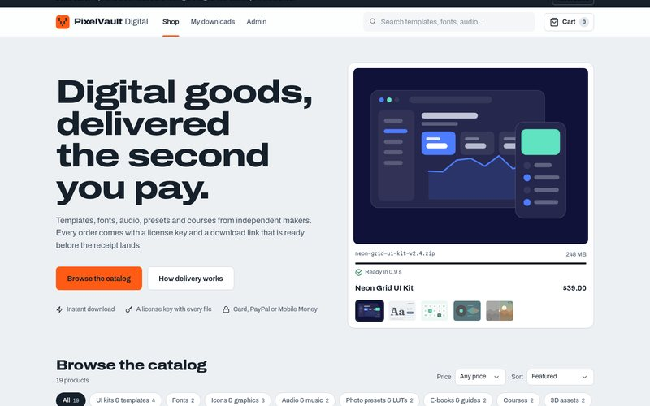</a> <b><a href="../portfolio/ecommerce/digital-download-store/">Digital Download Store Demo</a></b> متجر منتجات رقمية مع تحميل فوري Freelancer.com</td><td align="center" valign="top" width="33%"><a href="../portfolio/web/cleaning-company-website/">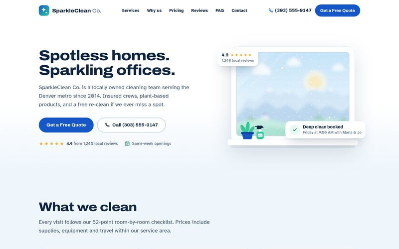</a> <b><a href="../portfolio/web/cleaning-company-website/">Cleaning Company One-Page Website</a></b> موقع صفحة واحدة لشركة تنظيف Freelancer.com</td></tr>
<tr><td align="center" valign="top" width="33%"><a href="../portfolio/web/wordpress-personal-brand/">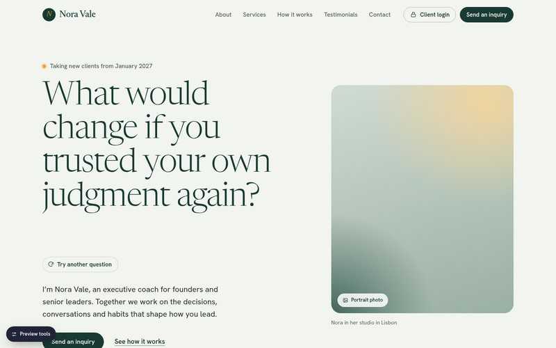</a> <b><a href="../portfolio/web/wordpress-personal-brand/">WordPress Personal Brand Site Demo</a></b> موقع علامة شخصية على ووردبريس Freelancer.com</td><td align="center" valign="top" width="33%"><a href="../portfolio/ai/opspilot-slack-automation/">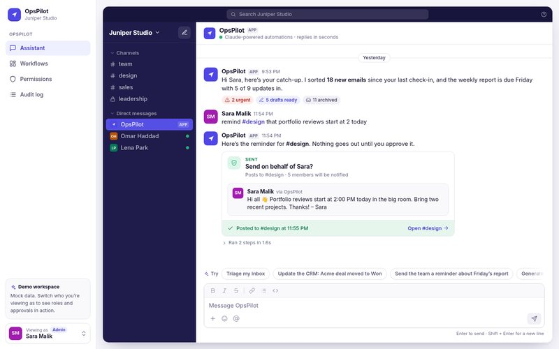</a> <b><a href="../portfolio/ai/opspilot-slack-automation/">OpsPilot – Slack Task Automation</a></b> OpsPilot لأتمتة المهام على Slack Freelancer.com</td><td align="center" valign="top" width="33%"><a href="../portfolio/backend/real-estate-erp-leads/">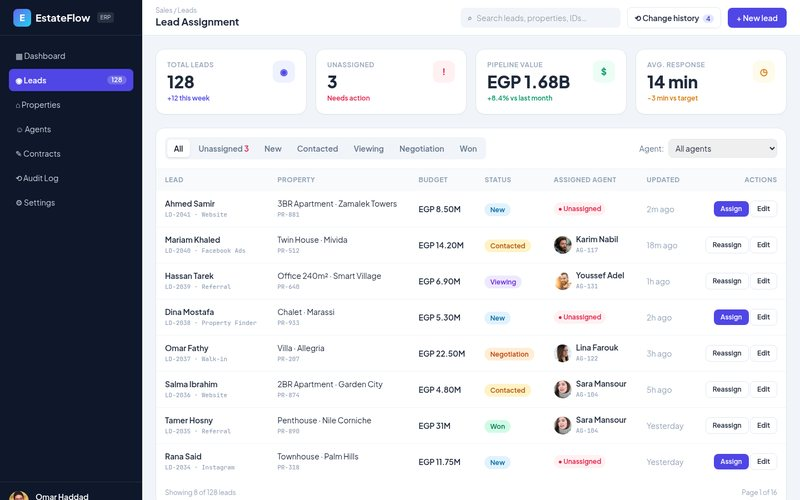</a> <b><a href="../portfolio/backend/real-estate-erp-leads/">Real Estate ERP Lead Assignment UI</a></b> واجهة توزيع العملاء لنظام ERP عقاري Freelancer.com</td></tr>
<tr><td align="center" valign="top" width="33%"><a href="../portfolio/web/file-service-dashboard/">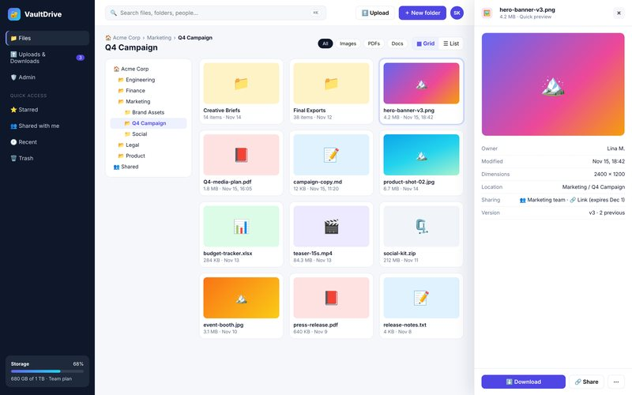</a> <b><a href="../portfolio/web/file-service-dashboard/">File Service Dashboard UI Prototype</a></b> لوحة تحكم لخدمة مشاركة الملفات Freelancer.com</td><td align="center" valign="top" width="33%"><a href="../portfolio/ai/ai-real-estate-cma/">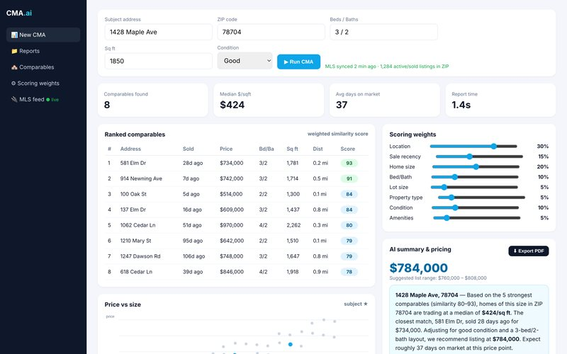</a> <b><a href="../portfolio/ai/ai-real-estate-cma/">AI Real Estate CMA Dashboard</a></b> لوحة تحليل السوق العقاري بالذكاء الاصطناعي Freelancer.com</td><td align="center" valign="top" width="33%"><a href="../portfolio/web/responsive-single-page/">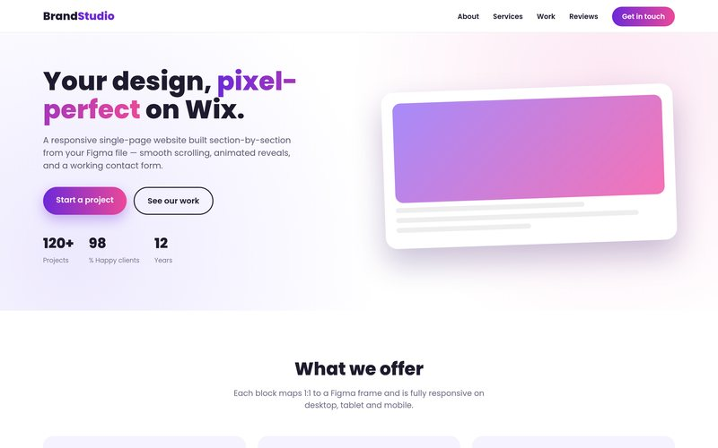</a> <b><a href="../portfolio/web/responsive-single-page/">Responsive Single-Page Website Design</a></b> تصميم موقع صفحة واحدة متجاوب Freelancer.com</td></tr>
<tr><td align="center" valign="top" width="33%"><a href="../portfolio/web/smart-traffic-signal/">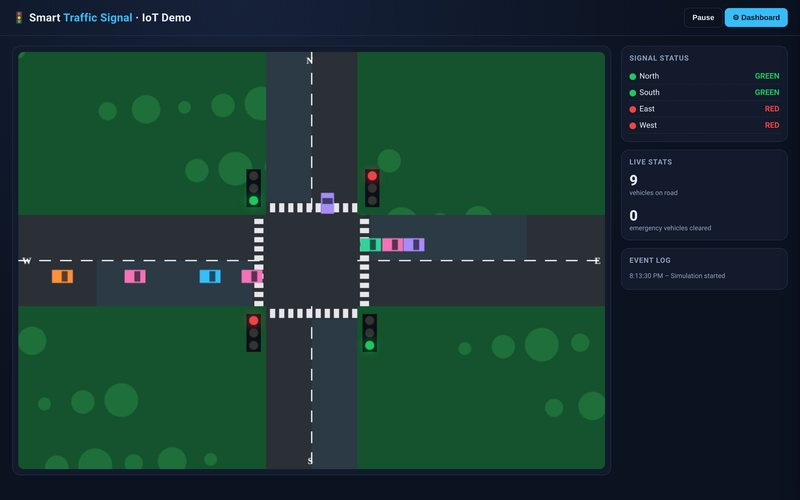</a> <b><a href="../portfolio/web/smart-traffic-signal/">Smart Traffic Signal Simulation Demo</a></b> محاكاة إشارة مرور ذكية Freelancer.com</td><td align="center" valign="top" width="33%"><a href="../portfolio/web/premium-business-website/">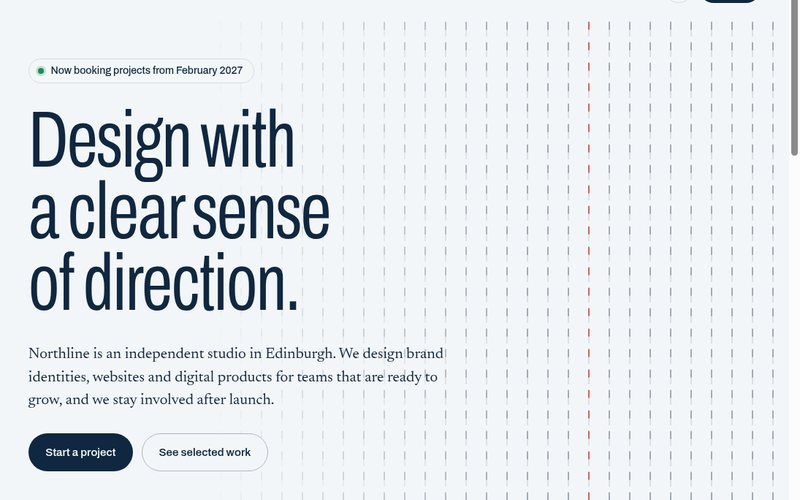</a> <b><a href="../portfolio/web/premium-business-website/">Premium Responsive Business Website</a></b> موقع أعمال احترافي متجاوب Freelancer.com</td><td align="center" valign="top" width="33%"><a href="../portfolio/web/lottery-results-website/">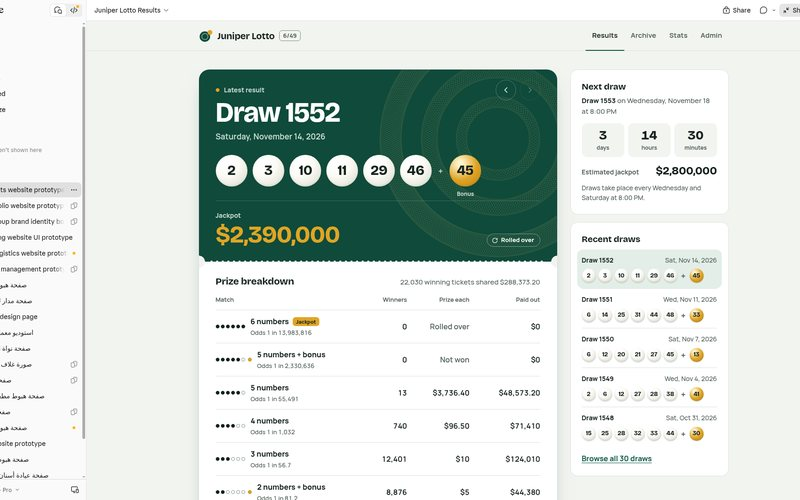</a> <b><a href="../portfolio/web/lottery-results-website/">Lottery Results Website – Interactive Prototype</a></b> موقع نتائج اليانصيب Freelancer.com</td></tr>
<tr><td align="center" valign="top" width="33%"><a href="../portfolio/ecommerce/shopify-booking-storefront/">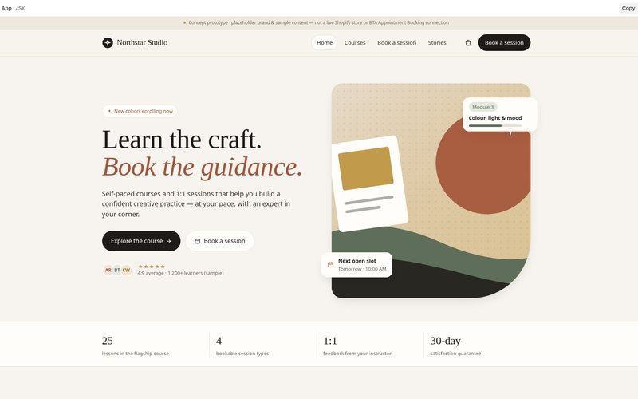</a> <b><a href="../portfolio/ecommerce/shopify-booking-storefront/">Shopify Storefront Booking Prototype</a></b> متجر Shopify مع نظام حجز Freelancer.com · ▶ Live demo</td><td width="33%"></td><td width="33%"></td></tr>
</table>

---

## Experience, Education & Qualifications

### Experience
1. **Machine Learning Engineer (Part-time)** — `Shipd (Datacurve)` *(Mar 2026 – Present)*  
   Work on machine learning engineering tasks through Shipd on a part-time basis.
2. **Freelance Backend Developer** — `ALX Ventures` *(Oct 2024 – Present)*  
   Provide freelance backend development support to startups sponsored by ALX through its Gig-at-a-Startup program.
3. **AI & Machine Learning Intern** — `Genius Technology Center (GTC)` *(Aug 2025 – Sep 2025)*  
   Completed a 60-hour machine learning training track. Prepared datasets, explored data, evaluated machine learning models, and covered introductory deep learning and model deployment.
4. **React Web Development Trainee** — `Information Technology Institute (ITI)` *(Sep 2024)*  
   Completed 60 hours of summer training in front-end development with HTML, CSS, JavaScript, and React.

### Education
- **Nahda University in Beni Suef** — Bachelor of Computer Science, Information Technology, Egypt *(2022 – 2026)*

### Qualifications (8)
1. **React Certificate of Training** — Information Technology Institute (ITI) *(2024)*
2. **ALX Ventures Gig-at-a-Startup Programme** — ALX Ventures *(2024)*
3. **PHP Certificate of Training** — Information Technology Institute (ITI) *(2025)*
4. **Cloud Technical Series: AI in Action Badge** — Google Cloud *(Issued Mar 19, 2026)*
5. **React Frontend Web Developer** — Digital Egypt Pioneers Initiative (DEPI) *(2025)*
6. **Machine Learning Track** — GTC *(2025)*
7. **Full Stack Software Developer Professional Certificate** — IBM Skills Network via Coursera *(2024)*
8. **Software Engineering, Backend Specialization** — ALX *(2024)*

<a href="README.md">⬅ Profiles</a> &nbsp;•&nbsp; <a href="../README.md">🏠 Home</a>

