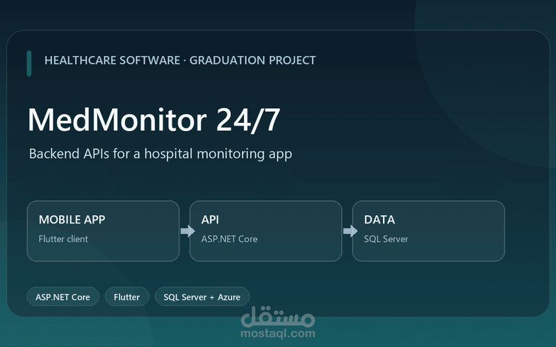
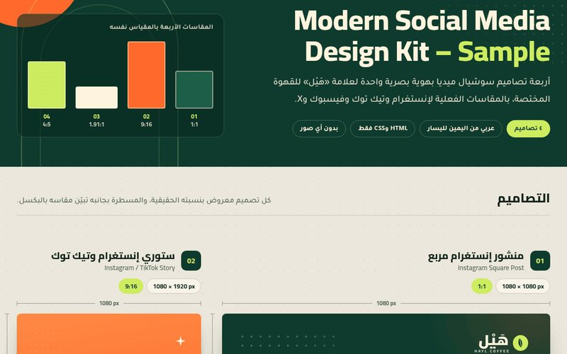

# Mostaql (مستقل) — Profile & Portfolio

- **Profile URL**: <https://mostaql.com/u/yyacoup>
- **Portfolio URL**: <https://mostaql.com/u/yyacoup/portfolio>
- **Display Name**: Youssef Y. (Youssef Yacoup)
- **Job Title**: مهندس برمجيات (Software Engineer)
- **Registered Since**: July 3, 2024 (03 يوليو 2024)
- **Verifications (`توثيقات`)**: Email (البريد الإلكتروني), National ID (`هوية موثقة`)
- **Badges (`أوسمة`)**: مستخدم منذ سنتين (2-year member)

---

## نبذة عني (Bio)

> أطوّر نماذج تعلّم الآلة باستخدام Python، وأبني واجهات برمجة تطبيقات REST باستخدام .NET وAzure. أساعدك على تحويل بياناتك أو فكرتك إلى نموذج أولي قابل للاختبار، ودمجه في تطبيق، وتوثيق خطوات تشغيله وتسليمه لفريقك.
>
> **من أعمالي**
> - **MedMonitor 24/7.** ساهمت في تطوير الواجهة الخلفية وإعداد Azure لنموذج مراقبة أسرّة المستشفى والعلامات الحيوية. حصل مشروع التخرج الجماعي على 100/100. ([GitHub](https://github.com/Youssef123ya/MedMonitor-24-7))
> - **InvoicePilot.** طوّرت نموذجًا يحوّل ملاحظات العمل إلى مسودة فاتورة باستخدام Gemini، ويتيح مراجعتها قبل إنشائها في بيئة PayPal التجريبية. ([GitHub](https://github.com/Youssef123ya/invoicepilot-paypal-ai))
> - **Kaggle.** حصلت على ميداليتين برونزيتين في تحدّي أمن وكلاء الذكاء الاصطناعي وتحدّي التنبؤ بجيولوجيا الآبار. ([Kaggle](https://www.kaggle.com/youssefyacoup))
>
> أحمل بكالوريوس علوم الحاسب من جامعة النهضة، وأكملت برنامج ALX لتطوير البرمجيات الخلفية، وشهادة IBM Full Stack Software Developer، وتدريبًا في تعلّم الآلة لدى GTC.
>
> أرسل تفاصيل مشروعك عبر مستقل لنحدد أول مخرج قابل للتسليم وكيفية تقييمه.

## 🧰 Skills · المهارات

<code>تعلم الآلة</code> <code>ASP.NET</code> <code>Microsoft Azure</code> <code>تطوير #C</code> <code>بايثون</code> <code>SQL</code> <code>React</code> <code>تحليل البيانات</code> <code>التعلم العميق</code> <code>الذكاء الاصطناعي</code>

---

## 🗂️ Portfolio on Mostaql · أعمالي على مستقل

<table>
<tr><td align="center" valign="top" width="33%"> <b><a href="../portfolio/ai/kaggle-ai-agent-security/">Kaggle Bronze – AI Agent Security</a></b> ميدالية برونزية على Kaggle – أمن وكلاء الذكاء الاصطناعي Nafezly · Upwork · Mostaql</td><td align="center" valign="top" width="33%"> <b><a href="../portfolio/ai/invoicepilot/">InvoicePilot – Smart Invoices for Freelancers</a></b> InvoicePilot – فواتير ذكية للمستقلين Nafezly · Upwork · Mostaql</td><td align="center" valign="top" width="33%"> <b><a href="../portfolio/backend/medmonitor-24-7/">MedMonitor 24/7 – Hospital Bed &amp; Vitals Monitoring</a></b> MedMonitor 24/7 — نظام لمراقبة أسرّة المستشفى Mostaql</td></tr>
<tr><td align="center" valign="top" width="33%"> <b><a href="../portfolio/design/hail-social-media-kit/">Modern Social Media Design Kit – Specialty Coffee (Hail)</a></b> Modern Social Media Design Kit – تصميمات سوشيال ميديا حديثة لعلامة قهوة مختصة Mostaql · ▶ Live demo</td><td width="33%"></td><td width="33%"></td></tr>
</table>

<a href="README.md">⬅ Profiles</a> &nbsp;•&nbsp; <a href="../README.md">🏠 Home</a>

