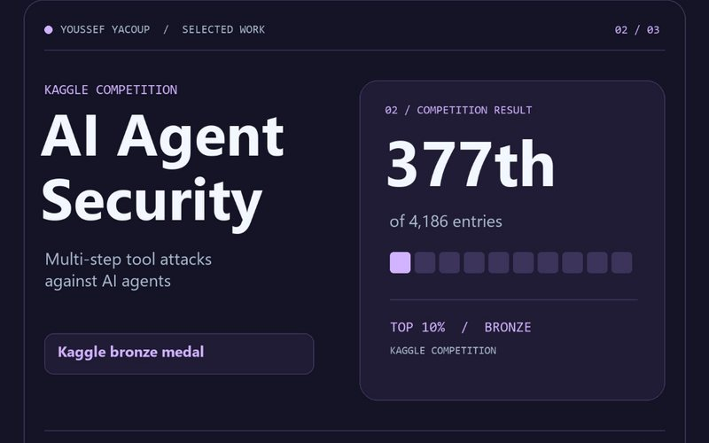
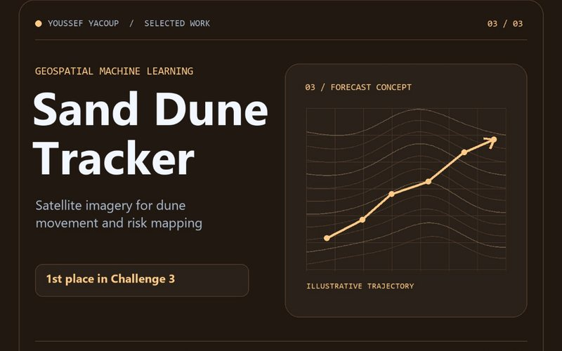

# Upwork — Profile & Portfolio

- **Profile URL**: <https://www.upwork.com/freelancers/~016f07b2d17f649923>
- **Display Name**: Youssef Y.
- **Headline**: AI & Backend Developer | Python, .NET, Azure
- **Hourly Rate**: `$20.00 / hr`
- **Location**: Cairo, Egypt
- **Availability**: More than 30 hrs/week · Open to contract to hire
- **Languages**: Arabic (`Native or Bilingual`), Saudi Arabian Sign Language (`Native or Bilingual`), English (`Conversational`), French (`Basic`)
- **Project Catalog**: `0` catalog projects currently listed (as of 2026-11-19)

---

## Overview

> I build Python machine learning prototypes and .NET backends that turn your data into predictions, dashboards, or usable APIs. I can help you establish a baseline, connect it to an application, and document how your team can run it.
>
> **What I can help you build**
> - Python notebooks for data preparation, model training, and evaluation
> - REST APIs and backend integrations in .NET, with Azure deployment support
> - Data dashboards and geospatial prototypes for exploring results and testing ideas
>
> **Selected work**
> - **MedMonitor 24/7**: I contributed the .NET backend and Azure cloud work for a team graduation project that scored 100/100. ([GitHub](https://github.com/Youssef123ya/MedMonitor-24-7))
> - **Kaggle**: I earned bronze medals in AI Agent Security and Wellbore Geology Prediction. ([Kaggle](https://www.kaggle.com/youssefyacoup) · [GitHub](https://github.com/Youssef123ya/Kaggle-Competitions))
> - **TechMind Challenge**: My team took first place in Challenge 3 with a prototype for forecasting sand dune movement from satellite imagery. ([GitHub](https://github.com/Youssef123ya/Challenge-3-Sand-Dune-Encroachment-Tracker))
>
> Send me your dataset, API requirements, or prototype brief here on Upwork. We can agree on the first deliverable and how you’ll evaluate it.

## 🧰 Skills · المهارات

<code>Python</code> <code>Machine Learning</code> <code>API Development</code> <code>.NET Framework</code> <code>Microsoft Azure</code> <code>C#</code> <code>RESTful API</code> <code>Data Science</code> <code>Data Analysis</code> <code>Generative AI</code> <code>SQL</code> <code>Git</code>

---

## 🗂️ Portfolio on Upwork · أعمالي على أب وورك

<table>
<tr><td align="center" valign="top" width="33%"> <b><a href="../portfolio/ai/kaggle-ai-agent-security/">Kaggle Bronze – AI Agent Security</a></b> ميدالية برونزية على Kaggle – أمن وكلاء الذكاء الاصطناعي Nafezly · Upwork</td><td align="center" valign="top" width="33%"> <b><a href="../portfolio/ai/invoicepilot/">InvoicePilot – Smart Invoices for Freelancers</a></b> InvoicePilot – فواتير ذكية للمستقلين Nafezly · Upwork</td><td align="center" valign="top" width="33%"> <b><a href="../portfolio/ai/sand-dune-encroachment-tracker/">Sand Dune Encroachment Tracker – Geospatial ML</a></b> متتبّع زحف الكثبان الرملية – تعلّم آلي جيومكاني Upwork</td></tr>
</table>

---

## 🎓 Education, Certifications & Other Experiences

### Education
1. **Nahda University** — Computer Science *(2022 – 2026)*
2. **Holberton School** *(2023 – 2024)*
3. **Institute of Management, Technology and Finance** — Marketing Management *(2024)*

### Certifications (7)
1. **Machine Learning Track — Certificate of Training** — Genius Technology Center (GTC) *(Sep 2025)* — 60 hours covering data preparation, exploratory analysis, model training, introductory deep learning, and deployment.
2. **PHP — Certificate of Training** — Information Technology Institute (ITI) *(Feb 2025)* — 60-hour winter training in PHP, MySQL, HTML, and CSS.
3. **ALX Ventures Gig-at-a-Startup Programme** — ALX Ventures *(Nov 2024)* — 30-hour startup backend project.
4. **ALX Software Engineering Programme — Back-end Specialization** — ALX Africa *(Oct 2024)* — 12-month backend specialization.
5. **React — Certificate of Training** — Information Technology Institute (ITI) *(Sep 2024)* — 60-hour summer training in React, HTML5, and CSS3.
6. **IBM Full Stack Software Developer** — IBM Skills Network / Coursera *(Jul 2024)* · [Verify Certificate](https://www.coursera.org/verify/professional-cert/86A8LFNLFG9B) — React, Node.js, Python, Django, SQL, Docker, Kubernetes, microservices, and full-stack capstone.
7. **Advanced Software Engineering Job Simulation** — Forage (Walmart Global Tech) *(Jul 2024)* — Advanced data structures, software architecture, relational database design, and data preparation.

### Other Experiences (5)
1. **Software Engineer** — Python, SQL, Network, C, HTML5, Git, Printf & Shell builds, JavaScript, Firewall, Webstack Debugging, Portfolio Project.
2. **Founder Academy** — Lean canvas, startup MVP & landing page, market research, financial sheets, budget & sales strategy, product plan, pitch deck.
3. **Virtual Assistant** — Google Workspace (Gmail, Drive, Calendar, Docs, Sheets, Slides, Forms), calendar & inbox management, communication, prioritization.
4. **Marketing and Social Media Manager** — NASA Space Apps Boumerdes *(Seasonal · Remote)*.
5. **Marketing and Social Media Manager** — Glopreneur *(Part-time · Remote)*.

<a href="README.md">⬅ Profiles</a> &nbsp;•&nbsp; <a href="../README.md">🏠 Home</a>

