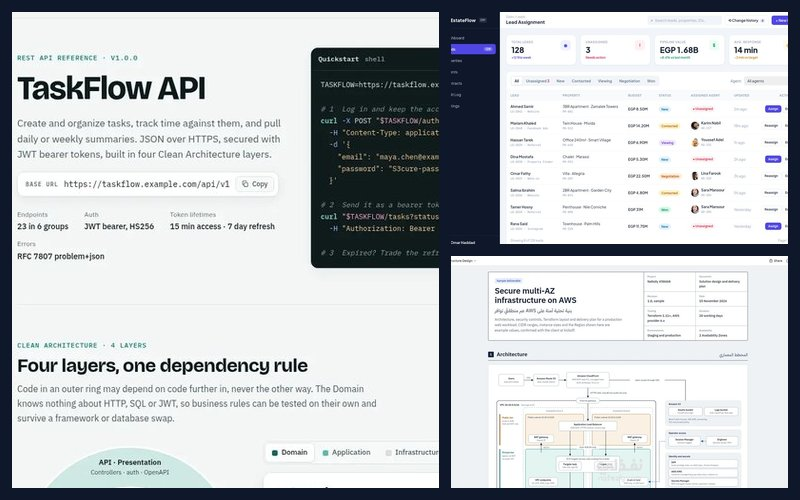
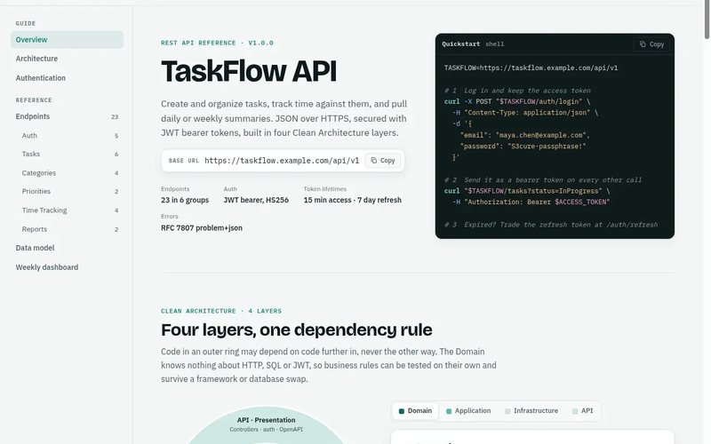
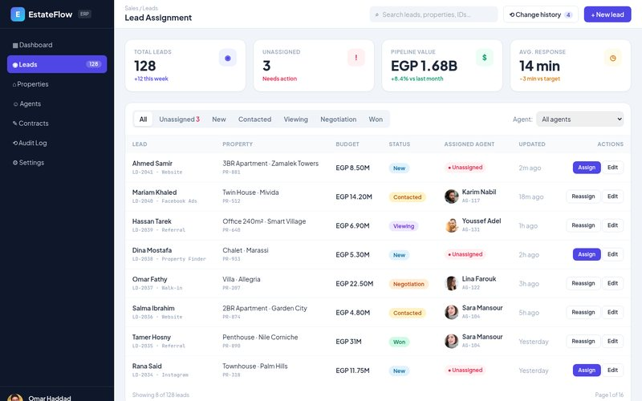
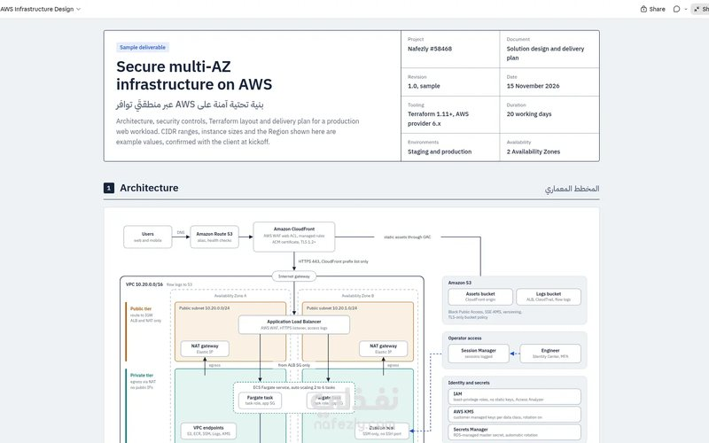

# Backend & REST API Development

<h3 dir="rtl">تطوير الباك إند وواجهات REST API</h3>

 

 

---

## 💡 About this service · عن الخدمة

Reliable backends and REST APIs that connect your app, database and third-party services — documented and ready to maintain.

أبني أنظمة Backend وواجهات REST API موثوقة تربط تطبيقك بقاعدة البيانات والخدمات الخارجية، مع توثيق واضح وكود سهل الصيانة.

## ✅ What you get · ماذا ستحصل عليه

| | English | العربية |
|:-:|---|---|
| ✔️ | API design & endpoint documentation | 
تصميم الـ API وتوثيق نقاط النهاية
 |
| ✔️ | Database schema & SQL queries | 
تصميم قاعدة البيانات واستعلامات SQL
 |
| ✔️ | Authentication (JWT) & role-based access | 
المصادقة (JWT) والصلاحيات حسب الأدوار
 |
| ✔️ | Integrations with payment / third-party APIs | 
الربط مع بوابات الدفع والخدمات الخارجية
 |
| ✔️ | Docker & cloud deployment (Azure / Google Cloud / AWS) | 
Docker والنشر على السحابة (Azure / Google Cloud / AWS)
 |
| ✔️ | Run instructions & handover docs | 
توثيق خطوات التشغيل والتسليم
 |

## 🧰 Tools · الأدوات

<code>C#</code> <code>ASP.NET Core</code> <code>.NET</code> <code>Python</code> <code>Node.js</code> <code>SQL</code> <code>Docker</code> <code>Azure</code> <code>Terraform</code>

## 🗂️ Related work · أعمال مرتبطة

<table>
<tr><td align="center" valign="top" width="33%"> <b><a href="../../portfolio/backend/taskflow-api/">TaskFlow API</a></b> TaskFlow API – واجهة برمجية لإدارة المهام Nafezly</td><td align="center" valign="top" width="33%"> <b><a href="../../portfolio/backend/real-estate-erp-leads/">Real Estate ERP Lead Assignment UI</a></b> واجهة توزيع العملاء لنظام ERP عقاري Freelancer.com</td><td align="center" valign="top" width="33%"> <b><a href="../../portfolio/backend/secure-aws-infrastructure/">Secure AWS Infrastructure Design</a></b> تصميم بنية تحتية آمنة على AWS Nafezly · ▶ Live demo</td></tr>
</table>

## 📩 Order / Contact · اطلب الخدمة

- **Freelancer.com** → https://www.freelancer.com/u/yyacoup
- **Nafezly · نفذلي** → https://nafezly.com/u/YoussefYacoup

<a href="../README.md">⬅ All services · كل الخدمات</a> &nbsp;•&nbsp; <a href="../../README.md">🏠 Home · الرئيسية</a>

