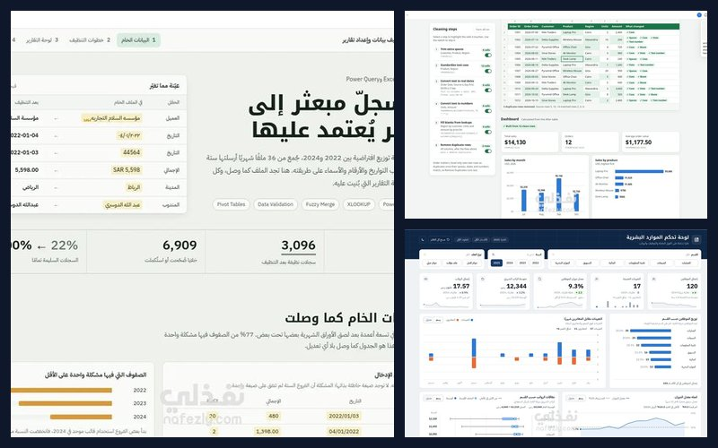
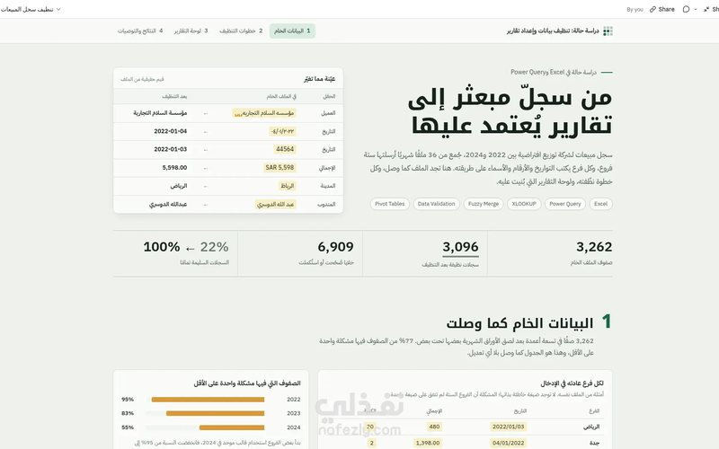
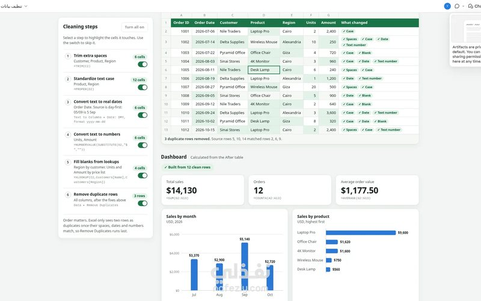
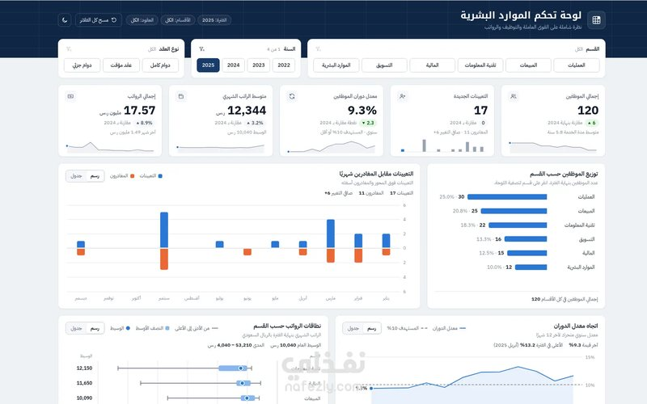

# Data Cleaning & Excel Dashboards

<h3 dir="rtl">تنظيف البيانات ولوحات تحكم Excel</h3>

 

 

---

## 💡 About this service · عن الخدمة

Messy spreadsheets turned into clean, trustworthy data and interactive dashboards your team can actually use.

أحوّل ملفات Excel العشوائية لبيانات نظيفة وموثوقة ولوحات تحكم تفاعلية يقدر فريقك يستخدمها.

## ✅ What you get · ماذا ستحصل عليه

| | English | العربية |
|:-:|---|---|
| ✔️ | Remove duplicates, fix formats & missing values | 
إزالة التكرار وتوحيد التنسيقات ومعالجة القيم الناقصة
 |
| ✔️ | Traceable Power Query cleaning steps | 
خطوات تنظيف قابلة للتتبع بـ Power Query
 |
| ✔️ | KPI dashboards with filters & charts | 
لوحات مؤشرات أداء بفلاتر ورسوم بيانية
 |
| ✔️ | Arabic-ready reports | 
تقارير تدعم اللغة العربية
 |

## 🧰 Tools · الأدوات

<code>Microsoft Excel</code> <code>Power Query</code> <code>Data Analysis</code> <code>HTML</code>

## 🗂️ Related work · أعمال مرتبطة

<table>
<tr><td align="center" valign="top" width="33%"> <b><a href="../../portfolio/data/sales-history-cleaning/">Historical Sales Cleanup &amp; Excel Reporting</a></b> تنظيف سجل المبيعات التاريخي وإعداد لوحة تقارير Excel Nafezly · ▶ Live demo</td><td align="center" valign="top" width="33%"> <b><a href="../../portfolio/data/excel-sales-cleanup/">Excel Sales Data Cleanup with Summary Dashboard</a></b> تنظيف وتنسيق بيانات مبيعات Excel مع لوحة ملخص Nafezly · ▶ Live demo</td><td align="center" valign="top" width="33%"> <b><a href="../../portfolio/data/hr-analytics-dashboard/">HR Analytics Interactive Dashboard</a></b> لوحة تحكم الموارد البشرية – داشبورد تفاعلي لتحليل بيانات الموظفين Nafezly · ▶ Live demo</td></tr>
</table>

## 📩 Order / Contact · اطلب الخدمة

- **Nafezly · نفذلي** → https://nafezly.com/u/YoussefYacoup
- **Freelancer.com** → https://www.freelancer.com/u/yyacoup

<a href="../README.md">⬅ All services · كل الخدمات</a> &nbsp;•&nbsp; <a href="../../README.md">🏠 Home · الرئيسية</a>

