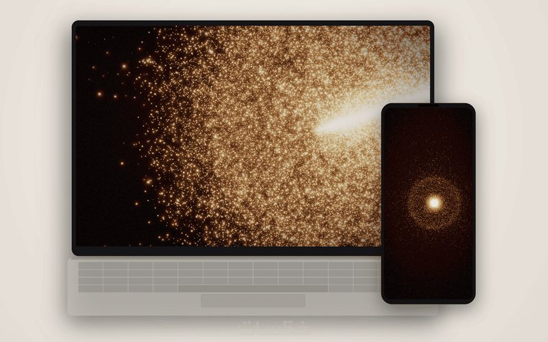
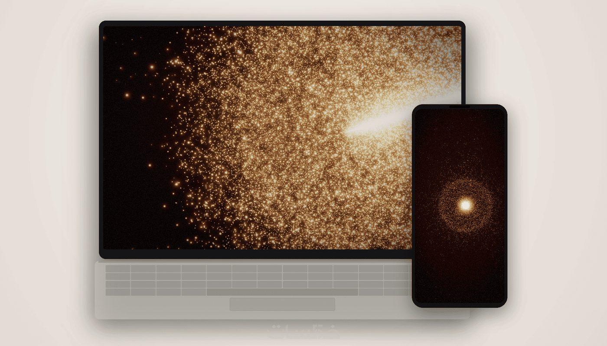
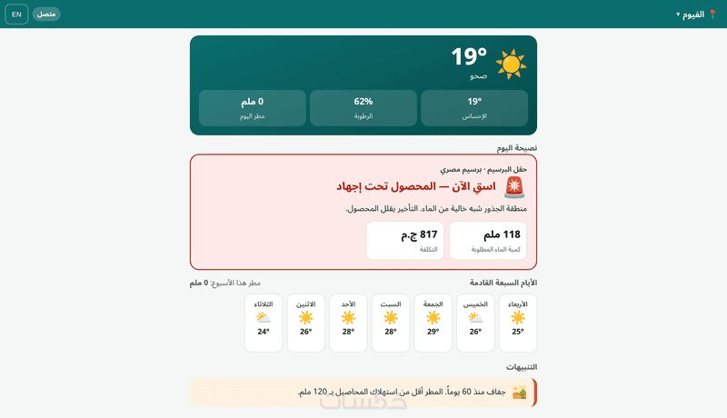
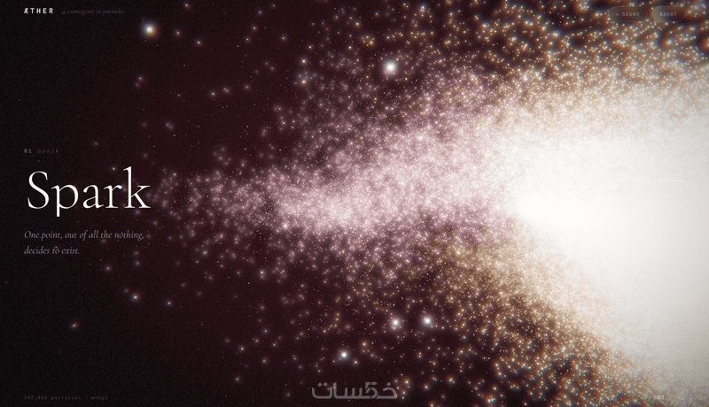
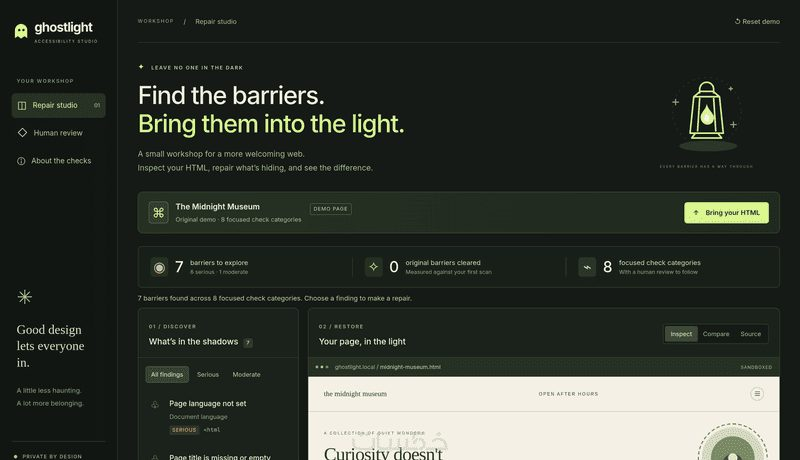
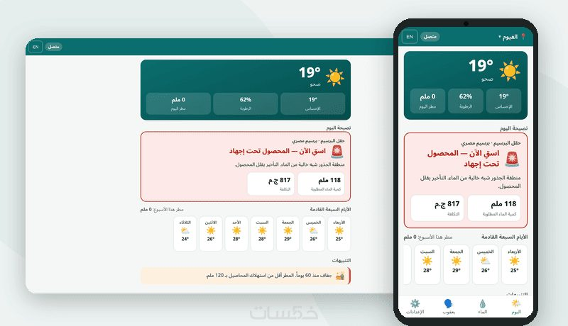
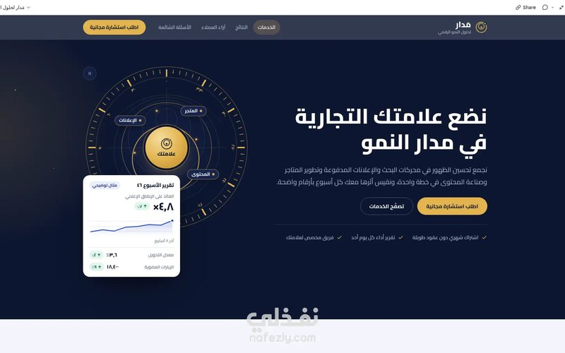
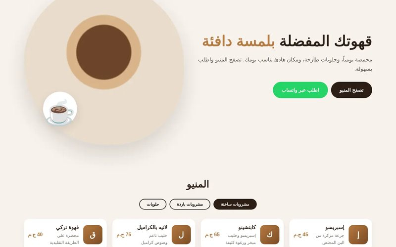
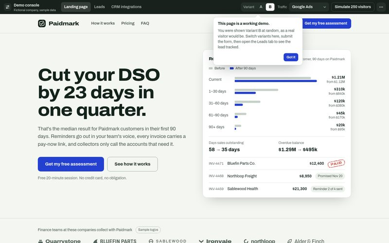
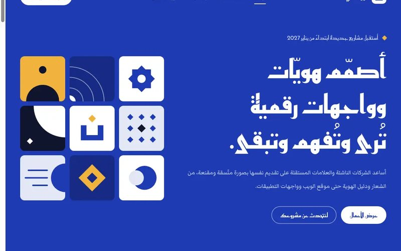

# Responsive Landing Page Design & Development

<h3 dir="rtl">سأصمم لك صفحة هبوط Landing Page متجاوبة واحترافية</h3>

  

---

## 💡 About this service · عن الخدمة

A modern, fast landing page that presents your product or service clearly and turns visitors into customers.

أصمم صفحات هبوط حديثة وسريعة تعرض منتجك أو خدمتك بشكل واضح وتساعد على تحويل الزوار إلى عملاء.

## ✅ What you get · ماذا ستحصل عليه

| | English | العربية |
|:-:|---|---|
| ✔️ | One complete landing page, up to 5 sections | 
صفحة هبوط كاملة حتى 5 أقسام (الرئيسية، المميزات، الخدمات، آراء العملاء، التواصل)
 |
| ✔️ | Fully responsive on mobile, tablet & desktop | 
تصميم متجاوب على الجوال والتابلت والكمبيوتر
 |
| ✔️ | Clean, organized HTML, CSS & JavaScript | 
كود نظيف ومنظم بـ HTML وCSS وJavaScript سهل التعديل
 |
| ✔️ | Fast loading & cross-browser compatible | 
سرعة تحميل عالية وتوافق مع كل المتصفحات الحديثة
 |
| ✔️ | CTA buttons, WhatsApp & social links | 
أزرار دعوة لاتخاذ إجراء وروابط واتساب ووسائل التواصل
 |
| ✔️ | Free revisions within scope | 
تعديلات مجانية حتى رضاك ضمن نطاق الخدمة
 |

## 🛠️ How we work · مراحل العمل

| Step | English | العربية |
|:-:|---|---|
| **1** | Understand the idea, audience & content | 
فهم فكرة المشروع والجمهور المستهدف والمحتوى
 |
| **2** | Design the UI and get your approval | 
تصميم الواجهة وعرضها عليك للموافقة
 |
| **3** | Build & test on all screen sizes | 
برمجة الصفحة وتجربتها على كل الشاشات
 |
| **4** | Deliver all files + a short upload guide | 
تسليم الملفات كاملة مع شرح مختصر لطريقة رفعها
 |

## ➕ Optional upgrades · تطويرات اختيارية

| Upgrade · التطوير | Price · السعر | Time · المدة |
|---|:-:|:-:|
| 
إضافة قسمين إضافيين للصفحة
 | **$5** | +1 day |
| 
إضافة نموذج تواصل يرسل الرسائل إلى بريدك
 | **$5** | +1 day |
| 
رفع الصفحة ونشرها على استضافة مجانية (Netlify أو GitHub Pages)
 | **$5** | +1 day |
| 
تسليم سريع خلال يوم واحد
 | **$10** | Delivered in 1 day |

## 🧰 Tools · الأدوات

<code>Figma</code> <code>HTML5</code> <code>CSS3</code> <code>JavaScript</code> <code>Tailwind CSS</code>

## 🖼️ Service gallery · صور الخدمة

<table>
<tr><td width="50%"></td><td width="50%"></td></tr>
<tr><td width="50%"></td><td width="50%"></td></tr>
<tr><td width="50%"></td><td width="50%"></td></tr>
</table>

## 🗂️ Related work · أعمال مرتبطة

<table>
<tr><td align="center" valign="top" width="50%"> <b><a href="../../portfolio/web/madar-landing-page/">"Madar" Arabic RTL Landing Page</a></b> صفحة هبوط إعلانية احترافية «مَدار» – HTML وCSS متجاوبة بالعربية Nafezly · ▶ Live demo</td><td align="center" valign="top" width="50%"> <b><a href="../../portfolio/web/cafe-landing-page/">Café Landing Page with Digital Menu</a></b> تصميم صفحة هبوط لكافيه مع عرض المنيو Nafezly</td></tr>
<tr><td align="center" valign="top" width="50%"> <b><a href="../../portfolio/web/lead-gen-landing-page/">Unbounce-Style Lead Gen Landing Page</a></b> صفحة هبوط لجمع العملاء المحتملين Freelancer.com</td><td align="center" valign="top" width="50%"> <b><a href="../../portfolio/web/arabic-portfolio-website/">Arabic Personal Portfolio Website</a></b> موقع بورتفوليو شخصي احترافي باللغة العربية – نموذج تفاعلي Nafezly · ▶ Live demo</td></tr>
</table>

## 📩 Order / Contact · اطلب الخدمة

- **Khamsat · خمسات** → https://khamsat.com/programming/custom-website-development/4505135-%D8%B3%D8%A3%D8%B5%D9%85%D9%85-%D9%84%D9%83-%D8%B5%D9%81%D8%AD%D8%A9-%D9%87%D8%A8%D9%88%D8%B7-landing-page-%D9%85%D8%AA%D8%AC%D8%A7%D9%88%D8%A8%D8%A9-%D9%88%D8%A7%D8%AD%D8%AA%D8%B1%D8%A7%D9%81%D9%8A%D8%A9

<a href="../README.md">⬅ All services · كل الخدمات</a> &nbsp;•&nbsp; <a href="../../README.md">🏠 Home · الرئيسية</a>

