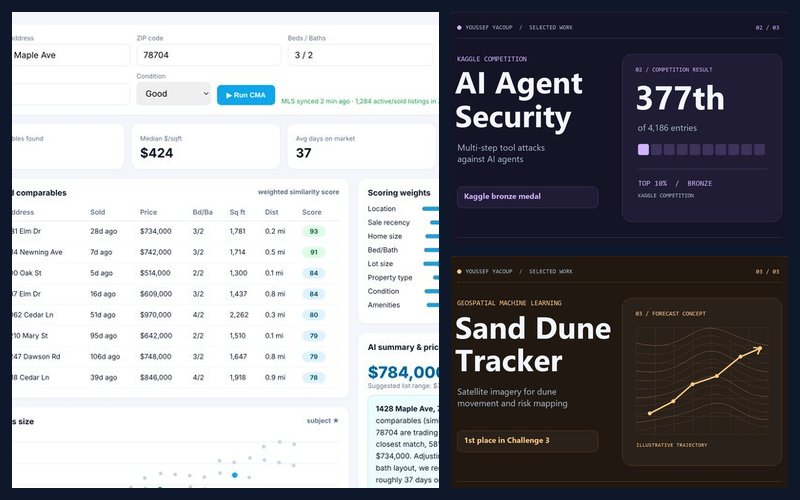
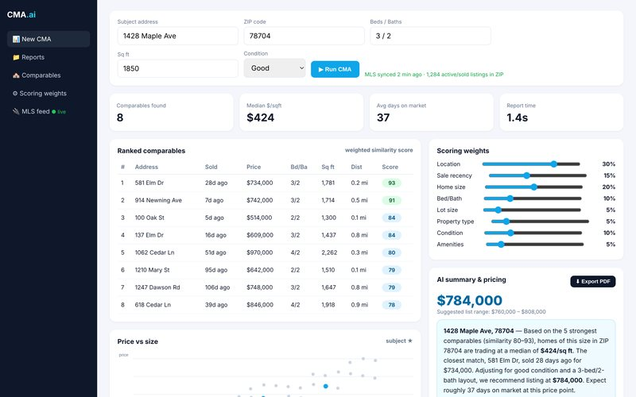
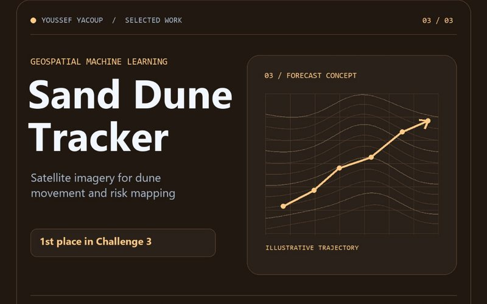

# Machine Learning & Data Science Prototypes

<h3 dir="rtl">نماذج تعلّم الآلة وعلوم البيانات</h3>

  

   

---

## 💡 About this service · عن الخدمة

Turn your dataset into a baseline model you can trust: cleaning, EDA, modeling, evaluation and a clear report.

أحوّل بياناتك لنموذج أولي تقدر تعتمد عليه: تنظيف، تحليل استكشافي، بناء نموذج، تقييم، وتقرير واضح.

## ✅ What you get · ماذا ستحصل عليه

| | English | العربية |
|:-:|---|---|
| ✔️ | Data cleaning & exploratory analysis (pandas) | 
تنظيف البيانات والتحليل الاستكشافي (pandas)
 |
| ✔️ | Baseline ML models & evaluation metrics | 
نماذج تعلّم آلة أولية ومقاييس تقييم
 |
| ✔️ | Kaggle-grade notebooks, reproducible | 
دفاتر Jupyter منظمة وقابلة لإعادة التشغيل
 |
| ✔️ | Model serving via API or dashboard | 
تشغيل النموذج عبر API أو لوحة تحكم
 |

## 🧰 Tools · الأدوات

<code>Python</code> <code>pandas</code> <code>scikit-learn</code> <code>Jupyter</code> <code>Kaggle</code> <code>GIS</code>

## 🗂️ Related work · أعمال مرتبطة

<table>
<tr><td align="center" valign="top" width="33%"> <b><a href="../../portfolio/ai/ai-real-estate-cma/">AI Real Estate CMA Dashboard</a></b> لوحة تحليل السوق العقاري بالذكاء الاصطناعي Freelancer.com</td><td align="center" valign="top" width="33%"> <b><a href="../../portfolio/ai/kaggle-ai-agent-security/">Kaggle Bronze – AI Agent Security</a></b> ميدالية برونزية على Kaggle – أمن وكلاء الذكاء الاصطناعي Nafezly · Upwork · Mostaql</td><td align="center" valign="top" width="33%"> <b><a href="../../portfolio/ai/sand-dune-encroachment-tracker/">Sand Dune Encroachment Tracker – Geospatial ML</a></b> متتبّع زحف الكثبان الرملية – تعلّم آلي جيومكاني Upwork</td></tr>
</table>

## 📩 Order / Contact · اطلب الخدمة

- **Upwork** → https://www.upwork.com/freelancers/~016f07b2d17f649923
- **Freelancer.com** → https://www.freelancer.com/u/yyacoup
- **Mostaql · مستقل** → https://mostaql.com/u/yyacoup
- **Nafezly · نفذلي** → https://nafezly.com/u/YoussefYacoup

<a href="../README.md">⬅ All services · كل الخدمات</a> &nbsp;•&nbsp; <a href="../../README.md">🏠 Home · الرئيسية</a>

